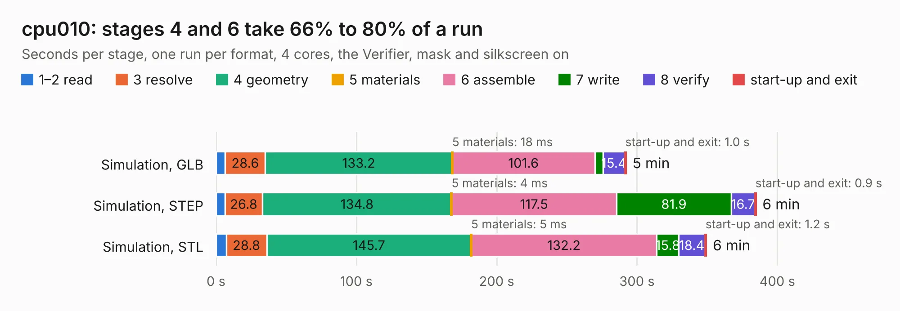

# 2794 cpu010

Board 2,794 of the 3,138 of [Corpus Testing](../Corpus-Testing.md), on [Corpus Page 26](../CorpusTestingPages/Corpus-Testing-26.md#2794-cpu010).

| Mode and format | 1–2 read | 3 resolve | 4 geometry | 5 materials | 6 assemble | 7 write | 8 verify | start-up and exit | Total |
|---|---:|---:|---:|---:|---:|---:|---:|---:|---:|
| Simulation, GLB | 6.5 | 28.6 | 133.2 | 18&nbsp;ms | 101.6 | 5.9 | 15.4 | 1.0 | 292.2 |
| Simulation, STEP | 6.3 | 26.8 | 134.8 | 4&nbsp;ms | 117.5 | 81.9 | 16.7 | 0.9 | 384.8 |
| Simulation, STL | 7.3 | 28.8 | 145.7 | 5&nbsp;ms | 132.2 | 15.8 | 18.4 | 1.2 | 349.4 |
| Simulation, OBJ |  |  |  |  |  |  |  |  | exceeded 11 GB on a 15 GB machine (stopped there, not a KESE failure); it will be run again on a machine with more memory |
| Visual, GLB | 6.3 | 25.2 | 117.0 | 3&nbsp;ms | 289.6 | 3.3 | 34.5 | 0.6 | 476.5 |
| Visual, OBJ | 6.4 | 26.5 | 125.8 | 3&nbsp;ms | 294.3 | 93.1 | 35.2 | 0.7 | 581.8 |

<table align="center"><tr><td valign="top">

| Board | Repo: [thorpej/pg68k](https://github.com/thorpej/pg68k) Board: `cpu010.kicad_pcb` |
|---|---|
| Folder | cpu010 / design-files |
| Complexity | 398&nbsp;/&nbsp;1000 (size&nbsp;308, features&nbsp;90) |
| KESE&nbsp;features | through vias, rounded, trapezoid or chamfered pads, filled zones, TrueType text, stack-up, dielectric εr and tanδ |
| Tested | 9th November 2026 |
| Copper&nbsp;layers | 4 |
| File&nbsp;format | KiCad 9 (20241229) |
| Parts,&nbsp;tracks,&nbsp;vias | 260, 10,422, 2,690 |
| Triangles,&nbsp;simulation | 26,264,430 in 658 parts |
| Verifier | Simulation, OBJ: exceeded 11 GB on a 15 GB machine (stopped there, not a KESE failure); it will be run again on a machine with more memory |

</td><td valign="top">

<table>
<tr><th>File type</th><th>File size</th><th>Peak memory used</th></tr>
<tr><th colspan="3" align="left">Simulation</th></tr>
<tr><td>GLB</td><td align="right">889&nbsp;MB</td><td align="right">6.4&nbsp;GB</td></tr>
<tr><td>STEP</td><td align="right">3.4&nbsp;GB</td><td align="right">8.2&nbsp;GB</td></tr>
<tr><td>STL</td><td align="right">1.3&nbsp;GB</td><td align="right">6.0&nbsp;GB</td></tr>
<tr><td>OBJ</td><td align="right">–</td><td align="right">11&nbsp;GB</td></tr>
<tr><th colspan="3" align="left">Visual</th></tr>
<tr><td>GLB</td><td align="right">521&nbsp;MB</td><td align="right">8.0&nbsp;GB</td></tr>
<tr><td>OBJ</td><td align="right">1.7&nbsp;GB</td><td align="right">11&nbsp;GB</td></tr>
</table>

</td></tr></table>

| Previous | Next |
|:---|---:|
| [2793 CM4_MATX](b2793b_CM4-MATX_KiCad_CM4-MATX_2174.md) | [2795 cpu030](b2795b_pg68k_cpu030.md) |
