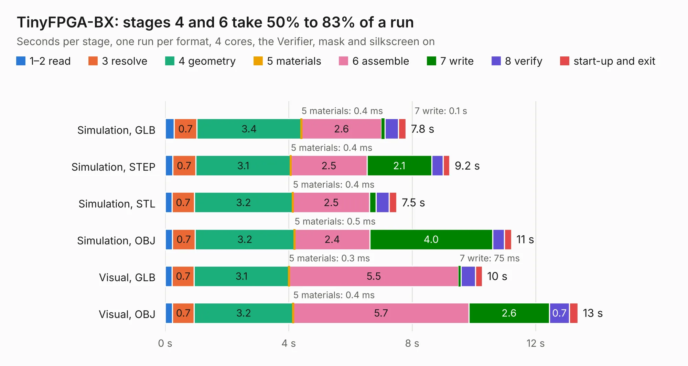

# 2796. TinyFPGA-BX

Board 2,796 of the 3,127 of [Corpus Testing](../Corpus-Testing.md), on [Corpus Page 26](../CorpusTestingPages/Corpus-Testing-26.md#2796-tinyfpga-bx).

| Mode and format | 1–2 read | 3 resolve | 4 geometry | 5 materials | 6 assemble | 7 write | 8 verify | start-up and exit | Total |
|---|---:|---:|---:|---:|---:|---:|---:|---:|---:|
| Simulation, GLB | 0.3 | 0.7 | 3.4 | 0.4&nbsp;ms | 2.6 | 0.1 | 0.4 | 0.2 | 7.8 |
| Simulation, STEP | 0.2 | 0.7 | 3.1 | 0.4&nbsp;ms | 2.5 | 2.1 | 0.4 | 0.2 | 9.2 |
| Simulation, STL | 0.2 | 0.7 | 3.2 | 0.4&nbsp;ms | 2.5 | 0.2 | 0.4 | 0.2 | 7.5 |
| Simulation, OBJ | 0.2 | 0.7 | 3.2 | 0.5&nbsp;ms | 2.4 | 4.0 | 0.4 | 0.2 | 11.2 |
| Visual, GLB | 0.2 | 0.7 | 3.1 | 0.3&nbsp;ms | 5.5 | 75&nbsp;ms | 0.5 | 0.2 | 10.3 |
| Visual, OBJ | 0.2 | 0.7 | 3.2 | 0.4&nbsp;ms | 5.7 | 2.6 | 0.7 | 0.3 | 13.4 |

<table align="center"><tr><td valign="top">

| Board | Repo: [tinyfpga/TinyFPGA-BX](https://github.com/tinyfpga/TinyFPGA-BX) Board: `TinyFPGA-BX.kicad_pcb` |
|---|---|
| Folder | board |
| Complexity | 223&nbsp;/&nbsp;1000 (size&nbsp;188, features&nbsp;35) |
| KESE&nbsp;features | through vias, filled zones |
| Tested | 9th November 2026 |
| Copper&nbsp;layers | 4 |
| File&nbsp;format | KiCad 4 (4) |
| Parts,&nbsp;tracks,&nbsp;vias | 41, 822, 77 |
| Triangles,&nbsp;simulation | 723,140 in 83 parts |
| Verifier | PASS in all six runs |

</td><td valign="top">

<table>
<tr><th>File type</th><th>File size</th><th>Peak memory used</th></tr>
<tr><th colspan="3" align="left">Simulation</th></tr>
<tr><td>GLB</td><td align="right">25&nbsp;MB</td><td align="right">360&nbsp;MB</td></tr>
<tr><td>STEP</td><td align="right">104&nbsp;MB</td><td align="right">399&nbsp;MB</td></tr>
<tr><td>STL</td><td align="right">36&nbsp;MB</td><td align="right">352&nbsp;MB</td></tr>
<tr><td>OBJ</td><td align="right">74&nbsp;MB</td><td align="right">525&nbsp;MB</td></tr>
<tr><th colspan="3" align="left">Visual</th></tr>
<tr><td>GLB</td><td align="right">15&nbsp;MB</td><td align="right">391&nbsp;MB</td></tr>
<tr><td>OBJ</td><td align="right">46&nbsp;MB</td><td align="right">383&nbsp;MB</td></tr>
</table>

</td></tr></table>

| Previous | Next |
|:---|---:|
| [2795. red](b2795b_red-brick_red.md) | [2797. caravel-breakout-fpga-ICE40UP5K-TT3](b2797b_breakout-pcb_caravel-breakout-fpga-ICE40UP5K-TT3.md) |
