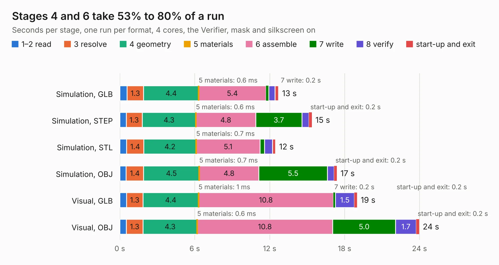

# 2798. caravel-breakout-fpga-ICE40UP5K-TT3

Board 2,798 of the 3,128 of [Corpus Testing](../Corpus-Testing.md), on [Corpus Page 26](../CorpusTestingPages/Corpus-Testing-26.md#2798-caravel-breakout-fpga-ice40up5k-tt3).

| Mode and format | 1–2 read | 3 resolve | 4 geometry | 5 materials | 6 assemble | 7 write | 8 verify | start-up and exit | Total |
|---|---:|---:|---:|---:|---:|---:|---:|---:|---:|
| Simulation, GLB | 0.6 | 1.3 | 4.4 | 0.6&nbsp;ms | 5.4 | 0.2 | 0.5 | 0.3 | 12.7 |
| Simulation, STEP | 0.5 | 1.3 | 4.3 | 0.6&nbsp;ms | 4.8 | 3.7 | 0.6 | 0.2 | 15.4 |
| Simulation, STL | 0.5 | 1.4 | 4.2 | 0.7&nbsp;ms | 5.1 | 0.4 | 0.6 | 0.3 | 12.5 |
| Simulation, OBJ | 0.5 | 1.4 | 4.5 | 0.7&nbsp;ms | 4.8 | 5.5 | 0.5 | 0.2 | 17.4 |
| Visual, GLB | 0.5 | 1.3 | 4.4 | 1&nbsp;ms | 10.8 | 0.2 | 1.5 | 0.2 | 19.0 |
| Visual, OBJ | 0.5 | 1.3 | 4.3 | 0.6&nbsp;ms | 10.8 | 5.0 | 1.7 | 0.2 | 24.0 |

<table align="center"><tr><td valign="top">

| Board | Repo: [TinyTapeout/breakout-pcb](https://github.com/TinyTapeout/breakout-pcb) Board: `caravel-breakout-fpga-ICE40UP5K-TT3.kicad_pcb` |
|---|---|
| Folder | ASIC-simulator / tt03-fpga-ICE40UP5k |
| Complexity | 319&nbsp;/&nbsp;1000 (size&nbsp;219, features&nbsp;100) |
| KESE&nbsp;features | through vias, slotted holes, rounded, trapezoid or chamfered pads, filled zones, curved board outline, stack-up, dielectric εr and tanδ, mask and silkscreen colours |
| Tested | 9th November 2026 |
| Copper&nbsp;layers | 2 |
| File&nbsp;format | KiCad 7 (20221018) |
| Parts,&nbsp;tracks,&nbsp;vias | 78, 734, 127 |
| Triangles,&nbsp;simulation | 1,226,884 in 105 parts |
| Verifier | PASS in all six runs |

</td><td valign="top">

<table>
<tr><th>File type</th><th>File size</th><th>Peak memory used</th></tr>
<tr><th colspan="3" align="left">Simulation</th></tr>
<tr><td>GLB</td><td align="right">43&nbsp;MB</td><td align="right">573&nbsp;MB</td></tr>
<tr><td>STEP</td><td align="right">223&nbsp;MB</td><td align="right">684&nbsp;MB</td></tr>
<tr><td>STL</td><td align="right">61&nbsp;MB</td><td align="right">565&nbsp;MB</td></tr>
<tr><td>OBJ</td><td align="right">127&nbsp;MB</td><td align="right">859&nbsp;MB</td></tr>
<tr><th colspan="3" align="left">Visual</th></tr>
<tr><td>GLB</td><td align="right">39&nbsp;MB</td><td align="right">832&nbsp;MB</td></tr>
<tr><td>OBJ</td><td align="right">116&nbsp;MB</td><td align="right">839&nbsp;MB</td></tr>
</table>

</td></tr></table>

| Previous | Next |
|:---|---:|
| [2797. TinyFPGA-BX](b2797b_TinyFPGA-BX_TinyFPGA-BX.md) | [2799. breakout-fpga-ICE40UP5K](b2799b_breakout-pcb_breakout-fpga-ICE40UP5K.md) |
