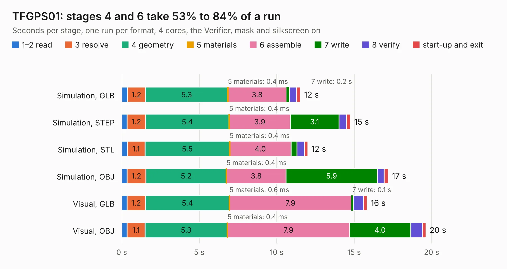

# 2799. TFGPS01

Board 2,799 of the 3,138 of [Corpus Testing](../Corpus-Testing.md), on [Corpus Page 26](../CorpusTestingPages/Corpus-Testing-26.md#2799-tfgps01).

| Mode and format | 1–2 read | 3 resolve | 4 geometry | 5 materials | 6 assemble | 7 write | 8 verify | start-up and exit | Total |
|---|---:|---:|---:|---:|---:|---:|---:|---:|---:|
| Simulation, GLB | 0.4 | 1.2 | 5.3 | 0.4&nbsp;ms | 3.8 | 0.2 | 0.5 | 0.2 | 11.5 |
| Simulation, STEP | 0.4 | 1.2 | 5.4 | 0.4&nbsp;ms | 3.9 | 3.1 | 0.5 | 0.3 | 14.8 |
| Simulation, STL | 0.4 | 1.1 | 5.5 | 0.4&nbsp;ms | 4.0 | 0.4 | 0.5 | 0.2 | 12.0 |
| Simulation, OBJ | 0.3 | 1.2 | 5.2 | 0.4&nbsp;ms | 3.8 | 5.9 | 0.5 | 0.3 | 17.2 |
| Visual, GLB | 0.3 | 1.2 | 5.4 | 0.6&nbsp;ms | 7.9 | 0.1 | 0.7 | 0.2 | 15.8 |
| Visual, OBJ | 0.4 | 1.1 | 5.3 | 0.4&nbsp;ms | 7.9 | 4.0 | 0.8 | 0.2 | 19.6 |

<table align="center"><tr><td valign="top">

| Board | Repo: [ThunderFly-aerospace/TFGPS01](https://github.com/ThunderFly-aerospace/TFGPS01) Board: `TFGPS01.kicad_pcb` |
|---|---|
| Folder | hw / sch_pcb |
| Complexity | 350&nbsp;/&nbsp;1000 (size&nbsp;195, features&nbsp;155) |
| KESE&nbsp;features | through vias, microvias, slotted holes, rounded, trapezoid or chamfered pads, filled zones, copper text, knockout text, stack-up, dielectric εr and tanδ, mask and silkscreen colours |
| Tested | 9th November 2026 |
| Copper&nbsp;layers | 4 |
| File&nbsp;format | KiCad 9 (20241229) |
| Parts,&nbsp;tracks,&nbsp;vias | 70, 508, 202 |
| Triangles,&nbsp;simulation | 1,120,590 in 81 parts |
| Verifier | PASS in all six runs |

</td><td valign="top">

<table>
<tr><th>File type</th><th>File size</th><th>Peak memory used</th></tr>
<tr><th colspan="3" align="left">Simulation</th></tr>
<tr><td>GLB</td><td align="right">38&nbsp;MB</td><td align="right">536&nbsp;MB</td></tr>
<tr><td>STEP</td><td align="right">171&nbsp;MB</td><td align="right">610&nbsp;MB</td></tr>
<tr><td>STL</td><td align="right">56&nbsp;MB</td><td align="right">543&nbsp;MB</td></tr>
<tr><td>OBJ</td><td align="right">116&nbsp;MB</td><td align="right">774&nbsp;MB</td></tr>
<tr><th colspan="3" align="left">Visual</th></tr>
<tr><td>GLB</td><td align="right">25&nbsp;MB</td><td align="right">621&nbsp;MB</td></tr>
<tr><td>OBJ</td><td align="right">77&nbsp;MB</td><td align="right">626&nbsp;MB</td></tr>
</table>

</td></tr></table>

| Previous | Next |
|:---|---:|
| [2798. Apple2Card](b2798b_Apple2Card_Apple2Card-x44_Apple2Card.md) | [2800. tigard](b2800b_tigard_tigard.md) |
