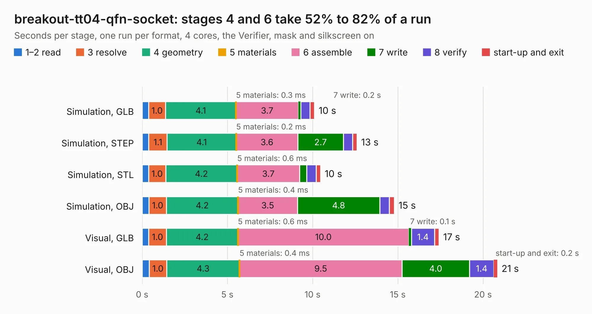

# 2799. breakout-tt04-qfn-socket

Board 2,799 of the 3,121 of [Corpus Testing](../Corpus-Testing.md), on [Corpus Page 26](../CorpusTestingPages/Corpus-Testing-26.md#2799-breakout-tt04-qfn-socket).

| Mode and format | 1–2 read | 3 resolve | 4 geometry | 5 materials | 6 assemble | 7 write | 8 verify | start-up and exit | Total |
|---|---:|---:|---:|---:|---:|---:|---:|---:|---:|
| Simulation, GLB | 0.4 | 1.0 | 4.1 | 0.3&nbsp;ms | 3.7 | 0.2 | 0.5 | 0.3 | 10.1 |
| Simulation, STEP | 0.4 | 1.1 | 4.1 | 0.2&nbsp;ms | 3.6 | 2.7 | 0.5 | 0.3 | 12.6 |
| Simulation, STL | 0.4 | 1.0 | 4.2 | 0.6&nbsp;ms | 3.7 | 0.4 | 0.5 | 0.3 | 10.5 |
| Simulation, OBJ | 0.4 | 1.0 | 4.2 | 0.4&nbsp;ms | 3.5 | 4.8 | 0.5 | 0.3 | 14.8 |
| Visual, GLB | 0.4 | 1.0 | 4.2 | 0.6&nbsp;ms | 10.0 | 0.1 | 1.4 | 0.3 | 17.4 |
| Visual, OBJ | 0.4 | 1.0 | 4.3 | 0.4&nbsp;ms | 9.5 | 4.0 | 1.4 | 0.2 | 20.8 |

<table align="center"><tr><td valign="top">

| Board | Repo: [TinyTapeout/breakout-pcb](https://github.com/TinyTapeout/breakout-pcb) Board: `breakout-tt04-qfn-socket.kicad_pcb` |
|---|---|
| Folder | breakout-tt04-qfn-socket |
| Complexity | 316&nbsp;/&nbsp;1000 (size&nbsp;201, features&nbsp;115) |
| KESE&nbsp;features | through vias, rounded, trapezoid or chamfered pads, filled zones, curved board outline, knockout text, TrueType text, stack-up, dielectric εr and tanδ |
| Tested | 9th November 2026 |
| Copper&nbsp;layers | 2 |
| File&nbsp;format | KiCad 8 (20240108) |
| Parts,&nbsp;tracks,&nbsp;vias | 13, 761, 128 |
| Triangles,&nbsp;simulation | 975,262 in 66 parts |
| Verifier | PASS in all six runs |

</td><td valign="top">

<table>
<tr><th>File type</th><th>File size</th><th>Peak memory used</th></tr>
<tr><th colspan="3" align="left">Simulation</th></tr>
<tr><td>GLB</td><td align="right">34&nbsp;MB</td><td align="right">516&nbsp;MB</td></tr>
<tr><td>STEP</td><td align="right">154&nbsp;MB</td><td align="right">546&nbsp;MB</td></tr>
<tr><td>STL</td><td align="right">49&nbsp;MB</td><td align="right">487&nbsp;MB</td></tr>
<tr><td>OBJ</td><td align="right">99&nbsp;MB</td><td align="right">685&nbsp;MB</td></tr>
<tr><th colspan="3" align="left">Visual</th></tr>
<tr><td>GLB</td><td align="right">27&nbsp;MB</td><td align="right">681&nbsp;MB</td></tr>
<tr><td>OBJ</td><td align="right">82&nbsp;MB</td><td align="right">660&nbsp;MB</td></tr>
</table>

</td></tr></table>

| Previous | Next |
|:---|---:|
| [2798. breakout-sky-qfn](b2798b_breakout-pcb_breakout-sky-qfn.md) | [2800. breakout-tt06-qfn-socket](b2800b_breakout-pcb_breakout-tt06-qfn-socket.md) |
