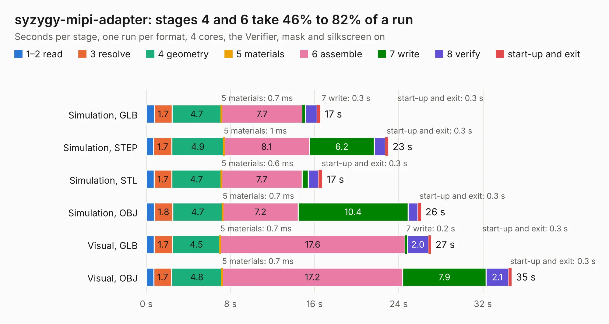

# 2799. syzygy-mipi-adapter

Board 2,799 of the 3,118 of [Corpus Testing](../Corpus-Testing.md), on [Corpus Page 26](../CorpusTestingPages/Corpus-Testing-26.md#2799-syzygy-mipi-adapter).

| Mode and format | 1–2 read | 3 resolve | 4 geometry | 5 materials | 6 assemble | 7 write | 8 verify | start-up and exit | Total |
|---|---:|---:|---:|---:|---:|---:|---:|---:|---:|
| Simulation, GLB | 0.8 | 1.7 | 4.7 | 0.7&nbsp;ms | 7.7 | 0.3 | 1.1 | 0.3 | 16.5 |
| Simulation, STEP | 0.7 | 1.7 | 4.9 | 1&nbsp;ms | 8.1 | 6.2 | 1.0 | 0.3 | 23.0 |
| Simulation, STL | 0.8 | 1.7 | 4.7 | 0.6&nbsp;ms | 7.7 | 0.6 | 1.0 | 0.3 | 16.7 |
| Simulation, OBJ | 0.8 | 1.8 | 4.7 | 0.7&nbsp;ms | 7.2 | 10.4 | 0.9 | 0.3 | 26.1 |
| Visual, GLB | 0.8 | 1.7 | 4.5 | 0.7&nbsp;ms | 17.6 | 0.2 | 2.0 | 0.3 | 27.1 |
| Visual, OBJ | 0.7 | 1.7 | 4.8 | 0.7&nbsp;ms | 17.2 | 7.9 | 2.1 | 0.3 | 34.7 |

<table align="center"><tr><td valign="top">

| Board | Repo: [tinyvision-ai-inc/oshw-adapters](https://github.com/tinyvision-ai-inc/oshw-adapters) Board: `syzygy-mipi-adapter.kicad_pcb` |
|---|---|
| Folder | syzygy-mipi-adapter / board / Rev0 |
| Complexity | 387&nbsp;/&nbsp;1000 (size&nbsp;252, features&nbsp;135) |
| KESE&nbsp;features | through vias, slotted holes, custom pads, rounded, trapezoid or chamfered pads, arc tracks, filled zones, copper drawings, curved board outline, stack-up, dielectric εr and tanδ |
| Tested | 9th November 2026 |
| Copper&nbsp;layers | 4 |
| File&nbsp;format | KiCad 9 (20241229) |
| Parts,&nbsp;tracks,&nbsp;vias | 77, 2,383, 207 |
| Triangles,&nbsp;simulation | 1,732,038 in 183 parts |
| Verifier | PASS in all six runs |

</td><td valign="top">

<table>
<tr><th>File type</th><th>File size</th><th>Peak memory used</th></tr>
<tr><th colspan="3" align="left">Simulation</th></tr>
<tr><td>GLB</td><td align="right">59&nbsp;MB</td><td align="right">776&nbsp;MB</td></tr>
<tr><td>STEP</td><td align="right">268&nbsp;MB</td><td align="right">864&nbsp;MB</td></tr>
<tr><td>STL</td><td align="right">87&nbsp;MB</td><td align="right">776&nbsp;MB</td></tr>
<tr><td>OBJ</td><td align="right">182&nbsp;MB</td><td align="right">1.2&nbsp;GB</td></tr>
<tr><th colspan="3" align="left">Visual</th></tr>
<tr><td>GLB</td><td align="right">43&nbsp;MB</td><td align="right">781&nbsp;MB</td></tr>
<tr><td>OBJ</td><td align="right">135&nbsp;MB</td><td align="right">950&nbsp;MB</td></tr>
</table>

</td></tr></table>

| Previous | Next |
|:---|---:|
| [2798. tinytapeout-demo](b2798b_tt-demo-pcb_tinytapeout-demo.md) | [2800. syzygy-mipi-adapter](b2800b_oshw-adapters_syzygy-mipi-adapter-board-Rev1_syzygy-mipi-adapter.md) |
