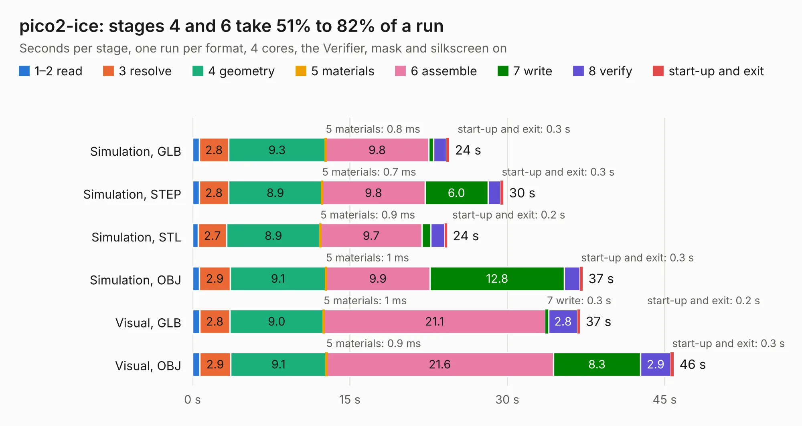

# 2800. pico2-ice

Board 2,800 of the 3,112 of [Corpus Testing](../Corpus-Testing.md), on [Corpus Page 26](../CorpusTestingPages/Corpus-Testing-26.md#2800-pico2-ice).

| Mode and format | 1–2 read | 3 resolve | 4 geometry | 5 materials | 6 assemble | 7 write | 8 verify | start-up and exit | Total |
|---|---:|---:|---:|---:|---:|---:|---:|---:|---:|
| Simulation, GLB | 0.7 | 2.8 | 9.3 | 0.8&nbsp;ms | 9.8 | 0.5 | 1.2 | 0.3 | 24.5 |
| Simulation, STEP | 0.6 | 2.8 | 8.9 | 0.7&nbsp;ms | 9.8 | 6.0 | 1.2 | 0.3 | 29.6 |
| Simulation, STL | 0.5 | 2.7 | 8.9 | 0.9&nbsp;ms | 9.7 | 0.8 | 1.3 | 0.2 | 24.3 |
| Simulation, OBJ | 0.7 | 2.9 | 9.1 | 1&nbsp;ms | 9.9 | 12.8 | 1.5 | 0.3 | 37.2 |
| Visual, GLB | 0.7 | 2.8 | 9.0 | 1&nbsp;ms | 21.1 | 0.3 | 2.8 | 0.2 | 36.9 |
| Visual, OBJ | 0.7 | 2.9 | 9.1 | 0.9&nbsp;ms | 21.6 | 8.3 | 2.9 | 0.3 | 45.9 |

<table align="center"><tr><td valign="top">

| Board | Repo: [tinyvision-ai-inc/pico2-ice](https://github.com/tinyvision-ai-inc/pico2-ice) Board: `pico2-ice.kicad_pcb` |
|---|---|
| Folder | Board / Rev1 |
| Complexity | 382&nbsp;/&nbsp;1000 (size&nbsp;262, features&nbsp;120) |
| KESE&nbsp;features | through vias, slotted holes, custom pads, rounded, trapezoid or chamfered pads, filled zones, copper drawings, curved board outline, stack-up, dielectric εr and tanδ |
| Tested | 9th November 2026 |
| Copper&nbsp;layers | 4 |
| File&nbsp;format | KiCad 8 (20240108) |
| Parts,&nbsp;tracks,&nbsp;vias | 109, 2,181, 270 |
| Triangles,&nbsp;simulation | 2,707,426 in 139 parts |
| Verifier | PASS in all six runs |

</td><td valign="top">

<table>
<tr><th>File type</th><th>File size</th><th>Peak memory used</th></tr>
<tr><th colspan="3" align="left">Simulation</th></tr>
<tr><td>GLB</td><td align="right">94&nbsp;MB</td><td align="right">967&nbsp;MB</td></tr>
<tr><td>STEP</td><td align="right">458&nbsp;MB</td><td align="right">1.0&nbsp;GB</td></tr>
<tr><td>STL</td><td align="right">135&nbsp;MB</td><td align="right">1.0&nbsp;GB</td></tr>
<tr><td>OBJ</td><td align="right">294&nbsp;MB</td><td align="right">1.8&nbsp;GB</td></tr>
<tr><th colspan="3" align="left">Visual</th></tr>
<tr><td>GLB</td><td align="right">59&nbsp;MB</td><td align="right">1.1&nbsp;GB</td></tr>
<tr><td>OBJ</td><td align="right">187&nbsp;MB</td><td align="right">1.4&nbsp;GB</td></tr>
</table>

</td></tr></table>

| Previous | Next |
|:---|---:|
| [2799. pico2-ice](b2799b_pico2-ice_Board-Rev0_pico2-ice.md) | [2801. pico2-ice](b2801b_pico2-ice_Board-Rev2_pico2-ice.md) |
