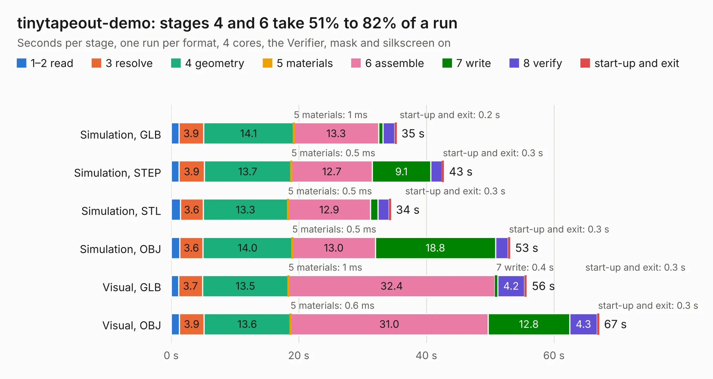

# 2800. tinytapeout-demo

Board 2,800 of the 3,120 of [Corpus Testing](../Corpus-Testing.md), on [Corpus Page 26](../CorpusTestingPages/Corpus-Testing-26.md#2800-tinytapeout-demo).

| Mode and format | 1–2 read | 3 resolve | 4 geometry | 5 materials | 6 assemble | 7 write | 8 verify | start-up and exit | Total |
|---|---:|---:|---:|---:|---:|---:|---:|---:|---:|
| Simulation, GLB | 1.2 | 3.9 | 14.1 | 1&nbsp;ms | 13.3 | 0.7 | 1.9 | 0.2 | 35.3 |
| Simulation, STEP | 1.2 | 3.9 | 13.7 | 0.5&nbsp;ms | 12.7 | 9.1 | 1.8 | 0.3 | 42.8 |
| Simulation, STL | 1.4 | 3.6 | 13.3 | 0.5&nbsp;ms | 12.9 | 1.1 | 1.8 | 0.3 | 34.4 |
| Simulation, OBJ | 1.3 | 3.6 | 14.0 | 0.5&nbsp;ms | 13.0 | 18.8 | 2.0 | 0.3 | 53.1 |
| Visual, GLB | 1.2 | 3.7 | 13.5 | 1&nbsp;ms | 32.4 | 0.4 | 4.2 | 0.3 | 55.7 |
| Visual, OBJ | 1.3 | 3.9 | 13.6 | 0.6&nbsp;ms | 31.0 | 12.8 | 4.3 | 0.3 | 67.1 |

<table align="center"><tr><td valign="top">

| Board | Repo: [TinyTapeout/tt-demo-pcb](https://github.com/TinyTapeout/tt-demo-pcb) Board: `tinytapeout-demo.kicad_pcb` |
|---|---|
| Complexity | 404&nbsp;/&nbsp;1000 (size&nbsp;264, features&nbsp;140) |
| KESE&nbsp;features | through vias, slotted holes, rounded, trapezoid or chamfered pads, filled zones, copper text, curved board outline, knockout text, TrueType text, stack-up, dielectric εr and tanδ, mask and silkscreen colours |
| Tested | 9th November 2026 |
| Copper&nbsp;layers | 4 |
| File&nbsp;format | KiCad 9 (20241229) |
| Parts,&nbsp;tracks,&nbsp;vias | 158, 2,785, 401 |
| Triangles,&nbsp;simulation | 3,981,250 in 162 parts |
| Verifier | PASS in all six runs |

</td><td valign="top">

<table>
<tr><th>File type</th><th>File size</th><th>Peak memory used</th></tr>
<tr><th colspan="3" align="left">Simulation</th></tr>
<tr><td>GLB</td><td align="right">137&nbsp;MB</td><td align="right">1.2&nbsp;GB</td></tr>
<tr><td>STEP</td><td align="right">608&nbsp;MB</td><td align="right">1.5&nbsp;GB</td></tr>
<tr><td>STL</td><td align="right">199&nbsp;MB</td><td align="right">1.2&nbsp;GB</td></tr>
<tr><td>OBJ</td><td align="right">427&nbsp;MB</td><td align="right">2.6&nbsp;GB</td></tr>
<tr><th colspan="3" align="left">Visual</th></tr>
<tr><td>GLB</td><td align="right">93&nbsp;MB</td><td align="right">1.5&nbsp;GB</td></tr>
<tr><td>OBJ</td><td align="right">294&nbsp;MB</td><td align="right">2.1&nbsp;GB</td></tr>
</table>

</td></tr></table>

| Previous | Next |
|:---|---:|
| [2799. breakout-tt06-qfn-socket](b2799b_breakout-pcb_breakout-tt06-qfn-socket.md) | [2801. syzygy-mipi-adapter](b2801b_oshw-adapters_syzygy-mipi-adapter-board-Rev0_syzygy-mipi-adapter.md) |
