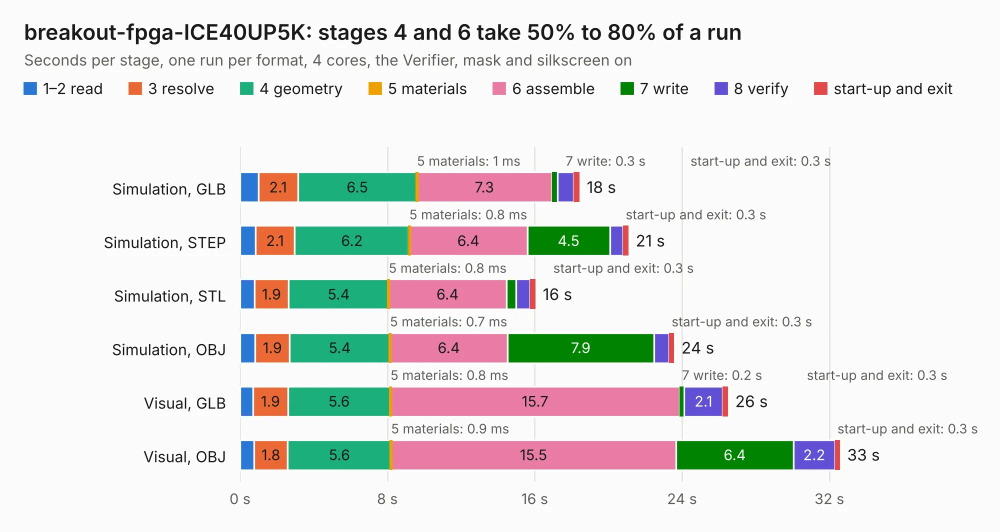

# 2801. breakout-fpga-ICE40UP5K

Board 2,801 of the 3,130 of [Corpus Testing](../Corpus-Testing.md), on [Corpus Page 26](../CorpusTestingPages/Corpus-Testing-26.md#2801-breakout-fpga-ice40up5k).

| Mode and format | 1–2 read | 3 resolve | 4 geometry | 5 materials | 6 assemble | 7 write | 8 verify | start-up and exit | Total |
|---|---:|---:|---:|---:|---:|---:|---:|---:|---:|
| Simulation, GLB | 1.0 | 2.1 | 6.5 | 1&nbsp;ms | 7.3 | 0.3 | 0.9 | 0.3 | 18.4 |
| Simulation, STEP | 0.8 | 2.1 | 6.2 | 0.8&nbsp;ms | 6.4 | 4.5 | 0.7 | 0.3 | 21.1 |
| Simulation, STL | 0.8 | 1.9 | 5.4 | 0.8&nbsp;ms | 6.4 | 0.5 | 0.8 | 0.3 | 16.1 |
| Simulation, OBJ | 0.8 | 1.9 | 5.4 | 0.7&nbsp;ms | 6.4 | 7.9 | 0.8 | 0.3 | 23.6 |
| Visual, GLB | 0.7 | 1.9 | 5.6 | 0.8&nbsp;ms | 15.7 | 0.2 | 2.1 | 0.3 | 26.5 |
| Visual, OBJ | 0.8 | 1.8 | 5.6 | 0.9&nbsp;ms | 15.5 | 6.4 | 2.2 | 0.3 | 32.6 |

<table align="center"><tr><td valign="top">

| Board | Repo: [TinyTapeout/breakout-pcb](https://github.com/TinyTapeout/breakout-pcb) Board: `breakout-fpga-ICE40UP5K.kicad_pcb` |
|---|---|
| Folder | ASIC-simulator / tt04-fpga-ICE40UP5k |
| Complexity | 361&nbsp;/&nbsp;1000 (size&nbsp;236, features&nbsp;125) |
| KESE&nbsp;features | through vias, slotted holes, rounded, trapezoid or chamfered pads, filled zones, curved board outline, knockout text, TrueType text, stack-up, dielectric εr and tanδ |
| Tested | 9th November 2026 |
| Copper&nbsp;layers | 4 |
| File&nbsp;format | KiCad 8 (20240108) |
| Parts,&nbsp;tracks,&nbsp;vias | 81, 732, 127 |
| Triangles,&nbsp;simulation | 1,557,710 in 110 parts |
| Verifier | PASS in all six runs |

</td><td valign="top">

<table>
<tr><th>File type</th><th>File size</th><th>Peak memory used</th></tr>
<tr><th colspan="3" align="left">Simulation</th></tr>
<tr><td>GLB</td><td align="right">54&nbsp;MB</td><td align="right">755&nbsp;MB</td></tr>
<tr><td>STEP</td><td align="right">263&nbsp;MB</td><td align="right">806&nbsp;MB</td></tr>
<tr><td>STL</td><td align="right">78&nbsp;MB</td><td align="right">719&nbsp;MB</td></tr>
<tr><td>OBJ</td><td align="right">163&nbsp;MB</td><td align="right">1.1&nbsp;GB</td></tr>
<tr><th colspan="3" align="left">Visual</th></tr>
<tr><td>GLB</td><td align="right">44&nbsp;MB</td><td align="right">756&nbsp;MB</td></tr>
<tr><td>OBJ</td><td align="right">133&nbsp;MB</td><td align="right">950&nbsp;MB</td></tr>
</table>

</td></tr></table>

| Previous | Next |
|:---|---:|
| [2800. caravel-breakout-fpga-ICE40UP5K-TT3](b2800b_breakout-pcb_caravel-breakout-fpga-ICE40UP5K-TT3.md) | [2802. tt06-fpga-ICE40UP5k](b2802b_breakout-pcb_tt06-fpga-ICE40UP5k.md) |
