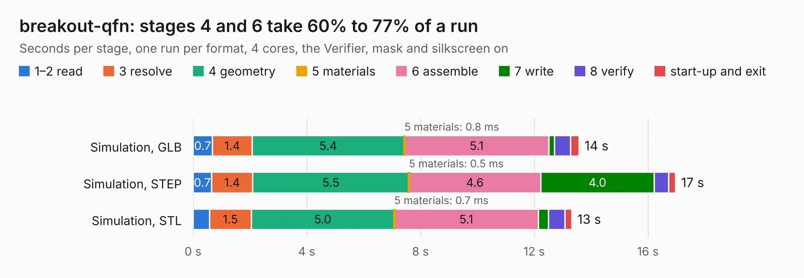

# 2801. breakout-qfn

Board 2,801 of the 3,125 of [Corpus Testing](../Corpus-Testing.md), on [Corpus Page 26](../CorpusTestingPages/Corpus-Testing-26.md#2801-breakout-qfn).

| Mode and format | 1–2 read | 3 resolve | 4 geometry | 5 materials | 6 assemble | 7 write | 8 verify | start-up and exit | Total |
|---|---:|---:|---:|---:|---:|---:|---:|---:|---:|
| Simulation, GLB | 0.7 | 1.4 | 5.4 | 0.8&nbsp;ms | 5.1 | 0.2 | 0.6 | 0.3 | 13.6 |
| Simulation, STEP | 0.7 | 1.4 | 5.5 | 0.5&nbsp;ms | 4.6 | 4.0 | 0.5 | 0.2 | 17.0 |
| Simulation, STL | 0.6 | 1.5 | 5.0 | 0.7&nbsp;ms | 5.1 | 0.4 | 0.6 | 0.2 | 13.3 |
| Simulation, OBJ | 0.6 | 1.5 | 5.2 | 0.5&nbsp;ms | 5.1 | 6.1 | 0.5 | 0.3 | 19.4 |
| Visual, GLB | 0.6 | 1.3 | 5.0 | 0.4&nbsp;ms | 11.3 | 0.2 | 1.1 | 0.2 | 19.7 |
| Visual, OBJ | 0.6 | 1.4 | 4.5 | 0.5&nbsp;ms | 11.3 | 5.0 | 1.1 | 0.2 | 24.1 |

<table align="center"><tr><td valign="top">

| Board | Repo: [TinyTapeout/breakout-pcb](https://github.com/TinyTapeout/breakout-pcb) Board: `breakout-qfn.kicad_pcb` |
|---|---|
| Folder | breakout-qfn |
| Complexity | 323&nbsp;/&nbsp;1000 (size&nbsp;213, features&nbsp;110) |
| KESE&nbsp;features | through vias, custom pads, rounded, trapezoid or chamfered pads, filled zones, copper drawings, curved board outline, knockout text, TrueType text |
| Tested | 9th November 2026 |
| Copper&nbsp;layers | 2 |
| File&nbsp;format | KiCad 8 (20240108) |
| Parts,&nbsp;tracks,&nbsp;vias | 44, 802, 118 |
| Triangles,&nbsp;simulation | 1,272,222 in 77 parts |
| Verifier | PASS in all six runs |

</td><td valign="top">

<table>
<tr><th>File type</th><th>File size</th><th>Peak memory used</th></tr>
<tr><th colspan="3" align="left">Simulation</th></tr>
<tr><td>GLB</td><td align="right">45&nbsp;MB</td><td align="right">617&nbsp;MB</td></tr>
<tr><td>STEP</td><td align="right">254&nbsp;MB</td><td align="right">742&nbsp;MB</td></tr>
<tr><td>STL</td><td align="right">64&nbsp;MB</td><td align="right">604&nbsp;MB</td></tr>
<tr><td>OBJ</td><td align="right">132&nbsp;MB</td><td align="right">871&nbsp;MB</td></tr>
<tr><th colspan="3" align="left">Visual</th></tr>
<tr><td>GLB</td><td align="right">39&nbsp;MB</td><td align="right">823&nbsp;MB</td></tr>
<tr><td>OBJ</td><td align="right">117&nbsp;MB</td><td align="right">840&nbsp;MB</td></tr>
</table>

</td></tr></table>

| Previous | Next |
|:---|---:|
| [2800. breakout-ihp-qfn](b2800b_breakout-pcb_breakout-ihp-qfn.md) | [2802. breakout-sky-qfn](b2802b_breakout-pcb_breakout-sky-qfn.md) |
