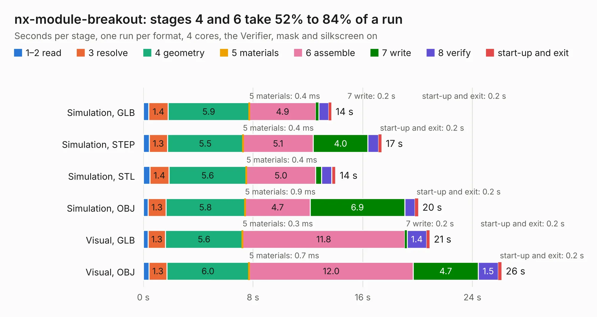

# 2801. nx-module-breakout

Board 2,801 of the 3,109 of [Corpus Testing](../Corpus-Testing.md), on [Corpus Page 26](../CorpusTestingPages/Corpus-Testing-26.md#2801-nx-module-breakout).

| Mode and format | 1–2 read | 3 resolve | 4 geometry | 5 materials | 6 assemble | 7 write | 8 verify | start-up and exit | Total |
|---|---:|---:|---:|---:|---:|---:|---:|---:|---:|
| Simulation, GLB | 0.4 | 1.4 | 5.9 | 0.4&nbsp;ms | 4.9 | 0.2 | 0.7 | 0.2 | 13.7 |
| Simulation, STEP | 0.4 | 1.3 | 5.5 | 0.4&nbsp;ms | 5.1 | 4.0 | 0.8 | 0.2 | 17.4 |
| Simulation, STL | 0.5 | 1.4 | 5.6 | 0.4&nbsp;ms | 5.0 | 0.4 | 0.7 | 0.3 | 14.0 |
| Simulation, OBJ | 0.4 | 1.3 | 5.8 | 0.9&nbsp;ms | 4.7 | 6.9 | 0.8 | 0.2 | 20.0 |
| Visual, GLB | 0.4 | 1.3 | 5.6 | 0.3&nbsp;ms | 11.8 | 0.2 | 1.4 | 0.2 | 20.9 |
| Visual, OBJ | 0.4 | 1.3 | 6.0 | 0.7&nbsp;ms | 12.0 | 4.7 | 1.5 | 0.2 | 26.1 |

<table align="center"><tr><td valign="top">

| Board | Repo: [tinyvision-ai-inc/pico2-nx](https://github.com/tinyvision-ai-inc/pico2-nx) Board: `nx-module-breakout.kicad_pcb` |
|---|---|
| Folder | board / Rev2 / nx-module-breakout |
| Complexity | 320&nbsp;/&nbsp;1000 (size&nbsp;195, features&nbsp;125) |
| KESE&nbsp;features | through vias, slotted holes, custom pads, rounded, trapezoid or chamfered pads, arc tracks, filled zones, copper drawings, stack-up, dielectric εr and tanδ |
| Tested | 9th November 2026 |
| Copper&nbsp;layers | 4 |
| File&nbsp;format | KiCad 9 (20241229) |
| Parts,&nbsp;tracks,&nbsp;vias | 45, 1,224, 92 |
| Triangles,&nbsp;simulation | 1,514,246 in 139 parts |
| Verifier | PASS in all six runs |

</td><td valign="top">

<table>
<tr><th>File type</th><th>File size</th><th>Peak memory used</th></tr>
<tr><th colspan="3" align="left">Simulation</th></tr>
<tr><td>GLB</td><td align="right">52&nbsp;MB</td><td align="right">547&nbsp;MB</td></tr>
<tr><td>STEP</td><td align="right">228&nbsp;MB</td><td align="right">721&nbsp;MB</td></tr>
<tr><td>STL</td><td align="right">76&nbsp;MB</td><td align="right">586&nbsp;MB</td></tr>
<tr><td>OBJ</td><td align="right">160&nbsp;MB</td><td align="right">1.1&nbsp;GB</td></tr>
<tr><th colspan="3" align="left">Visual</th></tr>
<tr><td>GLB</td><td align="right">35&nbsp;MB</td><td align="right">676&nbsp;MB</td></tr>
<tr><td>OBJ</td><td align="right">107&nbsp;MB</td><td align="right">773&nbsp;MB</td></tr>
</table>

</td></tr></table>

| Previous | Next |
|:---|---:|
| [2800. pico2-nx](b2800b_pico2-nx_pico2-nx.md) | [2802. pico2-nx-module](b2802b_pico2-nx_board-Rev2-nx-module_pico2-nx-module.md) |
