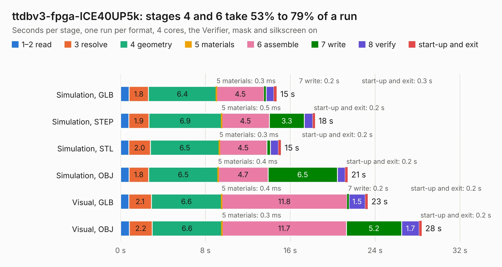

# 2803. ttdbv3-fpga-ICE40UP5k

Board 2,803 of the 3,130 of [Corpus Testing](../Corpus-Testing.md), on [Corpus Page 26](../CorpusTestingPages/Corpus-Testing-26.md#2803-ttdbv3-fpga-ice40up5k).

| Mode and format | 1–2 read | 3 resolve | 4 geometry | 5 materials | 6 assemble | 7 write | 8 verify | start-up and exit | Total |
|---|---:|---:|---:|---:|---:|---:|---:|---:|---:|
| Simulation, GLB | 0.8 | 1.8 | 6.4 | 0.3&nbsp;ms | 4.5 | 0.2 | 0.7 | 0.3 | 14.7 |
| Simulation, STEP | 0.8 | 1.9 | 6.9 | 0.5&nbsp;ms | 4.5 | 3.3 | 0.8 | 0.2 | 18.3 |
| Simulation, STL | 0.8 | 2.0 | 6.5 | 0.3&nbsp;ms | 4.5 | 0.3 | 0.8 | 0.2 | 15.1 |
| Simulation, OBJ | 0.8 | 1.8 | 6.5 | 0.4&nbsp;ms | 4.7 | 6.5 | 0.7 | 0.2 | 21.4 |
| Visual, GLB | 0.8 | 2.1 | 6.6 | 0.4&nbsp;ms | 11.8 | 0.2 | 1.5 | 0.2 | 23.3 |
| Visual, OBJ | 0.8 | 2.2 | 6.6 | 0.3&nbsp;ms | 11.7 | 5.2 | 1.7 | 0.2 | 28.4 |

<table align="center"><tr><td valign="top">

| Board | Repo: [TinyTapeout/breakout-pcb](https://github.com/TinyTapeout/breakout-pcb) Board: `ttdbv3-fpga-ICE40UP5k.kicad_pcb` |
|---|---|
| Folder | ASIC-simulator / ttdbv3-fpga-ICE40UP5k |
| Complexity | 353&nbsp;/&nbsp;1000 (size&nbsp;233, features&nbsp;120) |
| KESE&nbsp;features | through vias, rounded, trapezoid or chamfered pads, filled zones, curved board outline, knockout text, TrueType text, stack-up, dielectric εr and tanδ, mask and silkscreen colours |
| Tested | 9th November 2026 |
| Copper&nbsp;layers | 4 |
| File&nbsp;format | KiCad 9 (20241229) |
| Parts,&nbsp;tracks,&nbsp;vias | 41, 924, 169 |
| Triangles,&nbsp;simulation | 1,380,220 in 92 parts |
| Verifier | PASS in all six runs |

</td><td valign="top">

<table>
<tr><th>File type</th><th>File size</th><th>Peak memory used</th></tr>
<tr><th colspan="3" align="left">Simulation</th></tr>
<tr><td>GLB</td><td align="right">49&nbsp;MB</td><td align="right">670&nbsp;MB</td></tr>
<tr><td>STEP</td><td align="right">233&nbsp;MB</td><td align="right">712&nbsp;MB</td></tr>
<tr><td>STL</td><td align="right">69&nbsp;MB</td><td align="right">690&nbsp;MB</td></tr>
<tr><td>OBJ</td><td align="right">146&nbsp;MB</td><td align="right">992&nbsp;MB</td></tr>
<tr><th colspan="3" align="left">Visual</th></tr>
<tr><td>GLB</td><td align="right">38&nbsp;MB</td><td align="right">797&nbsp;MB</td></tr>
<tr><td>OBJ</td><td align="right">115&nbsp;MB</td><td align="right">863&nbsp;MB</td></tr>
</table>

</td></tr></table>

| Previous | Next |
|:---|---:|
| [2802. tt06-fpga-ICE40UP5k](b2802b_breakout-pcb_tt06-fpga-ICE40UP5k.md) | [2804. breakout-dip-gf](b2804b_breakout-pcb_breakout-dip-gf.md) |
