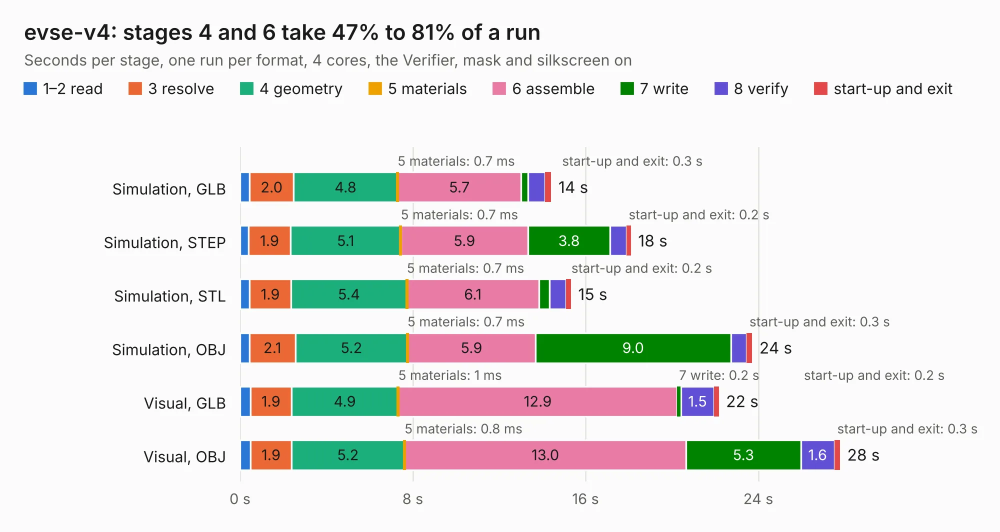

# 2804. evse-v4

Board 2,804 of the 3,138 of [Corpus Testing](../Corpus-Testing.md), on [Corpus Page 26](../CorpusTestingPages/Corpus-Testing-26.md#2804-evse-v4).

| Mode and format | 1–2 read | 3 resolve | 4 geometry | 5 materials | 6 assemble | 7 write | 8 verify | start-up and exit | Total |
|---|---:|---:|---:|---:|---:|---:|---:|---:|---:|
| Simulation, GLB | 0.4 | 2.0 | 4.8 | 0.7&nbsp;ms | 5.7 | 0.3 | 0.8 | 0.3 | 14.4 |
| Simulation, STEP | 0.4 | 1.9 | 5.1 | 0.7&nbsp;ms | 5.9 | 3.8 | 0.8 | 0.2 | 18.1 |
| Simulation, STL | 0.4 | 1.9 | 5.4 | 0.7&nbsp;ms | 6.1 | 0.5 | 0.8 | 0.2 | 15.3 |
| Simulation, OBJ | 0.4 | 2.1 | 5.2 | 0.7&nbsp;ms | 5.9 | 9.0 | 0.7 | 0.3 | 23.7 |
| Visual, GLB | 0.5 | 1.9 | 4.9 | 1&nbsp;ms | 12.9 | 0.2 | 1.5 | 0.2 | 22.2 |
| Visual, OBJ | 0.5 | 1.9 | 5.2 | 0.8&nbsp;ms | 13.0 | 5.3 | 1.6 | 0.3 | 27.8 |

<table align="center"><tr><td valign="top">

| Board | Repo: [tinkerforge/evse-v4-bricklet](https://github.com/tinkerforge/evse-v4-bricklet) Board: `evse-v4.kicad_pcb` |
|---|---|
| Folder | hardware |
| Complexity | 353&nbsp;/&nbsp;1000 (size&nbsp;258, features&nbsp;95) |
| KESE&nbsp;features | through vias, rounded, trapezoid or chamfered pads, filled zones, copper drawings, curved board outline, stack-up, dielectric εr and tanδ |
| Tested | 9th November 2026 |
| Copper&nbsp;layers | 4 |
| File&nbsp;format | KiCad 9 (20241229) |
| Parts,&nbsp;tracks,&nbsp;vias | 167, 1,676, 312 |
| Triangles,&nbsp;simulation | 1,930,076 in 136 parts |
| Verifier | PASS in all six runs |

</td><td valign="top">

<table>
<tr><th>File type</th><th>File size</th><th>Peak memory used</th></tr>
<tr><th colspan="3" align="left">Simulation</th></tr>
<tr><td>GLB</td><td align="right">64&nbsp;MB</td><td align="right">661&nbsp;MB</td></tr>
<tr><td>STEP</td><td align="right">220&nbsp;MB</td><td align="right">839&nbsp;MB</td></tr>
<tr><td>STL</td><td align="right">97&nbsp;MB</td><td align="right">660&nbsp;MB</td></tr>
<tr><td>OBJ</td><td align="right">201&nbsp;MB</td><td align="right">1.3&nbsp;GB</td></tr>
<tr><th colspan="3" align="left">Visual</th></tr>
<tr><td>GLB</td><td align="right">38&nbsp;MB</td><td align="right">751&nbsp;MB</td></tr>
<tr><td>OBJ</td><td align="right">118&nbsp;MB</td><td align="right">911&nbsp;MB</td></tr>
</table>

</td></tr></table>

| Previous | Next |
|:---|---:|
| [2803. ethernet-extension-wopoe](b2803b_ethernet-extension_ethernet-extension-wopoe.md) | [2805. evse-v4b](b2805b_evse-v4-bricklet_evse-v4b.md) |
