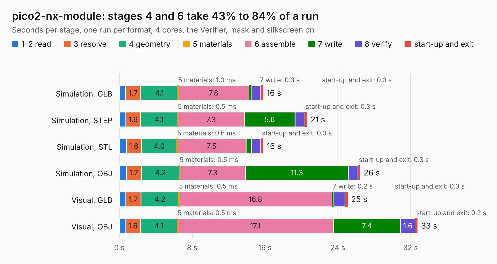

# 2809. pico2-nx-module

Board 2,809 of the 3,116 of [Corpus Testing](../Corpus-Testing.md), on [Corpus Page 27](../CorpusTestingPages/Corpus-Testing-27.md#2809-pico2-nx-module).

| Mode and format | 1–2 read | 3 resolve | 4 geometry | 5 materials | 6 assemble | 7 write | 8 verify | start-up and exit | Total |
|---|---:|---:|---:|---:|---:|---:|---:|---:|---:|
| Simulation, GLB | 0.7 | 1.7 | 4.1 | 1.0&nbsp;ms | 7.8 | 0.3 | 1.0 | 0.3 | 15.8 |
| Simulation, STEP | 0.7 | 1.6 | 4.1 | 0.5&nbsp;ms | 7.3 | 5.6 | 1.0 | 0.3 | 20.6 |
| Simulation, STL | 0.8 | 1.6 | 4.0 | 0.6&nbsp;ms | 7.5 | 0.6 | 1.0 | 0.3 | 15.8 |
| Simulation, OBJ | 0.8 | 1.7 | 4.2 | 0.5&nbsp;ms | 7.3 | 11.3 | 1.1 | 0.3 | 26.5 |
| Visual, GLB | 0.7 | 1.7 | 4.2 | 0.5&nbsp;ms | 16.8 | 0.2 | 1.2 | 0.3 | 25.1 |
| Visual, OBJ | 0.7 | 1.6 | 4.1 | 0.5&nbsp;ms | 17.1 | 7.4 | 1.6 | 0.2 | 32.8 |

<table align="center"><tr><td valign="top">

| Board | Repo: [tinyvision-ai-inc/pico2-nx](https://github.com/tinyvision-ai-inc/pico2-nx) Board: `pico2-nx-module.kicad_pcb` |
|---|---|
| Folder | board / Rev2 / nx-module |
| Complexity | 376&nbsp;/&nbsp;1000 (size&nbsp;276, features&nbsp;100) |
| KESE&nbsp;features | through vias, rounded, trapezoid or chamfered pads, arc tracks, filled zones, curved board outline, stack-up, dielectric εr and tanδ |
| Tested | 9th November 2026 |
| Copper&nbsp;layers | 6 |
| File&nbsp;format | KiCad 9 (20241229) |
| Parts,&nbsp;tracks,&nbsp;vias | 71, 2,995, 254 |
| Triangles,&nbsp;simulation | 1,957,374 in 138 parts |
| Verifier | PASS in all six runs |

</td><td valign="top">

<table>
<tr><th>File type</th><th>File size</th><th>Peak memory used</th></tr>
<tr><th colspan="3" align="left">Simulation</th></tr>
<tr><td>GLB</td><td align="right">66&nbsp;MB</td><td align="right">664&nbsp;MB</td></tr>
<tr><td>STEP</td><td align="right">256&nbsp;MB</td><td align="right">873&nbsp;MB</td></tr>
<tr><td>STL</td><td align="right">98&nbsp;MB</td><td align="right">663&nbsp;MB</td></tr>
<tr><td>OBJ</td><td align="right">204&nbsp;MB</td><td align="right">1.3&nbsp;GB</td></tr>
<tr><th colspan="3" align="left">Visual</th></tr>
<tr><td>GLB</td><td align="right">42&nbsp;MB</td><td align="right">992&nbsp;MB</td></tr>
<tr><td>OBJ</td><td align="right">131&nbsp;MB</td><td align="right">1.0&nbsp;GB</td></tr>
</table>

</td></tr></table>

| Previous | Next |
|:---|---:|
| [2808. nx-module-breakout](b2808b_pico2-nx_nx-module-breakout.md) | [2810. pogo_adapter](b2810b_upduino-jtag_pogo-adapter.md) |
