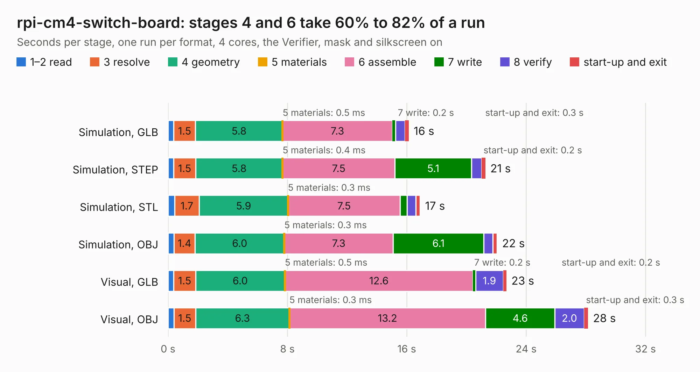

# 2810. rpi-cm4-switch-board

Board 2,810 of the 3,101 of [Corpus Testing](../Corpus-Testing.md), on [Corpus Page 27](../CorpusTestingPages/Corpus-Testing-27.md#2810-rpi-cm4-switch-board).

| Mode and format | 1–2 read | 3 resolve | 4 geometry | 5 materials | 6 assemble | 7 write | 8 verify | start-up and exit | Total |
|---|---:|---:|---:|---:|---:|---:|---:|---:|---:|
| Simulation, GLB | 0.4 | 1.5 | 5.8 | 0.5&nbsp;ms | 7.3 | 0.2 | 0.6 | 0.3 | 16.1 |
| Simulation, STEP | 0.4 | 1.5 | 5.8 | 0.4&nbsp;ms | 7.5 | 5.1 | 0.7 | 0.2 | 21.3 |
| Simulation, STL | 0.4 | 1.7 | 5.9 | 0.3&nbsp;ms | 7.5 | 0.5 | 0.6 | 0.3 | 16.9 |
| Simulation, OBJ | 0.4 | 1.4 | 6.0 | 0.3&nbsp;ms | 7.3 | 6.1 | 0.6 | 0.3 | 22.1 |
| Visual, GLB | 0.4 | 1.5 | 6.0 | 0.5&nbsp;ms | 12.6 | 0.2 | 1.9 | 0.2 | 22.7 |
| Visual, OBJ | 0.4 | 1.5 | 6.3 | 0.3&nbsp;ms | 13.2 | 4.6 | 2.0 | 0.3 | 28.1 |

<table align="center"><tr><td valign="top">

| Board | Repo: [tlalexander/rpi-cm4-switch-board](https://github.com/tlalexander/rpi-cm4-switch-board) Board: `rpi-cm4-switch-board.kicad_pcb` |
|---|---|
| Folder | hardware / rpi-cm4-switch-board |
| Complexity | 326&nbsp;/&nbsp;1000 (size&nbsp;221, features&nbsp;105) |
| KESE&nbsp;features | through vias, slotted holes, rounded, trapezoid or chamfered pads, arc tracks, filled zones, stack-up, dielectric εr and tanδ, mask and silkscreen colours |
| Tested | 9th November 2026 |
| Copper&nbsp;layers | 2 |
| File&nbsp;format | KiCad 6 (20210722) |
| Parts,&nbsp;tracks,&nbsp;vias | 94, 1,008, 34 |
| Triangles,&nbsp;simulation | 1,474,964 in 156 parts |
| Verifier | PASS in all six runs |

</td><td valign="top">

<table>
<tr><th>File type</th><th>File size</th><th>Peak memory used</th></tr>
<tr><th colspan="3" align="left">Simulation</th></tr>
<tr><td>GLB</td><td align="right">51&nbsp;MB</td><td align="right">651&nbsp;MB</td></tr>
<tr><td>STEP</td><td align="right">276&nbsp;MB</td><td align="right">738&nbsp;MB</td></tr>
<tr><td>STL</td><td align="right">74&nbsp;MB</td><td align="right">651&nbsp;MB</td></tr>
<tr><td>OBJ</td><td align="right">152&nbsp;MB</td><td align="right">984&nbsp;MB</td></tr>
<tr><th colspan="3" align="left">Visual</th></tr>
<tr><td>GLB</td><td align="right">39&nbsp;MB</td><td align="right">751&nbsp;MB</td></tr>
<tr><td>OBJ</td><td align="right">118&nbsp;MB</td><td align="right">884&nbsp;MB</td></tr>
</table>

</td></tr></table>

| Previous | Next |
|:---|---:|
| [2809. CM4IOv5](b2809b_rpi-cm4-switch-board_CM4IOv5.md) | [2811. add_sub](b2811b_alu_add-sub.md) |
