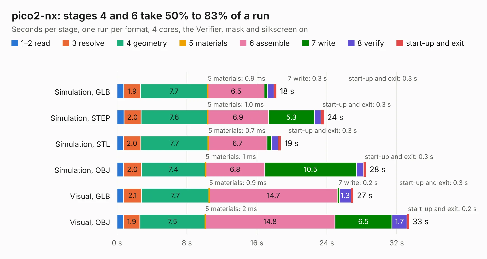

# 2811. pico2-nx

Board 2,811 of the 3,120 of [Corpus Testing](../Corpus-Testing.md), on [Corpus Page 27](../CorpusTestingPages/Corpus-Testing-27.md#2811-pico2-nx).

| Mode and format | 1–2 read | 3 resolve | 4 geometry | 5 materials | 6 assemble | 7 write | 8 verify | start-up and exit | Total |
|---|---:|---:|---:|---:|---:|---:|---:|---:|---:|
| Simulation, GLB | 0.8 | 1.9 | 7.7 | 0.9&nbsp;ms | 6.5 | 0.3 | 0.8 | 0.3 | 18.2 |
| Simulation, STEP | 0.8 | 2.0 | 7.6 | 1.0&nbsp;ms | 6.9 | 5.3 | 0.8 | 0.3 | 23.7 |
| Simulation, STL | 0.7 | 2.0 | 7.7 | 0.7&nbsp;ms | 6.7 | 0.5 | 0.8 | 0.3 | 18.8 |
| Simulation, OBJ | 0.8 | 2.0 | 7.4 | 1&nbsp;ms | 6.8 | 10.5 | 0.8 | 0.3 | 28.5 |
| Visual, GLB | 0.7 | 2.1 | 7.7 | 0.9&nbsp;ms | 14.7 | 0.2 | 1.3 | 0.3 | 27.1 |
| Visual, OBJ | 0.8 | 1.9 | 7.5 | 2&nbsp;ms | 14.8 | 6.5 | 1.7 | 0.2 | 33.4 |

<table align="center"><tr><td valign="top">

| Board | Repo: [tinyvision-ai-inc/pico2-nx](https://github.com/tinyvision-ai-inc/pico2-nx) Board: `pico2-nx.kicad_pcb` |
|---|---|
| Folder | board / Rev0 / pico2-nx |
| Complexity | 336&nbsp;/&nbsp;1000 (size&nbsp;221, features&nbsp;115) |
| KESE&nbsp;features | microvias, slotted holes, custom pads, rounded, trapezoid or chamfered pads, copper drawings, stack-up, dielectric εr and tanδ |
| Tested | 9th November 2026 |
| Copper&nbsp;layers | 2 |
| File&nbsp;format | KiCad 9 (20241229) |
| Parts,&nbsp;tracks,&nbsp;vias | 237, 10, 81 |
| Triangles,&nbsp;simulation | 1,634,060 in 259 parts |
| Note | mostly unrouted |
| Verifier | PASS in all six runs |

</td><td valign="top">

<table>
<tr><th>File type</th><th>File size</th><th>Peak memory used</th></tr>
<tr><th colspan="3" align="left">Simulation</th></tr>
<tr><td>GLB</td><td align="right">55&nbsp;MB</td><td align="right">692&nbsp;MB</td></tr>
<tr><td>STEP</td><td align="right">252&nbsp;MB</td><td align="right">780&nbsp;MB</td></tr>
<tr><td>STL</td><td align="right">82&nbsp;MB</td><td align="right">608&nbsp;MB</td></tr>
<tr><td>OBJ</td><td align="right">168&nbsp;MB</td><td align="right">1.1&nbsp;GB</td></tr>
<tr><th colspan="3" align="left">Visual</th></tr>
<tr><td>GLB</td><td align="right">37&nbsp;MB</td><td align="right">907&nbsp;MB</td></tr>
<tr><td>OBJ</td><td align="right">111&nbsp;MB</td><td align="right">821&nbsp;MB</td></tr>
</table>

</td></tr></table>

| Previous | Next |
|:---|---:|
| [2810. pico2-nx-module](b2810b_pico2-nx_board-Rev0-pico2-nx-module_pico2-nx-module.md) | [2812. nx-module-breakout](b2812b_pico2-nx_nx-module-breakout.md) |
