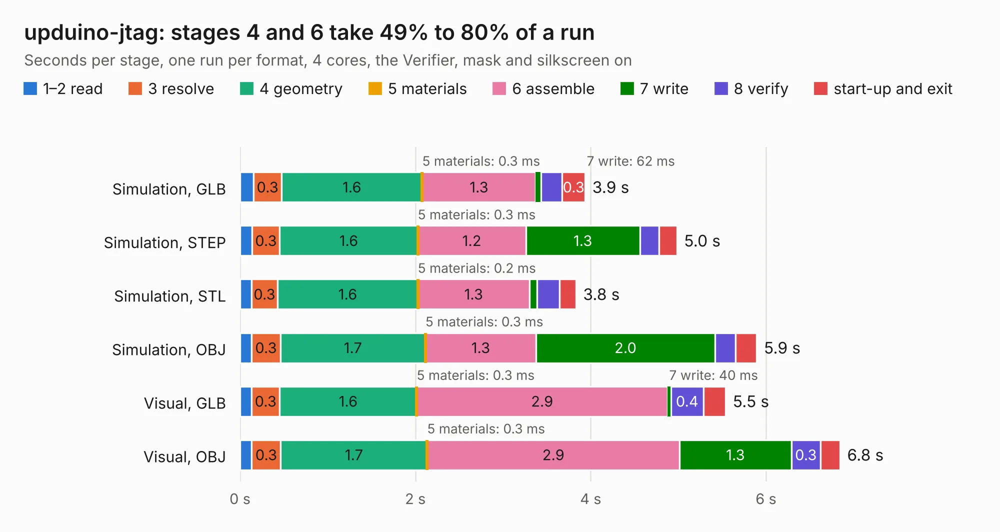

# 2811. upduino-jtag

Board 2,811 of the 3,116 of [Corpus Testing](../Corpus-Testing.md), on [Corpus Page 27](../CorpusTestingPages/Corpus-Testing-27.md#2811-upduino-jtag).

| Mode and format | 1–2 read | 3 resolve | 4 geometry | 5 materials | 6 assemble | 7 write | 8 verify | start-up and exit | Total |
|---|---:|---:|---:|---:|---:|---:|---:|---:|---:|
| Simulation, GLB | 0.2 | 0.3 | 1.6 | 0.3&nbsp;ms | 1.3 | 62&nbsp;ms | 0.2 | 0.3 | 3.9 |
| Simulation, STEP | 0.1 | 0.3 | 1.6 | 0.3&nbsp;ms | 1.2 | 1.3 | 0.2 | 0.2 | 5.0 |
| Simulation, STL | 0.1 | 0.3 | 1.6 | 0.2&nbsp;ms | 1.3 | 86&nbsp;ms | 0.3 | 0.2 | 3.8 |
| Simulation, OBJ | 0.1 | 0.3 | 1.7 | 0.3&nbsp;ms | 1.3 | 2.0 | 0.2 | 0.2 | 5.9 |
| Visual, GLB | 0.1 | 0.3 | 1.6 | 0.3&nbsp;ms | 2.9 | 40&nbsp;ms | 0.4 | 0.3 | 5.5 |
| Visual, OBJ | 0.1 | 0.3 | 1.7 | 0.3&nbsp;ms | 2.9 | 1.3 | 0.3 | 0.2 | 6.8 |

<table align="center"><tr><td valign="top">

| Board | Repo: [tinyvision-ai-inc/upduino-jtag](https://github.com/tinyvision-ai-inc/upduino-jtag) Board: `upduino-jtag.kicad_pcb` |
|---|---|
| Folder | board / upduino_adapter |
| Complexity | 208&nbsp;/&nbsp;1000 (size&nbsp;128, features&nbsp;80) |
| KESE&nbsp;features | through vias, rounded, trapezoid or chamfered pads, filled zones, stack-up, dielectric εr and tanδ, mask and silkscreen colours |
| Tested | 9th November 2026 |
| Copper&nbsp;layers | 2 |
| File&nbsp;format | KiCad 8 (20240108) |
| Parts,&nbsp;tracks,&nbsp;vias | 6, 94, 49 |
| Triangles,&nbsp;simulation | 365,398 in 59 parts |
| Verifier | PASS in all six runs |

</td><td valign="top">

<table>
<tr><th>File type</th><th>File size</th><th>Peak memory used</th></tr>
<tr><th colspan="3" align="left">Simulation</th></tr>
<tr><td>GLB</td><td align="right">12&nbsp;MB</td><td align="right">263&nbsp;MB</td></tr>
<tr><td>STEP</td><td align="right">46&nbsp;MB</td><td align="right">284&nbsp;MB</td></tr>
<tr><td>STL</td><td align="right">18&nbsp;MB</td><td align="right">275&nbsp;MB</td></tr>
<tr><td>OBJ</td><td align="right">36&nbsp;MB</td><td align="right">288&nbsp;MB</td></tr>
<tr><th colspan="3" align="left">Visual</th></tr>
<tr><td>GLB</td><td align="right">8.2&nbsp;MB</td><td align="right">265&nbsp;MB</td></tr>
<tr><td>OBJ</td><td align="right">24&nbsp;MB</td><td align="right">268&nbsp;MB</td></tr>
</table>

</td></tr></table>

| Previous | Next |
|:---|---:|
| [2810. pogo_adapter](b2810b_upduino-jtag_pogo-adapter.md) | [2812. UPduino_v3.0](b2812b_upduino-v3-0_Board-v1-0_UPduino-v3-0.md) |
