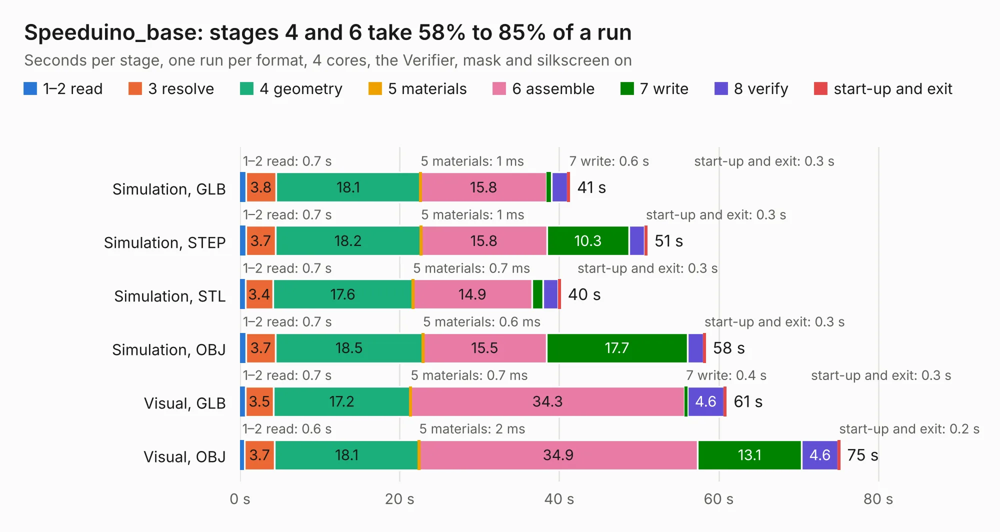

# 2812. Speeduino_base

Board 2,812 of the 3,106 of [Corpus Testing](../Corpus-Testing.md), on [Corpus Page 27](../CorpusTestingPages/Corpus-Testing-27.md#2812-speeduino_base).

| Mode and format | 1–2 read | 3 resolve | 4 geometry | 5 materials | 6 assemble | 7 write | 8 verify | start-up and exit | Total |
|---|---:|---:|---:|---:|---:|---:|---:|---:|---:|
| Simulation, GLB | 0.7 | 3.8 | 18.1 | 1&nbsp;ms | 15.8 | 0.6 | 2.0 | 0.3 | 41.3 |
| Simulation, STEP | 0.7 | 3.7 | 18.2 | 1&nbsp;ms | 15.8 | 10.3 | 2.0 | 0.3 | 51.0 |
| Simulation, STL | 0.7 | 3.4 | 17.6 | 0.7&nbsp;ms | 14.9 | 1.4 | 1.9 | 0.3 | 40.2 |
| Simulation, OBJ | 0.7 | 3.7 | 18.5 | 0.6&nbsp;ms | 15.5 | 17.7 | 2.0 | 0.3 | 58.3 |
| Visual, GLB | 0.7 | 3.5 | 17.2 | 0.7&nbsp;ms | 34.3 | 0.4 | 4.6 | 0.3 | 61.0 |
| Visual, OBJ | 0.6 | 3.7 | 18.1 | 2&nbsp;ms | 34.9 | 13.1 | 4.6 | 0.2 | 75.2 |

<table align="center"><tr><td valign="top">

| Board | Repo: [tjeerdie/spectre](https://github.com/tjeerdie/spectre) Board: `Speeduino_base.kicad_pcb` |
|---|---|
| Folder | SPECTRE_V0.5 |
| Complexity | 265&nbsp;/&nbsp;1000 (size&nbsp;210, features&nbsp;55) |
| KESE&nbsp;features | through vias, rounded, trapezoid or chamfered pads, filled zones, curved board outline |
| Tested | 9th November 2026 |
| Copper&nbsp;layers | 2 |
| File&nbsp;format | KiCad 5 (20171130) |
| Parts,&nbsp;tracks,&nbsp;vias | 213, 2,582, 407 |
| Triangles,&nbsp;simulation | 3,773,130 in 220 parts |
| Verifier | PASS in all six runs |

</td><td valign="top">

<table>
<tr><th>File type</th><th>File size</th><th>Peak memory used</th></tr>
<tr><th colspan="3" align="left">Simulation</th></tr>
<tr><td>GLB</td><td align="right">130&nbsp;MB</td><td align="right">1.2&nbsp;GB</td></tr>
<tr><td>STEP</td><td align="right">713&nbsp;MB</td><td align="right">1.6&nbsp;GB</td></tr>
<tr><td>STL</td><td align="right">189&nbsp;MB</td><td align="right">1.2&nbsp;GB</td></tr>
<tr><td>OBJ</td><td align="right">403&nbsp;MB</td><td align="right">2.5&nbsp;GB</td></tr>
<tr><th colspan="3" align="left">Visual</th></tr>
<tr><td>GLB</td><td align="right">98&nbsp;MB</td><td align="right">1.6&nbsp;GB</td></tr>
<tr><td>OBJ</td><td align="right">308&nbsp;MB</td><td align="right">2.1&nbsp;GB</td></tr>
</table>

</td></tr></table>

| Previous | Next |
|:---|---:|
| [2811. Speeduino_base](b2811b_spectre_SPECTRE-V0-5-4_Speeduino-base.md) | [2813. upsy-desky](b2813b_upsy-desky_upsy-desky.md) |
