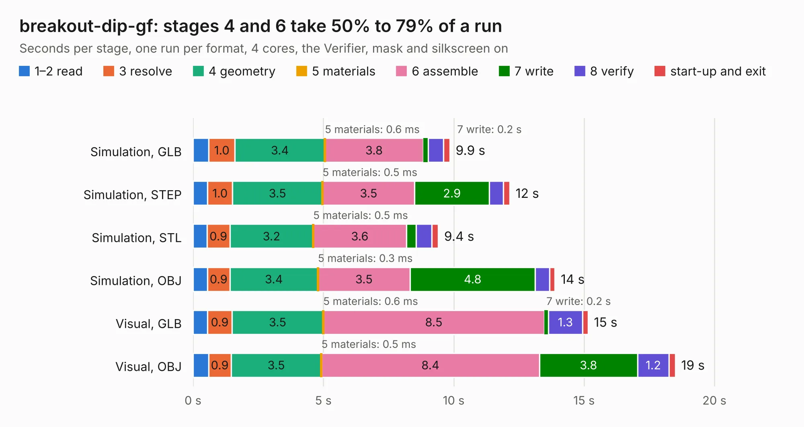

# 2813. breakout-dip-gf

Board 2,813 of the 3,139 of [Corpus Testing](../Corpus-Testing.md), on [Corpus Page 27](../CorpusTestingPages/Corpus-Testing-27.md#2813-breakout-dip-gf).

| Mode and format | 1–2 read | 3 resolve | 4 geometry | 5 materials | 6 assemble | 7 write | 8 verify | start-up and exit | Total |
|---|---:|---:|---:|---:|---:|---:|---:|---:|---:|
| Simulation, GLB | 0.6 | 1.0 | 3.4 | 0.6&nbsp;ms | 3.8 | 0.2 | 0.6 | 0.2 | 9.9 |
| Simulation, STEP | 0.6 | 1.0 | 3.5 | 0.5&nbsp;ms | 3.5 | 2.9 | 0.5 | 0.2 | 12.2 |
| Simulation, STL | 0.5 | 0.9 | 3.2 | 0.5&nbsp;ms | 3.6 | 0.4 | 0.6 | 0.3 | 9.4 |
| Simulation, OBJ | 0.6 | 0.9 | 3.4 | 0.3&nbsp;ms | 3.5 | 4.8 | 0.5 | 0.2 | 13.9 |
| Visual, GLB | 0.6 | 0.9 | 3.5 | 0.6&nbsp;ms | 8.5 | 0.2 | 1.3 | 0.2 | 15.2 |
| Visual, OBJ | 0.6 | 0.9 | 3.5 | 0.5&nbsp;ms | 8.4 | 3.8 | 1.2 | 0.2 | 18.5 |

<table align="center"><tr><td valign="top">

| Board | Repo: [TinyTapeout/breakout-pcb](https://github.com/TinyTapeout/breakout-pcb) Board: `breakout-dip-gf.kicad_pcb` |
|---|---|
| Folder | breakout-dip-gf |
| Complexity | 386&nbsp;/&nbsp;1000 (size&nbsp;231, features&nbsp;155) |
| KESE&nbsp;features | through vias, slotted holes, custom pads, rounded, trapezoid or chamfered pads, filled zones, copper drawings, curved board outline, knockout text, TrueType text, stack-up, dielectric εr and tanδ, mask and silkscreen colours |
| Tested | 9th November 2026 |
| Copper&nbsp;layers | 4 |
| File&nbsp;format | KiCad 10 (20260206) |
| Parts,&nbsp;tracks,&nbsp;vias | 35, 1,067, 104 |
| Triangles,&nbsp;simulation | 1,104,480 in 110 parts |
| Verifier | PASS in all six runs |

</td><td valign="top">

<table>
<tr><th>File type</th><th>File size</th><th>Peak memory used</th></tr>
<tr><th colspan="3" align="left">Simulation</th></tr>
<tr><td>GLB</td><td align="right">38&nbsp;MB</td><td align="right">459&nbsp;MB</td></tr>
<tr><td>STEP</td><td align="right">176&nbsp;MB</td><td align="right">552&nbsp;MB</td></tr>
<tr><td>STL</td><td align="right">55&nbsp;MB</td><td align="right">462&nbsp;MB</td></tr>
<tr><td>OBJ</td><td align="right">113&nbsp;MB</td><td align="right">765&nbsp;MB</td></tr>
<tr><th colspan="3" align="left">Visual</th></tr>
<tr><td>GLB</td><td align="right">27&nbsp;MB</td><td align="right">656&nbsp;MB</td></tr>
<tr><td>OBJ</td><td align="right">81&nbsp;MB</td><td align="right">645&nbsp;MB</td></tr>
</table>

</td></tr></table>

| Previous | Next |
|:---|---:|
| [2812. ttdbv3-fpga-ICE40UP5k](b2812b_breakout-pcb_ttdbv3-fpga-ICE40UP5k.md) | [2814. breakout-ihp-qfn](b2814b_breakout-pcb_breakout-ihp-qfn.md) |
