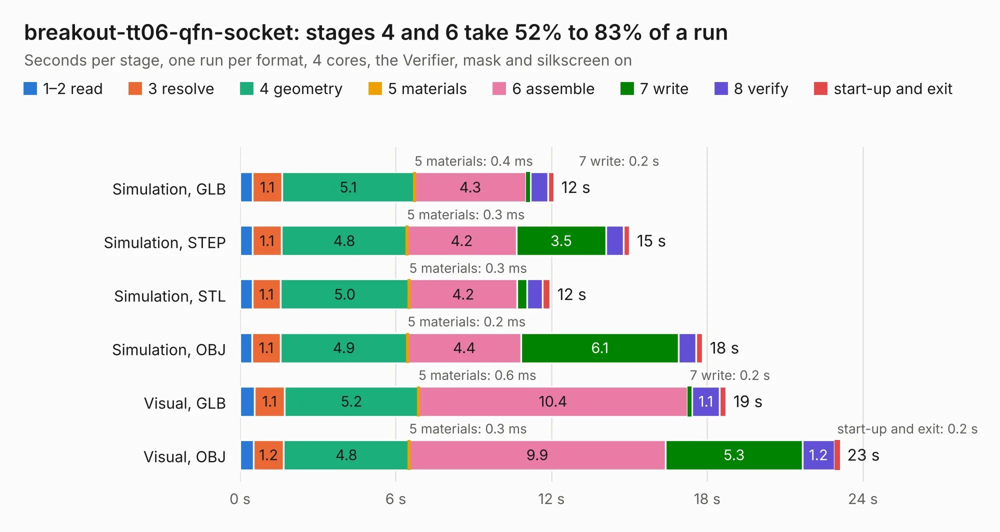

# 2817. breakout-tt06-qfn-socket

Board 2,817 of the 3,138 of [Corpus Testing](../Corpus-Testing.md), on [Corpus Page 27](../CorpusTestingPages/Corpus-Testing-27.md#2817-breakout-tt06-qfn-socket).

| Mode and format | 1–2 read | 3 resolve | 4 geometry | 5 materials | 6 assemble | 7 write | 8 verify | start-up and exit | Total |
|---|---:|---:|---:|---:|---:|---:|---:|---:|---:|
| Simulation, GLB | 0.5 | 1.1 | 5.1 | 0.4&nbsp;ms | 4.3 | 0.2 | 0.7 | 0.2 | 12.1 |
| Simulation, STEP | 0.5 | 1.1 | 4.8 | 0.3&nbsp;ms | 4.2 | 3.5 | 0.7 | 0.2 | 15.0 |
| Simulation, STL | 0.5 | 1.1 | 5.0 | 0.3&nbsp;ms | 4.2 | 0.4 | 0.6 | 0.3 | 11.9 |
| Simulation, OBJ | 0.5 | 1.1 | 4.9 | 0.2&nbsp;ms | 4.4 | 6.1 | 0.7 | 0.2 | 17.8 |
| Visual, GLB | 0.6 | 1.1 | 5.2 | 0.6&nbsp;ms | 10.4 | 0.2 | 1.1 | 0.3 | 18.7 |
| Visual, OBJ | 0.5 | 1.2 | 4.8 | 0.3&nbsp;ms | 9.9 | 5.3 | 1.2 | 0.2 | 23.1 |

<table align="center"><tr><td valign="top">

| Board | Repo: [TinyTapeout/breakout-pcb](https://github.com/TinyTapeout/breakout-pcb) Board: `breakout-tt06-qfn-socket.kicad_pcb` |
|---|---|
| Folder | breakout-tt06-qfn-socket |
| Complexity | 324&nbsp;/&nbsp;1000 (size&nbsp;214, features&nbsp;110) |
| KESE&nbsp;features | through vias, custom pads, rounded, trapezoid or chamfered pads, filled zones, copper drawings, curved board outline, knockout text, TrueType text |
| Tested | 9th November 2026 |
| Copper&nbsp;layers | 2 |
| File&nbsp;format | KiCad 8 (20240108) |
| Parts,&nbsp;tracks,&nbsp;vias | 42, 925, 99 |
| Triangles,&nbsp;simulation | 1,062,926 in 77 parts |
| Verifier | PASS in all six runs |

</td><td valign="top">

<table>
<tr><th>File type</th><th>File size</th><th>Peak memory used</th></tr>
<tr><th colspan="3" align="left">Simulation</th></tr>
<tr><td>GLB</td><td align="right">37&nbsp;MB</td><td align="right">479&nbsp;MB</td></tr>
<tr><td>STEP</td><td align="right">189&nbsp;MB</td><td align="right">599&nbsp;MB</td></tr>
<tr><td>STL</td><td align="right">53&nbsp;MB</td><td align="right">468&nbsp;MB</td></tr>
<tr><td>OBJ</td><td align="right">108&nbsp;MB</td><td align="right">741&nbsp;MB</td></tr>
<tr><th colspan="3" align="left">Visual</th></tr>
<tr><td>GLB</td><td align="right">30&nbsp;MB</td><td align="right">653&nbsp;MB</td></tr>
<tr><td>OBJ</td><td align="right">90&nbsp;MB</td><td align="right">694&nbsp;MB</td></tr>
</table>

</td></tr></table>

| Previous | Next |
|:---|---:|
| [2816. breakout-tt04-qfn-socket](b2816b_breakout-pcb_breakout-tt04-qfn-socket.md) | [2818. tinytapeout-demo](b2818b_tt-demo-pcb_tinytapeout-demo.md) |
