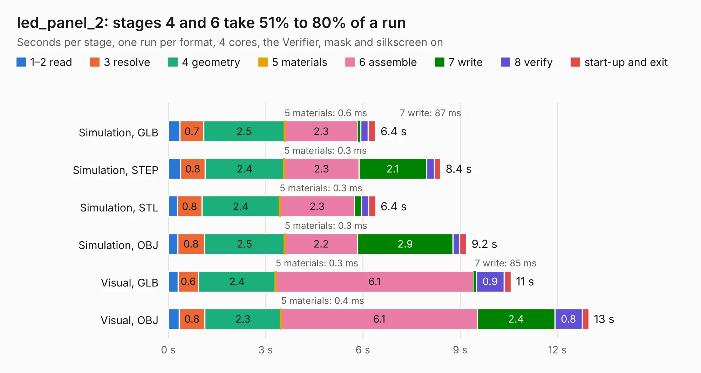

# 2819. led_panel_2

Board 2,819 of the 3,106 of [Corpus Testing](../Corpus-Testing.md), on [Corpus Page 27](../CorpusTestingPages/Corpus-Testing-27.md#2819-led_panel_2).

| Mode and format | 1–2 read | 3 resolve | 4 geometry | 5 materials | 6 assemble | 7 write | 8 verify | start-up and exit | Total |
|---|---:|---:|---:|---:|---:|---:|---:|---:|---:|
| Simulation, GLB | 0.4 | 0.7 | 2.5 | 0.6&nbsp;ms | 2.3 | 87&nbsp;ms | 0.2 | 0.2 | 6.4 |
| Simulation, STEP | 0.4 | 0.8 | 2.4 | 0.3&nbsp;ms | 2.3 | 2.1 | 0.2 | 0.2 | 8.4 |
| Simulation, STL | 0.3 | 0.8 | 2.4 | 0.3&nbsp;ms | 2.3 | 0.2 | 0.2 | 0.2 | 6.4 |
| Simulation, OBJ | 0.3 | 0.8 | 2.5 | 0.3&nbsp;ms | 2.2 | 2.9 | 0.2 | 0.2 | 9.2 |
| Visual, GLB | 0.3 | 0.6 | 2.4 | 0.3&nbsp;ms | 6.1 | 85&nbsp;ms | 0.9 | 0.2 | 10.6 |
| Visual, OBJ | 0.3 | 0.8 | 2.3 | 0.4&nbsp;ms | 6.1 | 2.4 | 0.8 | 0.2 | 13.0 |

<table align="center"><tr><td valign="top">

| Board | Repo: [tmarhguy/alu](https://github.com/tmarhguy/alu) Board: `led_panel_2.kicad_pcb` |
|---|---|
| Folder | schematics / kicad / boards / led_panel / led_panel_2 |
| Complexity | 80&nbsp;/&nbsp;1000 (size&nbsp;70, features&nbsp;10) |
| KESE&nbsp;features | rounded, trapezoid or chamfered pads |
| Tested | 9th November 2026 |
| Copper&nbsp;layers | 2 |
| File&nbsp;format | KiCad 9 (20241229) |
| Parts,&nbsp;tracks,&nbsp;vias | 129, 0, 0 |
| Triangles,&nbsp;simulation | 644,854 in 91 parts |
| Note | panel, mostly unrouted |
| Verifier | PASS in all six runs |

</td><td valign="top">

<table>
<tr><th>File type</th><th>File size</th><th>Peak memory used</th></tr>
<tr><th colspan="3" align="left">Simulation</th></tr>
<tr><td>GLB</td><td align="right">22&nbsp;MB</td><td align="right">425&nbsp;MB</td></tr>
<tr><td>STEP</td><td align="right">111&nbsp;MB</td><td align="right">477&nbsp;MB</td></tr>
<tr><td>STL</td><td align="right">32&nbsp;MB</td><td align="right">395&nbsp;MB</td></tr>
<tr><td>OBJ</td><td align="right">67&nbsp;MB</td><td align="right">484&nbsp;MB</td></tr>
<tr><th colspan="3" align="left">Visual</th></tr>
<tr><td>GLB</td><td align="right">20&nbsp;MB</td><td align="right">525&nbsp;MB</td></tr>
<tr><td>OBJ</td><td align="right">59&nbsp;MB</td><td align="right">527&nbsp;MB</td></tr>
</table>

</td></tr></table>

| Previous | Next |
|:---|---:|
| [2818. led_panel_1](b2818b_alu_led-panel-1.md) | [2820. led_panel_3](b2820b_alu_led-panel-3.md) |
