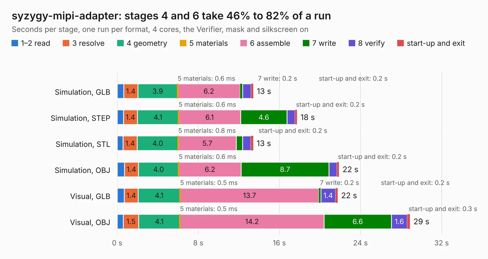

# 2820 syzygy-mipi-adapter

Board 2,820 of the 3,138 of [Corpus Testing](../Corpus-Testing.md), on [Corpus Page 27](../CorpusTestingPages/Corpus-Testing-27.md#2820-syzygy-mipi-adapter).

| Mode and format | 1–2 read | 3 resolve | 4 geometry | 5 materials | 6 assemble | 7 write | 8 verify | start-up and exit | Total |
|---|---:|---:|---:|---:|---:|---:|---:|---:|---:|
| Simulation, GLB | 0.6 | 1.4 | 3.9 | 0.6&nbsp;ms | 6.2 | 0.2 | 0.8 | 0.2 | 13.4 |
| Simulation, STEP | 0.6 | 1.4 | 4.1 | 0.6&nbsp;ms | 6.1 | 4.6 | 0.8 | 0.2 | 17.7 |
| Simulation, STL | 0.6 | 1.4 | 4.0 | 0.8&nbsp;ms | 5.7 | 0.6 | 0.8 | 0.2 | 13.4 |
| Simulation, OBJ | 0.7 | 1.4 | 4.0 | 0.6&nbsp;ms | 6.2 | 8.7 | 0.8 | 0.2 | 21.9 |
| Visual, GLB | 0.7 | 1.4 | 4.1 | 0.5&nbsp;ms | 13.7 | 0.2 | 1.4 | 0.2 | 21.8 |
| Visual, OBJ | 0.6 | 1.5 | 4.1 | 0.5&nbsp;ms | 14.2 | 6.6 | 1.6 | 0.3 | 28.9 |

<table align="center"><tr><td valign="top">

| Board | Repo: [tinyvision-ai-inc/oshw-adapters](https://github.com/tinyvision-ai-inc/oshw-adapters) Board: `syzygy-mipi-adapter.kicad_pcb` |
|---|---|
| Folder | syzygy-mipi-adapter / board / Rev1 |
| Complexity | 386&nbsp;/&nbsp;1000 (size&nbsp;251, features&nbsp;135) |
| KESE&nbsp;features | through vias, slotted holes, custom pads, rounded, trapezoid or chamfered pads, arc tracks, filled zones, copper drawings, curved board outline, stack-up, dielectric εr and tanδ |
| Tested | 9th November 2026 |
| Copper&nbsp;layers | 4 |
| File&nbsp;format | KiCad 9 (20241229) |
| Parts,&nbsp;tracks,&nbsp;vias | 75, 2,381, 204 |
| Triangles,&nbsp;simulation | 1,718,452 in 183 parts |
| Verifier | PASS in all six runs |

</td><td valign="top">

<table>
<tr><th>File type</th><th>File size</th><th>Peak memory used</th></tr>
<tr><th colspan="3" align="left">Simulation</th></tr>
<tr><td>GLB</td><td align="right">59&nbsp;MB</td><td align="right">772&nbsp;MB</td></tr>
<tr><td>STEP</td><td align="right">267&nbsp;MB</td><td align="right">829&nbsp;MB</td></tr>
<tr><td>STL</td><td align="right">86&nbsp;MB</td><td align="right">770&nbsp;MB</td></tr>
<tr><td>OBJ</td><td align="right">181&nbsp;MB</td><td align="right">1.2&nbsp;GB</td></tr>
<tr><th colspan="3" align="left">Visual</th></tr>
<tr><td>GLB</td><td align="right">43&nbsp;MB</td><td align="right">877&nbsp;MB</td></tr>
<tr><td>OBJ</td><td align="right">134&nbsp;MB</td><td align="right">967&nbsp;MB</td></tr>
</table>

</td></tr></table>

| Previous | Next |
|:---|---:|
| [2819 syzygy-mipi-adapter](b2819b_oshw-adapters_syzygy-mipi-adapter-board-Rev0_syzygy-mipi-adapter.md) | [2821 pico-ice](b2821b_pico-ice_Board-Rev0_pico-ice.md) |
