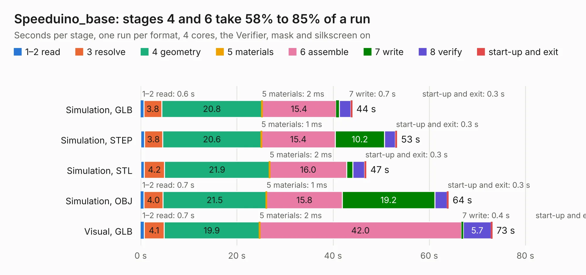

# 2820. Speeduino_base

Board 2,820 of the 3,116 of [Corpus Testing](../Corpus-Testing.md), on [Corpus Page 27](../CorpusTestingPages/Corpus-Testing-27.md#2820-speeduino_base).

| Mode and format | 1–2 read | 3 resolve | 4 geometry | 5 materials | 6 assemble | 7 write | 8 verify | start-up and exit | Total |
|---|---:|---:|---:|---:|---:|---:|---:|---:|---:|
| Simulation, GLB | 0.6 | 3.8 | 20.8 | 2&nbsp;ms | 15.4 | 0.7 | 2.4 | 0.3 | 44.0 |
| Simulation, STEP | 0.8 | 3.8 | 20.6 | 1&nbsp;ms | 15.4 | 10.2 | 2.3 | 0.3 | 53.3 |
| Simulation, STL | 0.8 | 4.2 | 21.9 | 2&nbsp;ms | 16.0 | 1.3 | 2.5 | 0.3 | 46.9 |
| Simulation, OBJ | 0.7 | 4.0 | 21.5 | 1&nbsp;ms | 15.8 | 19.2 | 2.6 | 0.3 | 64.0 |
| Visual, GLB | 0.7 | 4.1 | 19.9 | 2&nbsp;ms | 42.0 | 0.4 | 5.7 | 0.3 | 73.1 |
| Visual, OBJ | 0.6 | 4.1 | 20.7 | 0.8&nbsp;ms | 42.9 | 13.9 | 5.3 | 0.3 | 87.8 |

<table align="center"><tr><td valign="top">

| Board | Repo: [tjeerdie/spectre](https://github.com/tjeerdie/spectre) Board: `Speeduino_base.kicad_pcb` |
|---|---|
| Folder | SPECTRE_V0.5.3 |
| Complexity | 268&nbsp;/&nbsp;1000 (size&nbsp;213, features&nbsp;55) |
| KESE&nbsp;features | through vias, rounded, trapezoid or chamfered pads, filled zones, curved board outline |
| Tested | 9th November 2026 |
| Copper&nbsp;layers | 2 |
| File&nbsp;format | KiCad 5 (20171130) |
| Parts,&nbsp;tracks,&nbsp;vias | 217, 3,070, 450 |
| Triangles,&nbsp;simulation | 4,263,228 in 282 parts |
| Verifier | PASS in all six runs |

</td><td valign="top">

<table>
<tr><th>File type</th><th>File size</th><th>Peak memory used</th></tr>
<tr><th colspan="3" align="left">Simulation</th></tr>
<tr><td>GLB</td><td align="right">147&nbsp;MB</td><td align="right">1.4&nbsp;GB</td></tr>
<tr><td>STEP</td><td align="right">799&nbsp;MB</td><td align="right">1.7&nbsp;GB</td></tr>
<tr><td>STL</td><td align="right">213&nbsp;MB</td><td align="right">1.4&nbsp;GB</td></tr>
<tr><td>OBJ</td><td align="right">456&nbsp;MB</td><td align="right">2.8&nbsp;GB</td></tr>
<tr><th colspan="3" align="left">Visual</th></tr>
<tr><td>GLB</td><td align="right">110&nbsp;MB</td><td align="right">1.8&nbsp;GB</td></tr>
<tr><td>OBJ</td><td align="right">346&nbsp;MB</td><td align="right">2.3&nbsp;GB</td></tr>
</table>

</td></tr></table>

| Previous | Next |
|:---|---:|
| [2819. Speeduino_base](b2819b_spectre_SPECTRE-V0-5-2_Speeduino-base.md) | [2821. Speeduino_base](b2821b_spectre_SPECTRE-V0-5-4_Speeduino-base.md) |
