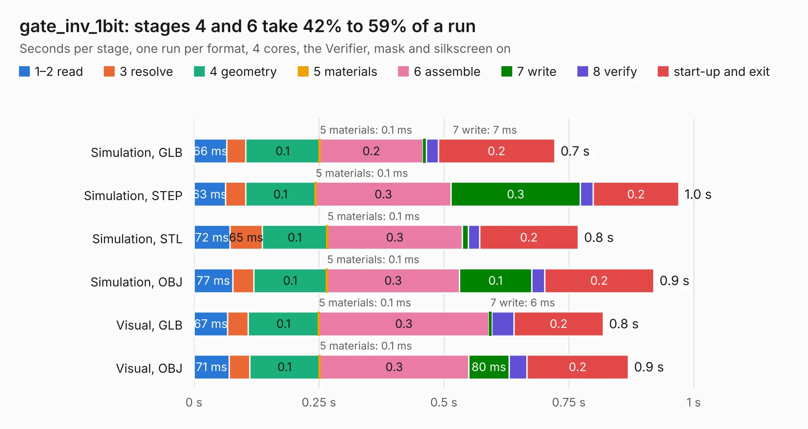

# 2821. gate_inv_1bit

Board 2,821 of the 3,102 of [Corpus Testing](../Corpus-Testing.md), on [Corpus Page 27](../CorpusTestingPages/Corpus-Testing-27.md#2821-gate_inv_1bit).

| Mode and format | 1–2 read | 3 resolve | 4 geometry | 5 materials | 6 assemble | 7 write | 8 verify | start-up and exit | Total |
|---|---:|---:|---:|---:|---:|---:|---:|---:|---:|
| Simulation, GLB | 66&nbsp;ms | 38&nbsp;ms | 0.1 | 0.1&nbsp;ms | 0.2 | 7&nbsp;ms | 24&nbsp;ms | 0.2 | 0.7 |
| Simulation, STEP | 63&nbsp;ms | 40&nbsp;ms | 0.1 | 0.1&nbsp;ms | 0.3 | 0.3 | 26&nbsp;ms | 0.2 | 1.0 |
| Simulation, STL | 72&nbsp;ms | 65&nbsp;ms | 0.1 | 0.1&nbsp;ms | 0.3 | 12&nbsp;ms | 22&nbsp;ms | 0.2 | 0.8 |
| Simulation, OBJ | 77&nbsp;ms | 42&nbsp;ms | 0.1 | 0.1&nbsp;ms | 0.3 | 0.1 | 25&nbsp;ms | 0.2 | 0.9 |
| Visual, GLB | 67&nbsp;ms | 42&nbsp;ms | 0.1 | 0.1&nbsp;ms | 0.3 | 6&nbsp;ms | 45&nbsp;ms | 0.2 | 0.8 |
| Visual, OBJ | 71&nbsp;ms | 41&nbsp;ms | 0.1 | 0.1&nbsp;ms | 0.3 | 80&nbsp;ms | 36&nbsp;ms | 0.2 | 0.9 |

<table align="center"><tr><td valign="top">

| Board | Repo: [tmarhguy/alu](https://github.com/tmarhguy/alu) Board: `gate_inv_1bit.kicad_pcb` |
|---|---|
| Folder | schematics / kicad / modules / gates / gate_inv / gate_inv_1bit |
| Complexity | 65&nbsp;/&nbsp;1000 (size&nbsp;65, features&nbsp;0) |
| Tested | 9th November 2026 |
| Copper&nbsp;layers | 2 |
| File&nbsp;format | KiCad 9 (20241229) |
| Parts,&nbsp;tracks,&nbsp;vias | 2, 8, 0 |
| Triangles,&nbsp;simulation | 33,822 in 14 parts |
| Verifier | PASS in all six runs |

</td><td valign="top">

<table>
<tr><th>File type</th><th>File size</th><th>Peak memory used</th></tr>
<tr><th colspan="3" align="left">Simulation</th></tr>
<tr><td>GLB</td><td align="right">1.1&nbsp;MB</td><td align="right">64&nbsp;MB</td></tr>
<tr><td>STEP</td><td align="right">4.2&nbsp;MB</td><td align="right">68&nbsp;MB</td></tr>
<tr><td>STL</td><td align="right">1.7&nbsp;MB</td><td align="right">65&nbsp;MB</td></tr>
<tr><td>OBJ</td><td align="right">3.2&nbsp;MB</td><td align="right">71&nbsp;MB</td></tr>
<tr><th colspan="3" align="left">Visual</th></tr>
<tr><td>GLB</td><td align="right">764&nbsp;kB</td><td align="right">100&nbsp;MB</td></tr>
<tr><td>OBJ</td><td align="right">2.1&nbsp;MB</td><td align="right">100&nbsp;MB</td></tr>
</table>

</td></tr></table>

| Previous | Next |
|:---|---:|
| [2820. gate_and_4in](b2820b_alu_gate-and-4in.md) | [2822. gate_nand_2in](b2822b_alu_gate-nand-2in.md) |
