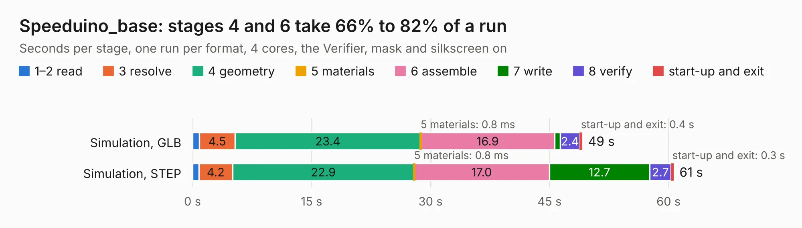

# 2822. Speeduino_base

Board 2,822 of the 3,119 of [Corpus Testing](../Corpus-Testing.md), on [Corpus Page 27](../CorpusTestingPages/Corpus-Testing-27.md#2822-speeduino_base).

| Mode and format | 1–2 read | 3 resolve | 4 geometry | 5 materials | 6 assemble | 7 write | 8 verify | start-up and exit | Total |
|---|---:|---:|---:|---:|---:|---:|---:|---:|---:|
| Simulation, GLB | 0.9 | 4.5 | 23.4 | 0.8&nbsp;ms | 16.9 | 0.7 | 2.4 | 0.4 | 49.1 |
| Simulation, STEP | 0.8 | 4.2 | 22.9 | 0.8&nbsp;ms | 17.0 | 12.7 | 2.7 | 0.3 | 60.6 |
| Simulation, STL | 0.9 | 4.3 | 22.6 | 0.9&nbsp;ms | 17.1 | 1.5 | 2.7 | 0.3 | 49.4 |
| Simulation, OBJ | 0.9 | 4.2 | 23.0 | 1&nbsp;ms | 16.6 | 22.5 | 2.9 | 0.3 | 70.4 |
| Visual, GLB | 0.8 | 4.4 | 22.9 | 1&nbsp;ms | 47.8 | 0.6 | 7.1 | 0.3 | 83.9 |
| Visual, OBJ | 1.0 | 4.4 | 24.0 | 1&nbsp;ms | 46.7 | 16.2 | 6.8 | 0.3 | 99.4 |

<table align="center"><tr><td valign="top">

| Board | Repo: [tjeerdie/spectre](https://github.com/tjeerdie/spectre) Board: `Speeduino_base.kicad_pcb` |
|---|---|
| Folder | SPECTRE_V0.5.2 |
| Complexity | 267&nbsp;/&nbsp;1000 (size&nbsp;212, features&nbsp;55) |
| KESE&nbsp;features | through vias, rounded, trapezoid or chamfered pads, filled zones, curved board outline |
| Tested | 9th November 2026 |
| Copper&nbsp;layers | 2 |
| File&nbsp;format | KiCad 5 (20171130) |
| Parts,&nbsp;tracks,&nbsp;vias | 211, 3,015, 444 |
| Triangles,&nbsp;simulation | 4,220,042 in 275 parts |
| Verifier | PASS in all six runs |

</td><td valign="top">

<table>
<tr><th>File type</th><th>File size</th><th>Peak memory used</th></tr>
<tr><th colspan="3" align="left">Simulation</th></tr>
<tr><td>GLB</td><td align="right">145&nbsp;MB</td><td align="right">1.4&nbsp;GB</td></tr>
<tr><td>STEP</td><td align="right">789&nbsp;MB</td><td align="right">1.7&nbsp;GB</td></tr>
<tr><td>STL</td><td align="right">211&nbsp;MB</td><td align="right">1.4&nbsp;GB</td></tr>
<tr><td>OBJ</td><td align="right">451&nbsp;MB</td><td align="right">2.7&nbsp;GB</td></tr>
<tr><th colspan="3" align="left">Visual</th></tr>
<tr><td>GLB</td><td align="right">109&nbsp;MB</td><td align="right">1.8&nbsp;GB</td></tr>
<tr><td>OBJ</td><td align="right">341&nbsp;MB</td><td align="right">2.2&nbsp;GB</td></tr>
</table>

</td></tr></table>

| Previous | Next |
|:---|---:|
| [2821. Speeduino_base](b2821b_spectre_SPECTRE-V0-5-1_Speeduino-base.md) | [2823. Speeduino_base](b2823b_spectre_SPECTRE-V0-5-3_Speeduino-base.md) |
