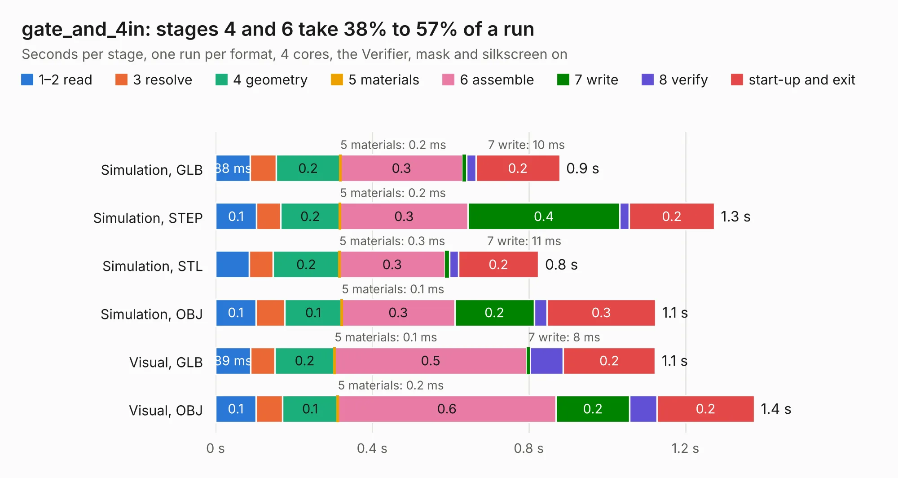

# 2823. gate_and_4in

Board 2,823 of the 3,105 of [Corpus Testing](../Corpus-Testing.md), on [Corpus Page 27](../CorpusTestingPages/Corpus-Testing-27.md#2823-gate_and_4in).

| Mode and format | 1–2 read | 3 resolve | 4 geometry | 5 materials | 6 assemble | 7 write | 8 verify | start-up and exit | Total |
|---|---:|---:|---:|---:|---:|---:|---:|---:|---:|
| Simulation, GLB | 88&nbsp;ms | 67&nbsp;ms | 0.2 | 0.2&nbsp;ms | 0.3 | 10&nbsp;ms | 24&nbsp;ms | 0.2 | 0.9 |
| Simulation, STEP | 0.1 | 62&nbsp;ms | 0.2 | 0.2&nbsp;ms | 0.3 | 0.4 | 24&nbsp;ms | 0.2 | 1.3 |
| Simulation, STL | 86&nbsp;ms | 61&nbsp;ms | 0.2 | 0.3&nbsp;ms | 0.3 | 11&nbsp;ms | 23&nbsp;ms | 0.2 | 0.8 |
| Simulation, OBJ | 0.1 | 74&nbsp;ms | 0.1 | 0.1&nbsp;ms | 0.3 | 0.2 | 32&nbsp;ms | 0.3 | 1.1 |
| Visual, GLB | 89&nbsp;ms | 62&nbsp;ms | 0.2 | 0.1&nbsp;ms | 0.5 | 8&nbsp;ms | 85&nbsp;ms | 0.2 | 1.1 |
| Visual, OBJ | 0.1 | 67&nbsp;ms | 0.1 | 0.2&nbsp;ms | 0.6 | 0.2 | 69&nbsp;ms | 0.2 | 1.4 |

<table align="center"><tr><td valign="top">

| Board | Repo: [tmarhguy/alu](https://github.com/tmarhguy/alu) Board: `gate_and_4in.kicad_pcb` |
|---|---|
| Folder | schematics / kicad / modules / gates / gate_and / gate_and_4in |
| Complexity | 53&nbsp;/&nbsp;1000 (size&nbsp;43, features&nbsp;10) |
| KESE&nbsp;features | rounded, trapezoid or chamfered pads |
| Tested | 9th November 2026 |
| Copper&nbsp;layers | 2 |
| File&nbsp;format | KiCad 9 (20241229) |
| Parts,&nbsp;tracks,&nbsp;vias | 10, 0, 0 |
| Triangles,&nbsp;simulation | 40,752 in 17 parts |
| Verifier | PASS in all six runs |

</td><td valign="top">

<table>
<tr><th>File type</th><th>File size</th><th>Peak memory used</th></tr>
<tr><th colspan="3" align="left">Simulation</th></tr>
<tr><td>GLB</td><td align="right">1.4&nbsp;MB</td><td align="right">69&nbsp;MB</td></tr>
<tr><td>STEP</td><td align="right">6.0&nbsp;MB</td><td align="right">73&nbsp;MB</td></tr>
<tr><td>STL</td><td align="right">2.0&nbsp;MB</td><td align="right">71&nbsp;MB</td></tr>
<tr><td>OBJ</td><td align="right">4.0&nbsp;MB</td><td align="right">79&nbsp;MB</td></tr>
<tr><th colspan="3" align="left">Visual</th></tr>
<tr><td>GLB</td><td align="right">1.4&nbsp;MB</td><td align="right">102&nbsp;MB</td></tr>
<tr><td>OBJ</td><td align="right">3.8&nbsp;MB</td><td align="right">100&nbsp;MB</td></tr>
</table>

</td></tr></table>

| Previous | Next |
|:---|---:|
| [2822. gate_and_2in](b2822b_alu_gate-and-2in.md) | [2824. gate_inv_1bit](b2824b_alu_gate-inv-1bit.md) |
