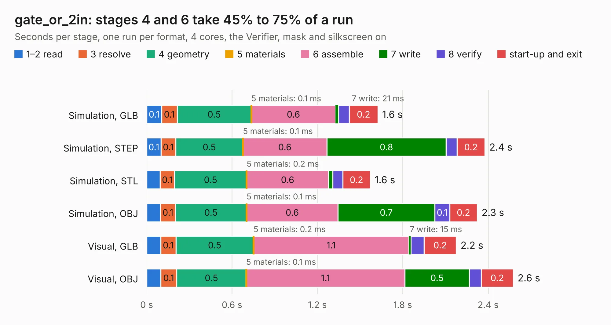

# 2823. gate_or_2in

Board 2,823 of the 3,101 of [Corpus Testing](../Corpus-Testing.md), on [Corpus Page 27](../CorpusTestingPages/Corpus-Testing-27.md#2823-gate_or_2in).

| Mode and format | 1–2 read | 3 resolve | 4 geometry | 5 materials | 6 assemble | 7 write | 8 verify | start-up and exit | Total |
|---|---:|---:|---:|---:|---:|---:|---:|---:|---:|
| Simulation, GLB | 0.1 | 0.1 | 0.5 | 0.1&nbsp;ms | 0.6 | 21&nbsp;ms | 76&nbsp;ms | 0.2 | 1.6 |
| Simulation, STEP | 0.1 | 0.1 | 0.5 | 0.1&nbsp;ms | 0.6 | 0.8 | 77&nbsp;ms | 0.2 | 2.4 |
| Simulation, STL | 96&nbsp;ms | 0.1 | 0.5 | 0.2&nbsp;ms | 0.6 | 28&nbsp;ms | 71&nbsp;ms | 0.2 | 1.6 |
| Simulation, OBJ | 96&nbsp;ms | 0.1 | 0.5 | 0.1&nbsp;ms | 0.6 | 0.7 | 0.1 | 0.2 | 2.3 |
| Visual, GLB | 99&nbsp;ms | 0.1 | 0.5 | 0.2&nbsp;ms | 1.1 | 15&nbsp;ms | 93&nbsp;ms | 0.2 | 2.2 |
| Visual, OBJ | 98&nbsp;ms | 0.1 | 0.5 | 0.1&nbsp;ms | 1.1 | 0.5 | 84&nbsp;ms | 0.2 | 2.6 |

<table align="center"><tr><td valign="top">

| Board | Repo: [tmarhguy/alu](https://github.com/tmarhguy/alu) Board: `gate_or_2in.kicad_pcb` |
|---|---|
| Folder | schematics / kicad / modules / gates / gate_or / gate_or_2in |
| Complexity | 137&nbsp;/&nbsp;1000 (size&nbsp;102, features&nbsp;35) |
| KESE&nbsp;features | through vias, filled zones |
| Tested | 9th November 2026 |
| Copper&nbsp;layers | 2 |
| File&nbsp;format | KiCad 9 (20241229) |
| Parts,&nbsp;tracks,&nbsp;vias | 6, 40, 3 |
| Triangles,&nbsp;simulation | 127,190 in 17 parts |
| Verifier | PASS in all six runs |

</td><td valign="top">

<table>
<tr><th>File type</th><th>File size</th><th>Peak memory used</th></tr>
<tr><th colspan="3" align="left">Simulation</th></tr>
<tr><td>GLB</td><td align="right">4.3&nbsp;MB</td><td align="right">189&nbsp;MB</td></tr>
<tr><td>STEP</td><td align="right">18&nbsp;MB</td><td align="right">197&nbsp;MB</td></tr>
<tr><td>STL</td><td align="right">6.4&nbsp;MB</td><td align="right">183&nbsp;MB</td></tr>
<tr><td>OBJ</td><td align="right">12&nbsp;MB</td><td align="right">186&nbsp;MB</td></tr>
<tr><th colspan="3" align="left">Visual</th></tr>
<tr><td>GLB</td><td align="right">2.9&nbsp;MB</td><td align="right">156&nbsp;MB</td></tr>
<tr><td>OBJ</td><td align="right">8.2&nbsp;MB</td><td align="right">157&nbsp;MB</td></tr>
</table>

</td></tr></table>

| Previous | Next |
|:---|---:|
| [2822. gate_nor_2in](b2822b_alu_gate-nor-2in.md) | [2824. gate_xnor_2in](b2824b_alu_gate-xnor-2in.md) |
