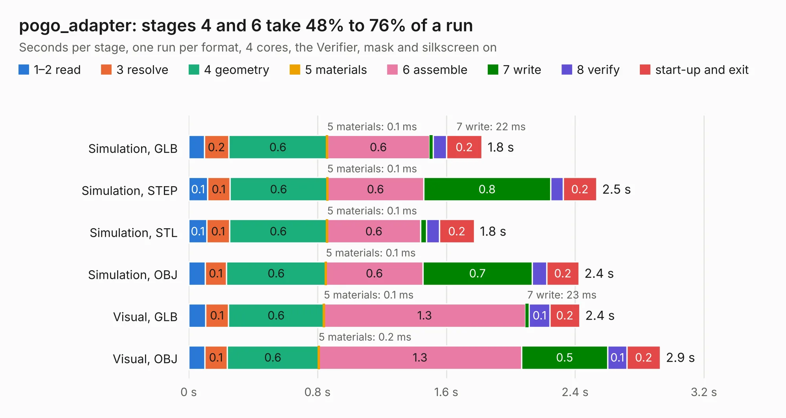

# 2823. pogo_adapter

Board 2,823 of the 3,129 of [Corpus Testing](../Corpus-Testing.md), on [Corpus Page 27](../CorpusTestingPages/Corpus-Testing-27.md#2823-pogo_adapter).

| Mode and format | 1–2 read | 3 resolve | 4 geometry | 5 materials | 6 assemble | 7 write | 8 verify | start-up and exit | Total |
|---|---:|---:|---:|---:|---:|---:|---:|---:|---:|
| Simulation, GLB | 97&nbsp;ms | 0.2 | 0.6 | 0.1&nbsp;ms | 0.6 | 22&nbsp;ms | 84&nbsp;ms | 0.2 | 1.8 |
| Simulation, STEP | 0.1 | 0.1 | 0.6 | 0.1&nbsp;ms | 0.6 | 0.8 | 79&nbsp;ms | 0.2 | 2.5 |
| Simulation, STL | 0.1 | 0.1 | 0.6 | 0.1&nbsp;ms | 0.6 | 36&nbsp;ms | 80&nbsp;ms | 0.2 | 1.8 |
| Simulation, OBJ | 0.1 | 0.1 | 0.6 | 0.1&nbsp;ms | 0.6 | 0.7 | 92&nbsp;ms | 0.2 | 2.4 |
| Visual, GLB | 0.1 | 0.1 | 0.6 | 0.1&nbsp;ms | 1.3 | 23&nbsp;ms | 0.1 | 0.2 | 2.4 |
| Visual, OBJ | 0.1 | 0.1 | 0.6 | 0.2&nbsp;ms | 1.3 | 0.5 | 0.1 | 0.2 | 2.9 |

<table align="center"><tr><td valign="top">

| Board | Repo: [tinyvision-ai-inc/upduino-jtag](https://github.com/tinyvision-ai-inc/upduino-jtag) Board: `pogo_adapter.kicad_pcb` |
|---|---|
| Folder | board / pogo_adapter |
| Complexity | 181&nbsp;/&nbsp;1000 (size&nbsp;111, features&nbsp;70) |
| KESE&nbsp;features | through vias, filled zones, stack-up, dielectric εr and tanδ, mask and silkscreen colours |
| Tested | 9th November 2026 |
| Copper&nbsp;layers | 2 |
| File&nbsp;format | KiCad 8 (20240108) |
| Parts,&nbsp;tracks,&nbsp;vias | 2, 55, 32 |
| Triangles,&nbsp;simulation | 139,780 in 20 parts |
| Verifier | PASS in all six runs |

</td><td valign="top">

<table>
<tr><th>File type</th><th>File size</th><th>Peak memory used</th></tr>
<tr><th colspan="3" align="left">Simulation</th></tr>
<tr><td>GLB</td><td align="right">4.8&nbsp;MB</td><td align="right">196&nbsp;MB</td></tr>
<tr><td>STEP</td><td align="right">19&nbsp;MB</td><td align="right">201&nbsp;MB</td></tr>
<tr><td>STL</td><td align="right">7.0&nbsp;MB</td><td align="right">191&nbsp;MB</td></tr>
<tr><td>OBJ</td><td align="right">14&nbsp;MB</td><td align="right">192&nbsp;MB</td></tr>
<tr><th colspan="3" align="left">Visual</th></tr>
<tr><td>GLB</td><td align="right">3.8&nbsp;MB</td><td align="right">160&nbsp;MB</td></tr>
<tr><td>OBJ</td><td align="right">11&nbsp;MB</td><td align="right">165&nbsp;MB</td></tr>
</table>

</td></tr></table>

| Previous | Next |
|:---|---:|
| [2822. pico2-nx-module](b2822b_pico2-nx_board-Rev2-nx-module_pico2-nx-module.md) | [2824. upduino-jtag](b2824b_upduino-jtag_upduino-jtag.md) |
