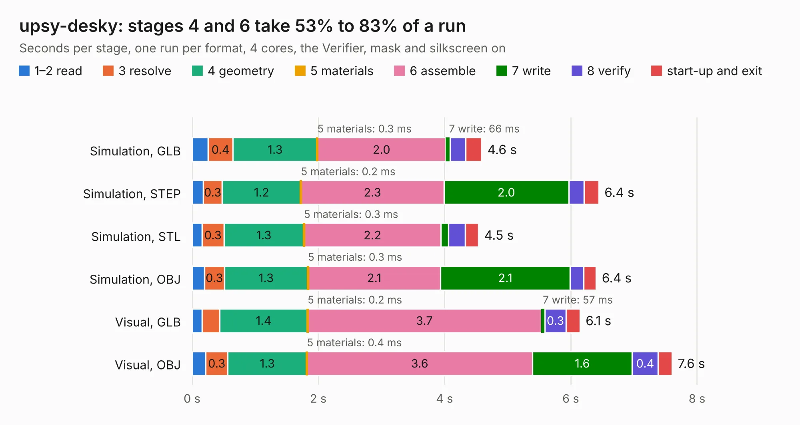

# 2824. upsy-desky

Board 2,824 of the 3,117 of [Corpus Testing](../Corpus-Testing.md), on [Corpus Page 27](../CorpusTestingPages/Corpus-Testing-27.md#2824-upsy-desky).

| Mode and format | 1–2 read | 3 resolve | 4 geometry | 5 materials | 6 assemble | 7 write | 8 verify | start-up and exit | Total |
|---|---:|---:|---:|---:|---:|---:|---:|---:|---:|
| Simulation, GLB | 0.3 | 0.4 | 1.3 | 0.3&nbsp;ms | 2.0 | 66&nbsp;ms | 0.2 | 0.3 | 4.6 |
| Simulation, STEP | 0.2 | 0.3 | 1.2 | 0.2&nbsp;ms | 2.3 | 2.0 | 0.2 | 0.2 | 6.4 |
| Simulation, STL | 0.2 | 0.3 | 1.3 | 0.3&nbsp;ms | 2.2 | 0.1 | 0.3 | 0.2 | 4.5 |
| Simulation, OBJ | 0.2 | 0.3 | 1.3 | 0.3&nbsp;ms | 2.1 | 2.1 | 0.2 | 0.2 | 6.4 |
| Visual, GLB | 0.2 | 0.3 | 1.4 | 0.2&nbsp;ms | 3.7 | 57&nbsp;ms | 0.3 | 0.2 | 6.1 |
| Visual, OBJ | 0.2 | 0.3 | 1.3 | 0.4&nbsp;ms | 3.6 | 1.6 | 0.4 | 0.2 | 7.6 |

<table align="center"><tr><td valign="top">

| Board | Repo: [tjhorner/upsy-desky](https://github.com/tjhorner/upsy-desky) Board: `upsy-desky.kicad_pcb` |
|---|---|
| Folder | pcb |
| Complexity | 286&nbsp;/&nbsp;1000 (size&nbsp;201, features&nbsp;85) |
| KESE&nbsp;features | through vias, slotted holes, rounded, trapezoid or chamfered pads, filled zones, stack-up, dielectric εr and tanδ |
| Tested | 9th November 2026 |
| Copper&nbsp;layers | 2 |
| File&nbsp;format | KiCad 8 (20240108) |
| Parts,&nbsp;tracks,&nbsp;vias | 44, 391, 48 |
| Triangles,&nbsp;simulation | 447,552 in 85 parts |
| Verifier | PASS in all six runs |

</td><td valign="top">

<table>
<tr><th>File type</th><th>File size</th><th>Peak memory used</th></tr>
<tr><th colspan="3" align="left">Simulation</th></tr>
<tr><td>GLB</td><td align="right">15&nbsp;MB</td><td align="right">326&nbsp;MB</td></tr>
<tr><td>STEP</td><td align="right">74&nbsp;MB</td><td align="right">351&nbsp;MB</td></tr>
<tr><td>STL</td><td align="right">22&nbsp;MB</td><td align="right">306&nbsp;MB</td></tr>
<tr><td>OBJ</td><td align="right">45&nbsp;MB</td><td align="right">365&nbsp;MB</td></tr>
<tr><th colspan="3" align="left">Visual</th></tr>
<tr><td>GLB</td><td align="right">12&nbsp;MB</td><td align="right">389&nbsp;MB</td></tr>
<tr><td>OBJ</td><td align="right">35&nbsp;MB</td><td align="right">390&nbsp;MB</td></tr>
</table>

</td></tr></table>

| Previous | Next |
|:---|---:|
| [2823. Speeduino_base](b2823b_spectre_SPECTRE-V0-5_Speeduino-base.md) | [2825. CM4IOv5](b2825b_rpi-cm4-switch-board_CM4IOv5.md) |
