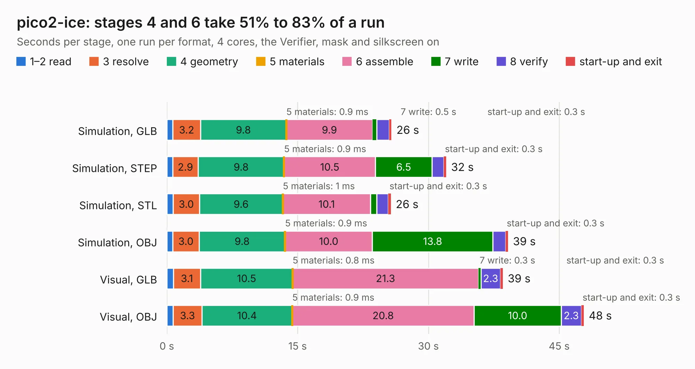

# 2825 pico2-ice

Board 2,825 of the 3,138 of [Corpus Testing](../Corpus-Testing.md), on [Corpus Page 27](../CorpusTestingPages/Corpus-Testing-27.md#2825-pico2-ice).

| Mode and format | 1–2 read | 3 resolve | 4 geometry | 5 materials | 6 assemble | 7 write | 8 verify | start-up and exit | Total |
|---|---:|---:|---:|---:|---:|---:|---:|---:|---:|
| Simulation, GLB | 0.7 | 3.2 | 9.8 | 0.9&nbsp;ms | 9.9 | 0.5 | 1.5 | 0.3 | 25.8 |
| Simulation, STEP | 0.7 | 2.9 | 9.8 | 0.9&nbsp;ms | 10.5 | 6.5 | 1.4 | 0.3 | 32.0 |
| Simulation, STL | 0.7 | 3.0 | 9.6 | 1&nbsp;ms | 10.1 | 0.7 | 1.3 | 0.3 | 25.7 |
| Simulation, OBJ | 0.7 | 3.0 | 9.8 | 0.9&nbsp;ms | 10.0 | 13.8 | 1.4 | 0.3 | 39.1 |
| Visual, GLB | 0.7 | 3.1 | 10.5 | 0.8&nbsp;ms | 21.3 | 0.3 | 2.3 | 0.3 | 38.5 |
| Visual, OBJ | 0.7 | 3.3 | 10.4 | 0.9&nbsp;ms | 20.8 | 10.0 | 2.3 | 0.3 | 47.8 |

<table align="center"><tr><td valign="top">

| Board | Repo: [tinyvision-ai-inc/pico2-ice](https://github.com/tinyvision-ai-inc/pico2-ice) Board: `pico2-ice.kicad_pcb` |
|---|---|
| Folder | Board / Rev0 |
| Complexity | 381&nbsp;/&nbsp;1000 (size&nbsp;261, features&nbsp;120) |
| KESE&nbsp;features | through vias, slotted holes, custom pads, rounded, trapezoid or chamfered pads, filled zones, copper drawings, curved board outline, stack-up, dielectric εr and tanδ |
| Tested | 9th November 2026 to 10th November 2026 |
| Copper&nbsp;layers | 4 |
| File&nbsp;format | KiCad 8 (20240108) |
| Parts,&nbsp;tracks,&nbsp;vias | 108, 2,040, 262 |
| Triangles,&nbsp;simulation | 2,664,998 in 141 parts |
| Verifier | PASS in all six runs |
| Run&nbsp;again | Simulation, GLB; Simulation, STEP; Simulation, STL; Simulation, OBJ: failed in the corpus run, run again with fixes to KESE made after the corpus run, and passed |

</td><td valign="top">

<table>
<tr><th>File type</th><th>File size</th><th>Peak memory used</th></tr>
<tr><th colspan="3" align="left">Simulation</th></tr>
<tr><td>GLB</td><td align="right">92&nbsp;MB</td><td align="right">1.0&nbsp;GB</td></tr>
<tr><td>STEP</td><td align="right">451&nbsp;MB</td><td align="right">1.0&nbsp;GB</td></tr>
<tr><td>STL</td><td align="right">133&nbsp;MB</td><td align="right">988&nbsp;MB</td></tr>
<tr><td>OBJ</td><td align="right">290&nbsp;MB</td><td align="right">1.8&nbsp;GB</td></tr>
<tr><th colspan="3" align="left">Visual</th></tr>
<tr><td>GLB</td><td align="right">58&nbsp;MB</td><td align="right">1.1&nbsp;GB</td></tr>
<tr><td>OBJ</td><td align="right">183&nbsp;MB</td><td align="right">1.3&nbsp;GB</td></tr>
</table>

</td></tr></table>

| Previous | Next |
|:---|---:|
| [2824 pico-ice](b2824b_pico-ice_Board-Rev3_pico-ice.md) | [2826 pico2-ice](b2826b_pico2-ice_Board-Rev1_pico2-ice.md) |
