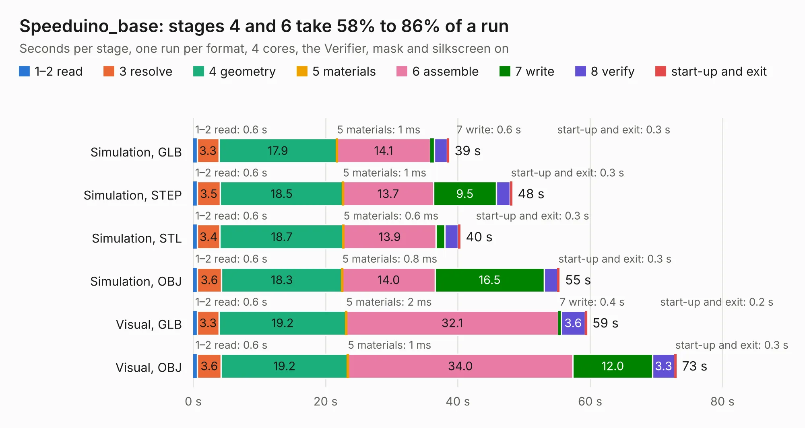

# 2826. Speeduino_base

Board 2,826 of the 3,121 of [Corpus Testing](../Corpus-Testing.md), on [Corpus Page 27](../CorpusTestingPages/Corpus-Testing-27.md#2826-speeduino_base).

| Mode and format | 1–2 read | 3 resolve | 4 geometry | 5 materials | 6 assemble | 7 write | 8 verify | start-up and exit | Total |
|---|---:|---:|---:|---:|---:|---:|---:|---:|---:|
| Simulation, GLB | 0.6 | 3.3 | 17.9 | 1&nbsp;ms | 14.1 | 0.6 | 1.9 | 0.3 | 38.6 |
| Simulation, STEP | 0.6 | 3.5 | 18.5 | 1&nbsp;ms | 13.7 | 9.5 | 2.1 | 0.3 | 48.2 |
| Simulation, STL | 0.6 | 3.4 | 18.7 | 0.6&nbsp;ms | 13.9 | 1.3 | 2.0 | 0.3 | 40.3 |
| Simulation, OBJ | 0.6 | 3.6 | 18.3 | 0.8&nbsp;ms | 14.0 | 16.5 | 2.0 | 0.3 | 55.3 |
| Visual, GLB | 0.6 | 3.3 | 19.2 | 2&nbsp;ms | 32.1 | 0.4 | 3.6 | 0.2 | 59.5 |
| Visual, OBJ | 0.6 | 3.6 | 19.2 | 1&nbsp;ms | 34.0 | 12.0 | 3.3 | 0.3 | 73.0 |

<table align="center"><tr><td valign="top">

| Board | Repo: [tjeerdie/spectre](https://github.com/tjeerdie/spectre) Board: `Speeduino_base.kicad_pcb` |
|---|---|
| Folder | SPECTRE_V0.5.4 |
| Complexity | 262&nbsp;/&nbsp;1000 (size&nbsp;207, features&nbsp;55) |
| KESE&nbsp;features | through vias, rounded, trapezoid or chamfered pads, filled zones, curved board outline |
| Tested | 9th November 2026 |
| Copper&nbsp;layers | 2 |
| File&nbsp;format | KiCad 5 (20171130) |
| Parts,&nbsp;tracks,&nbsp;vias | 197, 1,996, 420 |
| Triangles,&nbsp;simulation | 3,873,032 in 281 parts |
| Verifier | PASS in all six runs |

</td><td valign="top">

<table>
<tr><th>File type</th><th>File size</th><th>Peak memory used</th></tr>
<tr><th colspan="3" align="left">Simulation</th></tr>
<tr><td>GLB</td><td align="right">133&nbsp;MB</td><td align="right">1.3&nbsp;GB</td></tr>
<tr><td>STEP</td><td align="right">709&nbsp;MB</td><td align="right">1.6&nbsp;GB</td></tr>
<tr><td>STL</td><td align="right">194&nbsp;MB</td><td align="right">1.3&nbsp;GB</td></tr>
<tr><td>OBJ</td><td align="right">415&nbsp;MB</td><td align="right">2.5&nbsp;GB</td></tr>
<tr><th colspan="3" align="left">Visual</th></tr>
<tr><td>GLB</td><td align="right">98&nbsp;MB</td><td align="right">1.8&nbsp;GB</td></tr>
<tr><td>OBJ</td><td align="right">306&nbsp;MB</td><td align="right">2.1&nbsp;GB</td></tr>
</table>

</td></tr></table>

| Previous | Next |
|:---|---:|
| [2825. Speeduino_base](b2825b_spectre_SPECTRE-V0-5-3_Speeduino-base.md) | [2827. Speeduino_base](b2827b_spectre_SPECTRE-V0-5_Speeduino-base.md) |
