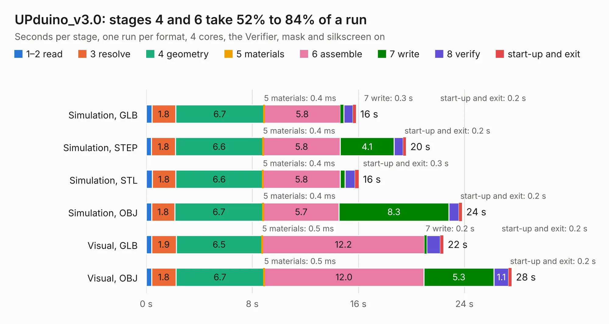

# 2826. UPduino_v3.0

Board 2,826 of the 3,130 of [Corpus Testing](../Corpus-Testing.md), on [Corpus Page 27](../CorpusTestingPages/Corpus-Testing-27.md#2826-upduino_v30).

| Mode and format | 1–2 read | 3 resolve | 4 geometry | 5 materials | 6 assemble | 7 write | 8 verify | start-up and exit | Total |
|---|---:|---:|---:|---:|---:|---:|---:|---:|---:|
| Simulation, GLB | 0.4 | 1.8 | 6.7 | 0.4&nbsp;ms | 5.8 | 0.3 | 0.7 | 0.2 | 15.8 |
| Simulation, STEP | 0.4 | 1.8 | 6.6 | 0.4&nbsp;ms | 5.8 | 4.1 | 0.7 | 0.2 | 19.6 |
| Simulation, STL | 0.4 | 1.8 | 6.6 | 0.4&nbsp;ms | 5.8 | 0.4 | 0.7 | 0.3 | 16.0 |
| Simulation, OBJ | 0.4 | 1.8 | 6.7 | 0.4&nbsp;ms | 5.7 | 8.3 | 0.8 | 0.2 | 23.8 |
| Visual, GLB | 0.4 | 1.9 | 6.5 | 0.5&nbsp;ms | 12.2 | 0.2 | 1.0 | 0.2 | 22.4 |
| Visual, OBJ | 0.4 | 1.8 | 6.7 | 0.5&nbsp;ms | 12.0 | 5.3 | 1.1 | 0.2 | 27.6 |

<table align="center"><tr><td valign="top">

| Board | Repo: [tinyvision-ai-inc/upduino-v3.0](https://github.com/tinyvision-ai-inc/upduino-v3.0) Board: `UPduino_v3.0.kicad_pcb` |
|---|---|
| Folder | Board / v1.0 |
| Complexity | 344&nbsp;/&nbsp;1000 (size&nbsp;254, features&nbsp;90) |
| KESE&nbsp;features | through vias, slotted holes, custom pads, rounded, trapezoid or chamfered pads, filled zones, copper drawings, curved board outline |
| Tested | 9th November 2026 |
| Copper&nbsp;layers | 4 |
| File&nbsp;format | KiCad 5 (20171130) |
| Parts,&nbsp;tracks,&nbsp;vias | 85, 1,713, 127 |
| Triangles,&nbsp;simulation | 1,650,130 in 109 parts |
| Verifier | PASS in all six runs |

</td><td valign="top">

<table>
<tr><th>File type</th><th>File size</th><th>Peak memory used</th></tr>
<tr><th colspan="3" align="left">Simulation</th></tr>
<tr><td>GLB</td><td align="right">58&nbsp;MB</td><td align="right">588&nbsp;MB</td></tr>
<tr><td>STEP</td><td align="right">277&nbsp;MB</td><td align="right">707&nbsp;MB</td></tr>
<tr><td>STL</td><td align="right">83&nbsp;MB</td><td align="right">569&nbsp;MB</td></tr>
<tr><td>OBJ</td><td align="right">174&nbsp;MB</td><td align="right">1.1&nbsp;GB</td></tr>
<tr><th colspan="3" align="left">Visual</th></tr>
<tr><td>GLB</td><td align="right">36&nbsp;MB</td><td align="right">714&nbsp;MB</td></tr>
<tr><td>OBJ</td><td align="right">107&nbsp;MB</td><td align="right">794&nbsp;MB</td></tr>
</table>

</td></tr></table>

| Previous | Next |
|:---|---:|
| [2825. upduino-jtag](b2825b_upduino-jtag_upduino-jtag.md) | [2827. UPduino_v3.0](b2827b_upduino-v3-0_Board-v2-0_UPduino-v3-0.md) |
