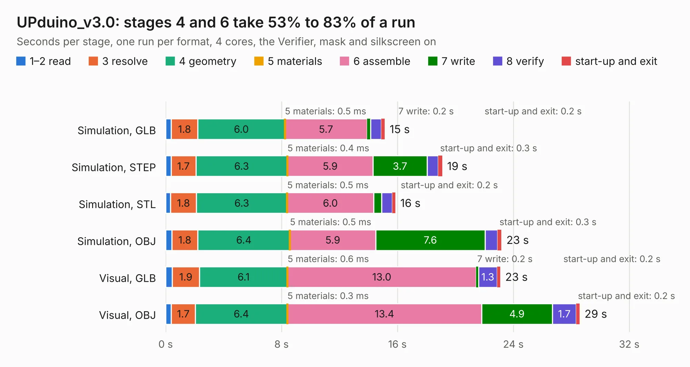

# 2829. UPduino_v3.0

Board 2,829 of the 3,131 of [Corpus Testing](../Corpus-Testing.md), on [Corpus Page 27](../CorpusTestingPages/Corpus-Testing-27.md#2829-upduino_v30).

| Mode and format | 1–2 read | 3 resolve | 4 geometry | 5 materials | 6 assemble | 7 write | 8 verify | start-up and exit | Total |
|---|---:|---:|---:|---:|---:|---:|---:|---:|---:|
| Simulation, GLB | 0.4 | 1.8 | 6.0 | 0.5&nbsp;ms | 5.7 | 0.2 | 0.7 | 0.2 | 15.1 |
| Simulation, STEP | 0.4 | 1.7 | 6.3 | 0.4&nbsp;ms | 5.9 | 3.7 | 0.8 | 0.3 | 19.1 |
| Simulation, STL | 0.3 | 1.8 | 6.3 | 0.5&nbsp;ms | 6.0 | 0.6 | 0.7 | 0.2 | 15.9 |
| Simulation, OBJ | 0.4 | 1.8 | 6.4 | 0.5&nbsp;ms | 5.9 | 7.6 | 0.9 | 0.3 | 23.2 |
| Visual, GLB | 0.4 | 1.9 | 6.1 | 0.6&nbsp;ms | 13.0 | 0.2 | 1.3 | 0.2 | 23.1 |
| Visual, OBJ | 0.4 | 1.7 | 6.4 | 0.3&nbsp;ms | 13.4 | 4.9 | 1.7 | 0.2 | 28.6 |

<table align="center"><tr><td valign="top">

| Board | Repo: [tinyvision-ai-inc/upduino-v3.0](https://github.com/tinyvision-ai-inc/upduino-v3.0) Board: `UPduino_v3.0.kicad_pcb` |
|---|---|
| Folder | Board / v3.0 |
| Complexity | 342&nbsp;/&nbsp;1000 (size&nbsp;252, features&nbsp;90) |
| KESE&nbsp;features | through vias, slotted holes, custom pads, rounded, trapezoid or chamfered pads, filled zones, copper drawings, curved board outline |
| Tested | 9th November 2026 |
| Copper&nbsp;layers | 4 |
| File&nbsp;format | KiCad 5 (20171130) |
| Parts,&nbsp;tracks,&nbsp;vias | 83, 1,585, 123 |
| Triangles,&nbsp;simulation | 1,629,942 in 105 parts |
| Verifier | PASS in all six runs |

</td><td valign="top">

<table>
<tr><th>File type</th><th>File size</th><th>Peak memory used</th></tr>
<tr><th colspan="3" align="left">Simulation</th></tr>
<tr><td>GLB</td><td align="right">57&nbsp;MB</td><td align="right">597&nbsp;MB</td></tr>
<tr><td>STEP</td><td align="right">272&nbsp;MB</td><td align="right">690&nbsp;MB</td></tr>
<tr><td>STL</td><td align="right">82&nbsp;MB</td><td align="right">597&nbsp;MB</td></tr>
<tr><td>OBJ</td><td align="right">172&nbsp;MB</td><td align="right">1.1&nbsp;GB</td></tr>
<tr><th colspan="3" align="left">Visual</th></tr>
<tr><td>GLB</td><td align="right">35&nbsp;MB</td><td align="right">770&nbsp;MB</td></tr>
<tr><td>OBJ</td><td align="right">106&nbsp;MB</td><td align="right">811&nbsp;MB</td></tr>
</table>

</td></tr></table>

| Previous | Next |
|:---|---:|
| [2828. UPduino_v3.0](b2828b_upduino-v3-0_Board-v2-0_UPduino-v3-0.md) | [2830. UPduino_v3.01](b2830b_upduino-v3-0_UPduino-v3-01.md) |
