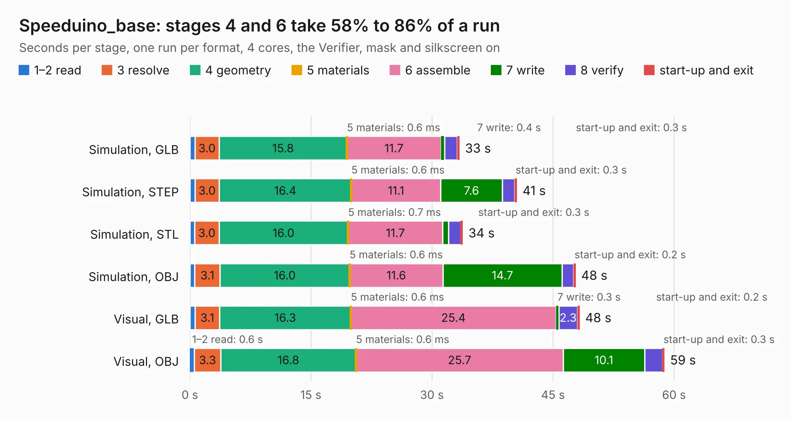

# 2832. Speeduino_base

Board 2,832 of the 3,132 of [Corpus Testing](../Corpus-Testing.md), on [Corpus Page 27](../CorpusTestingPages/Corpus-Testing-27.md#2832-speeduino_base).

| Mode and format | 1–2 read | 3 resolve | 4 geometry | 5 materials | 6 assemble | 7 write | 8 verify | start-up and exit | Total |
|---|---:|---:|---:|---:|---:|---:|---:|---:|---:|
| Simulation, GLB | 0.6 | 3.0 | 15.8 | 0.6&nbsp;ms | 11.7 | 0.4 | 1.6 | 0.3 | 33.4 |
| Simulation, STEP | 0.6 | 3.0 | 16.4 | 0.6&nbsp;ms | 11.1 | 7.6 | 1.5 | 0.3 | 40.5 |
| Simulation, STL | 0.6 | 3.0 | 16.0 | 0.7&nbsp;ms | 11.7 | 0.7 | 1.5 | 0.3 | 33.8 |
| Simulation, OBJ | 0.6 | 3.1 | 16.0 | 0.6&nbsp;ms | 11.6 | 14.7 | 1.4 | 0.2 | 47.8 |
| Visual, GLB | 0.6 | 3.1 | 16.3 | 0.6&nbsp;ms | 25.4 | 0.3 | 2.3 | 0.2 | 48.3 |
| Visual, OBJ | 0.6 | 3.3 | 16.8 | 0.6&nbsp;ms | 25.7 | 10.1 | 2.2 | 0.3 | 58.8 |

<table align="center"><tr><td valign="top">

| Board | Repo: [tjeerdie/spectre](https://github.com/tjeerdie/spectre) Board: `Speeduino_base.kicad_pcb` |
|---|---|
| Folder | SPECTRE_V0.3 |
| Complexity | 249&nbsp;/&nbsp;1000 (size&nbsp;204, features&nbsp;45) |
| KESE&nbsp;features | through vias, rounded, trapezoid or chamfered pads, filled zones |
| Tested | 9th November 2026 |
| Copper&nbsp;layers | 2 |
| File&nbsp;format | KiCad 5 (20171130) |
| Parts,&nbsp;tracks,&nbsp;vias | 161, 2,568, 227 |
| Triangles,&nbsp;simulation | 2,573,754 in 189 parts |
| Verifier | PASS in all six runs |

</td><td valign="top">

<table>
<tr><th>File type</th><th>File size</th><th>Peak memory used</th></tr>
<tr><th colspan="3" align="left">Simulation</th></tr>
<tr><td>GLB</td><td align="right">89&nbsp;MB</td><td align="right">824&nbsp;MB</td></tr>
<tr><td>STEP</td><td align="right">483&nbsp;MB</td><td align="right">1.1&nbsp;GB</td></tr>
<tr><td>STL</td><td align="right">129&nbsp;MB</td><td align="right">810&nbsp;MB</td></tr>
<tr><td>OBJ</td><td align="right">274&nbsp;MB</td><td align="right">1.7&nbsp;GB</td></tr>
<tr><th colspan="3" align="left">Visual</th></tr>
<tr><td>GLB</td><td align="right">64&nbsp;MB</td><td align="right">1.2&nbsp;GB</td></tr>
<tr><td>OBJ</td><td align="right">199&nbsp;MB</td><td align="right">1.3&nbsp;GB</td></tr>
</table>

</td></tr></table>

| Previous | Next |
|:---|---:|
| [2831. UPduino_v3.01](b2831b_upduino-v3-0_UPduino-v3-01.md) | [2833. Speeduino_base](b2833b_spectre_SPECTRE-V0-4_Speeduino-base.md) |
