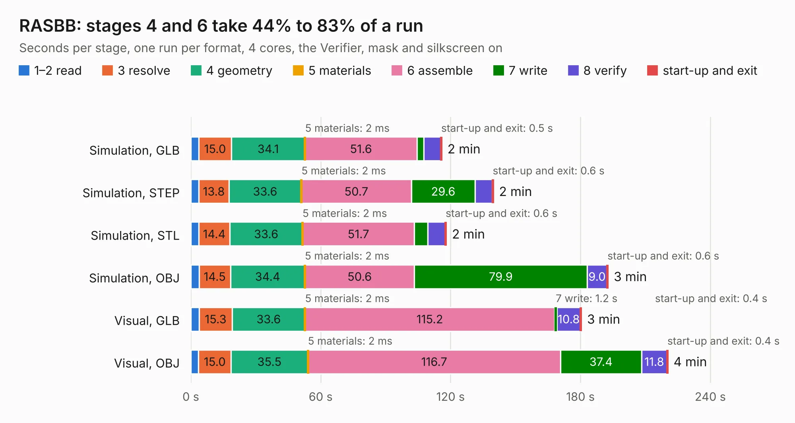

# 2833. RASBB

Board 2,833 of the 3,107 of [Corpus Testing](../Corpus-Testing.md), on [Corpus Page 27](../CorpusTestingPages/Corpus-Testing-27.md#2833-rasbb).

| Mode and format | 1–2 read | 3 resolve | 4 geometry | 5 materials | 6 assemble | 7 write | 8 verify | start-up and exit | Total |
|---|---:|---:|---:|---:|---:|---:|---:|---:|---:|
| Simulation, GLB | 3.7 | 15.0 | 34.1 | 2&nbsp;ms | 51.6 | 3.2 | 7.8 | 0.5 | 115.9 |
| Simulation, STEP | 3.7 | 13.8 | 33.6 | 2&nbsp;ms | 50.7 | 29.6 | 7.8 | 0.6 | 139.8 |
| Simulation, STL | 3.6 | 14.4 | 33.6 | 2&nbsp;ms | 51.7 | 6.2 | 8.0 | 0.6 | 118.0 |
| Simulation, OBJ | 3.8 | 14.5 | 34.4 | 2&nbsp;ms | 50.6 | 79.9 | 9.0 | 0.6 | 192.8 |
| Visual, GLB | 3.8 | 15.3 | 33.6 | 2&nbsp;ms | 115.2 | 1.2 | 10.8 | 0.4 | 180.4 |
| Visual, OBJ | 3.6 | 15.0 | 35.5 | 2&nbsp;ms | 116.7 | 37.4 | 11.8 | 0.4 | 220.4 |

<table align="center"><tr><td valign="top">

| Board | Repo: [tobias-dg3yev/ra-sentinel](https://github.com/tobias-dg3yev/ra-sentinel) Board: `RASBB.kicad_pcb` |
|---|---|
| Folder | RASBB / Hardware / Rev.A / Design |
| Complexity | 481&nbsp;/&nbsp;1000 (size&nbsp;346, features&nbsp;135) |
| KESE&nbsp;features | through vias, slotted holes, custom pads, rounded, trapezoid or chamfered pads, arc tracks, filled zones, copper drawings, copper text, stack-up, dielectric εr and tanδ |
| Tested | 9th November 2026 |
| Copper&nbsp;layers | 8 |
| File&nbsp;format | KiCad 10 (20260206) |
| Parts,&nbsp;tracks,&nbsp;vias | 580, 11,520, 1,908 |
| Triangles,&nbsp;simulation | 16,234,920 in 757 parts |
| Verifier | PASS in all six runs |

</td><td valign="top">

<table>
<tr><th>File type</th><th>File size</th><th>Peak memory used</th></tr>
<tr><th colspan="3" align="left">Simulation</th></tr>
<tr><td>GLB</td><td align="right">539&nbsp;MB</td><td align="right">3.6&nbsp;GB</td></tr>
<tr><td>STEP</td><td align="right">1.7&nbsp;GB</td><td align="right">5.0&nbsp;GB</td></tr>
<tr><td>STL</td><td align="right">812&nbsp;MB</td><td align="right">3.6&nbsp;GB</td></tr>
<tr><td>OBJ</td><td align="right">1.8&nbsp;GB</td><td align="right">10&nbsp;GB</td></tr>
<tr><th colspan="3" align="left">Visual</th></tr>
<tr><td>GLB</td><td align="right">256&nbsp;MB</td><td align="right">4.4&nbsp;GB</td></tr>
<tr><td>OBJ</td><td align="right">860&nbsp;MB</td><td align="right">5.6&nbsp;GB</td></tr>
</table>

</td></tr></table>

| Previous | Next |
|:---|---:|
| [2832. RASANT2400](b2832b_ra-sentinel_RASANT2400.md) | [2834. RASBB](b2834b_ra-sentinel_RASBB-Hardware-Rev-B-Design_RASBB.md) |
