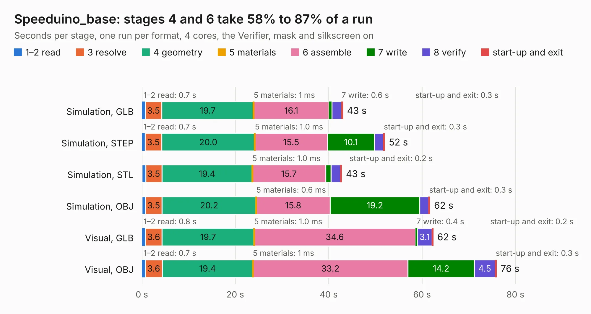

# 2834. Speeduino_base

Board 2,834 of the 3,132 of [Corpus Testing](../Corpus-Testing.md), on [Corpus Page 27](../CorpusTestingPages/Corpus-Testing-27.md#2834-speeduino_base).

| Mode and format | 1–2 read | 3 resolve | 4 geometry | 5 materials | 6 assemble | 7 write | 8 verify | start-up and exit | Total |
|---|---:|---:|---:|---:|---:|---:|---:|---:|---:|
| Simulation, GLB | 0.7 | 3.5 | 19.7 | 1&nbsp;ms | 16.1 | 0.6 | 2.1 | 0.3 | 43.0 |
| Simulation, STEP | 0.7 | 3.5 | 20.0 | 1.0&nbsp;ms | 15.5 | 10.1 | 1.9 | 0.3 | 52.0 |
| Simulation, STL | 0.8 | 3.5 | 19.4 | 1.0&nbsp;ms | 15.7 | 1.1 | 2.1 | 0.2 | 42.8 |
| Simulation, OBJ | 0.8 | 3.5 | 20.2 | 0.6&nbsp;ms | 15.8 | 19.2 | 1.9 | 0.3 | 61.7 |
| Visual, GLB | 0.8 | 3.6 | 19.7 | 1.0&nbsp;ms | 34.6 | 0.4 | 3.1 | 0.2 | 62.4 |
| Visual, OBJ | 0.7 | 3.6 | 19.4 | 1&nbsp;ms | 33.2 | 14.2 | 4.5 | 0.3 | 75.9 |

<table align="center"><tr><td valign="top">

| Board | Repo: [tjeerdie/spectre](https://github.com/tjeerdie/spectre) Board: `Speeduino_base.kicad_pcb` |
|---|---|
| Folder | SPECTRE_V0.5.1 |
| Complexity | 264&nbsp;/&nbsp;1000 (size&nbsp;209, features&nbsp;55) |
| KESE&nbsp;features | through vias, rounded, trapezoid or chamfered pads, filled zones, curved board outline |
| Tested | 10th November 2026 |
| Copper&nbsp;layers | 2 |
| File&nbsp;format | KiCad 5 (20171130) |
| Parts,&nbsp;tracks,&nbsp;vias | 204, 2,483, 368 |
| Triangles,&nbsp;simulation | 3,634,522 in 217 parts |
| Verifier | PASS in all six runs |

</td><td valign="top">

<table>
<tr><th>File type</th><th>File size</th><th>Peak memory used</th></tr>
<tr><th colspan="3" align="left">Simulation</th></tr>
<tr><td>GLB</td><td align="right">126&nbsp;MB</td><td align="right">1.1&nbsp;GB</td></tr>
<tr><td>STEP</td><td align="right">687&nbsp;MB</td><td align="right">1.6&nbsp;GB</td></tr>
<tr><td>STL</td><td align="right">182&nbsp;MB</td><td align="right">1.1&nbsp;GB</td></tr>
<tr><td>OBJ</td><td align="right">388&nbsp;MB</td><td align="right">2.4&nbsp;GB</td></tr>
<tr><th colspan="3" align="left">Visual</th></tr>
<tr><td>GLB</td><td align="right">94&nbsp;MB</td><td align="right">1.6&nbsp;GB</td></tr>
<tr><td>OBJ</td><td align="right">295&nbsp;MB</td><td align="right">1.9&nbsp;GB</td></tr>
</table>

</td></tr></table>

| Previous | Next |
|:---|---:|
| [2833. Speeduino_base](b2833b_spectre_SPECTRE-V0-4_Speeduino-base.md) | [2835. Speeduino_base](b2835b_spectre_SPECTRE-V0-5-2_Speeduino-base.md) |
