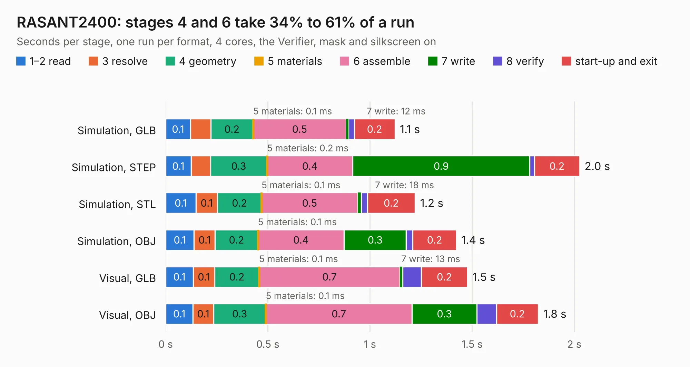

# 2835. RASANT2400

Board 2,835 of the 3,110 of [Corpus Testing](../Corpus-Testing.md), on [Corpus Page 27](../CorpusTestingPages/Corpus-Testing-27.md#2835-rasant2400).

| Mode and format | 1–2 read | 3 resolve | 4 geometry | 5 materials | 6 assemble | 7 write | 8 verify | start-up and exit | Total |
|---|---:|---:|---:|---:|---:|---:|---:|---:|---:|
| Simulation, GLB | 0.1 | 99&nbsp;ms | 0.2 | 0.1&nbsp;ms | 0.5 | 12&nbsp;ms | 28&nbsp;ms | 0.2 | 1.1 |
| Simulation, STEP | 0.1 | 95&nbsp;ms | 0.3 | 0.2&nbsp;ms | 0.4 | 0.9 | 23&nbsp;ms | 0.2 | 2.0 |
| Simulation, STL | 0.1 | 0.1 | 0.2 | 0.1&nbsp;ms | 0.5 | 18&nbsp;ms | 29&nbsp;ms | 0.2 | 1.2 |
| Simulation, OBJ | 0.1 | 0.1 | 0.2 | 0.1&nbsp;ms | 0.4 | 0.3 | 32&nbsp;ms | 0.2 | 1.4 |
| Visual, GLB | 0.1 | 0.1 | 0.2 | 0.1&nbsp;ms | 0.7 | 13&nbsp;ms | 91&nbsp;ms | 0.2 | 1.5 |
| Visual, OBJ | 0.1 | 0.1 | 0.3 | 0.1&nbsp;ms | 0.7 | 0.3 | 96&nbsp;ms | 0.2 | 1.8 |

<table align="center"><tr><td valign="top">

| Board | Repo: [tobias-dg3yev/ra-sentinel](https://github.com/tobias-dg3yev/ra-sentinel) Board: `RASANT2400.kicad_pcb` |
|---|---|
| Folder | RASANT2400 / Hardware / KiCad |
| Complexity | 131&nbsp;/&nbsp;1000 (size&nbsp;91, features&nbsp;40) |
| KESE&nbsp;features | through vias, arc tracks, copper drawings |
| Tested | 9th November 2026 |
| Copper&nbsp;layers | 2 |
| File&nbsp;format | KiCad 10 (20260206) |
| Parts,&nbsp;tracks,&nbsp;vias | 0, 20, 24 |
| Triangles,&nbsp;simulation | 70,964 in 11 parts |
| Note | no components |
| Verifier | PASS in all six runs |

</td><td valign="top">

<table>
<tr><th>File type</th><th>File size</th><th>Peak memory used</th></tr>
<tr><th colspan="3" align="left">Simulation</th></tr>
<tr><td>GLB</td><td align="right">2.6&nbsp;MB</td><td align="right">87&nbsp;MB</td></tr>
<tr><td>STEP</td><td align="right">5.9&nbsp;MB</td><td align="right">200&nbsp;MB</td></tr>
<tr><td>STL</td><td align="right">3.5&nbsp;MB</td><td align="right">88&nbsp;MB</td></tr>
<tr><td>OBJ</td><td align="right">7.0&nbsp;MB</td><td align="right">114&nbsp;MB</td></tr>
<tr><th colspan="3" align="left">Visual</th></tr>
<tr><td>GLB</td><td align="right">2.3&nbsp;MB</td><td align="right">125&nbsp;MB</td></tr>
<tr><td>OBJ</td><td align="right">6.4&nbsp;MB</td><td align="right">125&nbsp;MB</td></tr>
</table>

</td></tr></table>

| Previous | Next |
|:---|---:|
| [2834. gate_xor_2in](b2834b_alu_gate-xor-2in.md) | [2836. RASBB](b2836b_ra-sentinel_RASBB-Hardware-Rev-A-Design_RASBB.md) |
