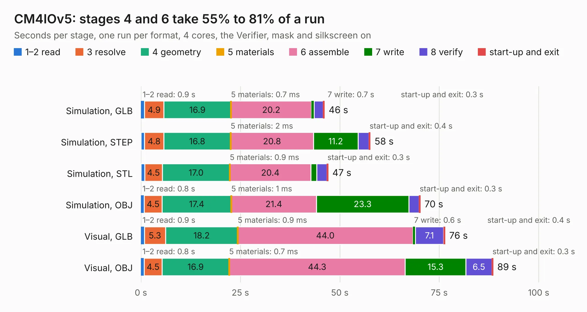

# 2836. CM4IOv5

Board 2,836 of the 3,128 of [Corpus Testing](../Corpus-Testing.md), on [Corpus Page 27](../CorpusTestingPages/Corpus-Testing-27.md#2836-cm4iov5).

| Mode and format | 1–2 read | 3 resolve | 4 geometry | 5 materials | 6 assemble | 7 write | 8 verify | start-up and exit | Total |
|---|---:|---:|---:|---:|---:|---:|---:|---:|---:|
| Simulation, GLB | 0.9 | 4.9 | 16.9 | 0.7&nbsp;ms | 20.2 | 0.7 | 2.3 | 0.3 | 46.1 |
| Simulation, STEP | 0.9 | 4.8 | 16.8 | 2&nbsp;ms | 20.8 | 11.2 | 2.7 | 0.4 | 57.7 |
| Simulation, STL | 0.9 | 4.5 | 17.0 | 0.9&nbsp;ms | 20.4 | 1.5 | 2.6 | 0.3 | 47.1 |
| Simulation, OBJ | 0.8 | 4.5 | 17.4 | 1&nbsp;ms | 21.4 | 23.3 | 2.6 | 0.3 | 70.2 |
| Visual, GLB | 0.9 | 5.3 | 18.2 | 0.9&nbsp;ms | 44.0 | 0.6 | 7.1 | 0.4 | 76.5 |
| Visual, OBJ | 0.8 | 4.5 | 16.9 | 0.7&nbsp;ms | 44.3 | 15.3 | 6.5 | 0.3 | 88.5 |

<table align="center"><tr><td valign="top">

| Board | Repo: [tlalexander/rpi-cm4-switch-board](https://github.com/tlalexander/rpi-cm4-switch-board) Board: `CM4IOv5.kicad_pcb` |
|---|---|
| Folder | CM4IO |
| Complexity | 409&nbsp;/&nbsp;1000 (size&nbsp;274, features&nbsp;135) |
| KESE&nbsp;features | through vias, slotted holes, custom pads, rounded, trapezoid or chamfered pads, filled zones, copper drawings, copper text, curved board outline, stack-up, dielectric εr and tanδ, mask and silkscreen colours |
| Tested | 9th November 2026 |
| Copper&nbsp;layers | 4 |
| File&nbsp;format | KiCad 6 (20201002) |
| Parts,&nbsp;tracks,&nbsp;vias | 137, 5,669, 782 |
| Triangles,&nbsp;simulation | 4,961,408 in 261 parts |
| Verifier | PASS in all six runs |

</td><td valign="top">

<table>
<tr><th>File type</th><th>File size</th><th>Peak memory used</th></tr>
<tr><th colspan="3" align="left">Simulation</th></tr>
<tr><td>GLB</td><td align="right">166&nbsp;MB</td><td align="right">1.4&nbsp;GB</td></tr>
<tr><td>STEP</td><td align="right">690&nbsp;MB</td><td align="right">2.0&nbsp;GB</td></tr>
<tr><td>STL</td><td align="right">248&nbsp;MB</td><td align="right">1.4&nbsp;GB</td></tr>
<tr><td>OBJ</td><td align="right">523&nbsp;MB</td><td align="right">3.2&nbsp;GB</td></tr>
<tr><th colspan="3" align="left">Visual</th></tr>
<tr><td>GLB</td><td align="right">116&nbsp;MB</td><td align="right">1.9&nbsp;GB</td></tr>
<tr><td>OBJ</td><td align="right">368&nbsp;MB</td><td align="right">2.4&nbsp;GB</td></tr>
</table>

</td></tr></table>

| Previous | Next |
|:---|---:|
| [2835. upsy-desky](b2835b_upsy-desky_upsy-desky.md) | [2837. rpi-cm4-switch-board](b2837b_rpi-cm4-switch-board_rpi-cm4-switch-board.md) |
