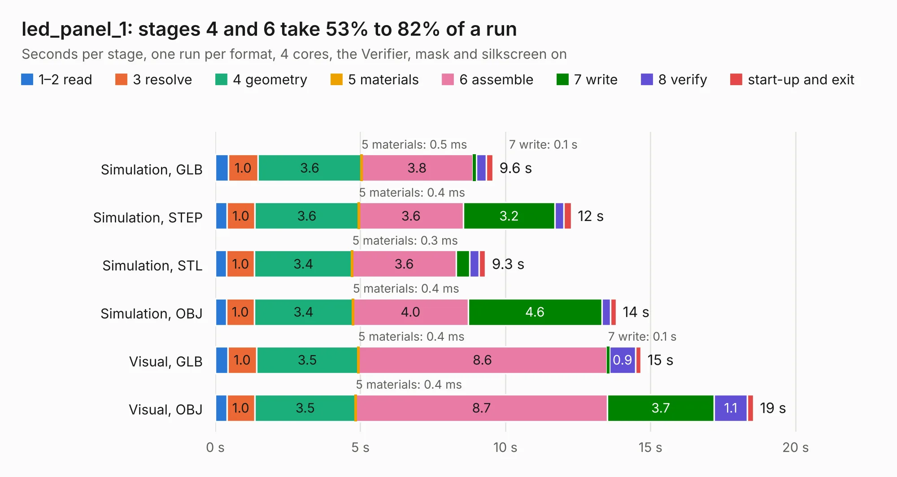

# 2837. led_panel_1

Board 2,837 of the 3,125 of [Corpus Testing](../Corpus-Testing.md), on [Corpus Page 27](../CorpusTestingPages/Corpus-Testing-27.md#2837-led_panel_1).

| Mode and format | 1–2 read | 3 resolve | 4 geometry | 5 materials | 6 assemble | 7 write | 8 verify | start-up and exit | Total |
|---|---:|---:|---:|---:|---:|---:|---:|---:|---:|
| Simulation, GLB | 0.4 | 1.0 | 3.6 | 0.5&nbsp;ms | 3.8 | 0.1 | 0.3 | 0.2 | 9.6 |
| Simulation, STEP | 0.4 | 1.0 | 3.6 | 0.4&nbsp;ms | 3.6 | 3.2 | 0.3 | 0.3 | 12.3 |
| Simulation, STL | 0.4 | 1.0 | 3.4 | 0.3&nbsp;ms | 3.6 | 0.5 | 0.3 | 0.2 | 9.3 |
| Simulation, OBJ | 0.4 | 1.0 | 3.4 | 0.4&nbsp;ms | 4.0 | 4.6 | 0.3 | 0.2 | 13.8 |
| Visual, GLB | 0.4 | 1.0 | 3.5 | 0.4&nbsp;ms | 8.6 | 0.1 | 0.9 | 0.2 | 14.7 |
| Visual, OBJ | 0.4 | 1.0 | 3.5 | 0.4&nbsp;ms | 8.7 | 3.7 | 1.1 | 0.2 | 18.5 |

<table align="center"><tr><td valign="top">

| Board | Repo: [tmarhguy/alu](https://github.com/tmarhguy/alu) Board: `led_panel_1.kicad_pcb` |
|---|---|
| Folder | schematics / kicad / boards / led_panel / led_panel_1 |
| Complexity | 208&nbsp;/&nbsp;1000 (size&nbsp;183, features&nbsp;25) |
| KESE&nbsp;features | through vias, rounded, trapezoid or chamfered pads |
| Tested | 9th November 2026 |
| Copper&nbsp;layers | 2 |
| File&nbsp;format | KiCad 9 (20241229) |
| Parts,&nbsp;tracks,&nbsp;vias | 131, 713, 92 |
| Triangles,&nbsp;simulation | 885,558 in 82 parts |
| Note | panel |
| Verifier | PASS in all six runs |

</td><td valign="top">

<table>
<tr><th>File type</th><th>File size</th><th>Peak memory used</th></tr>
<tr><th colspan="3" align="left">Simulation</th></tr>
<tr><td>GLB</td><td align="right">30&nbsp;MB</td><td align="right">492&nbsp;MB</td></tr>
<tr><td>STEP</td><td align="right">167&nbsp;MB</td><td align="right">565&nbsp;MB</td></tr>
<tr><td>STL</td><td align="right">44&nbsp;MB</td><td align="right">493&nbsp;MB</td></tr>
<tr><td>OBJ</td><td align="right">90&nbsp;MB</td><td align="right">631&nbsp;MB</td></tr>
<tr><th colspan="3" align="left">Visual</th></tr>
<tr><td>GLB</td><td align="right">25&nbsp;MB</td><td align="right">564&nbsp;MB</td></tr>
<tr><td>OBJ</td><td align="right">74&nbsp;MB</td><td align="right">703&nbsp;MB</td></tr>
</table>

</td></tr></table>

| Previous | Next |
|:---|---:|
| [2836. flags](b2836b_alu_flags.md) | [2838. led_panel_2](b2838b_alu_led-panel-2.md) |
