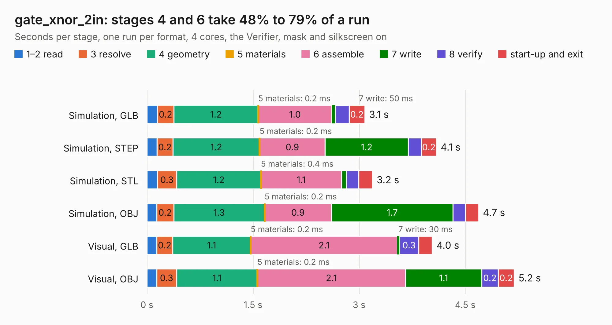

# 2839. gate_xnor_2in

Board 2,839 of the 3,116 of [Corpus Testing](../Corpus-Testing.md), on [Corpus Page 27](../CorpusTestingPages/Corpus-Testing-27.md#2839-gate_xnor_2in).

| Mode and format | 1–2 read | 3 resolve | 4 geometry | 5 materials | 6 assemble | 7 write | 8 verify | start-up and exit | Total |
|---|---:|---:|---:|---:|---:|---:|---:|---:|---:|
| Simulation, GLB | 0.1 | 0.2 | 1.2 | 0.2&nbsp;ms | 1.0 | 50&nbsp;ms | 0.2 | 0.2 | 3.1 |
| Simulation, STEP | 0.1 | 0.2 | 1.2 | 0.2&nbsp;ms | 0.9 | 1.2 | 0.2 | 0.2 | 4.1 |
| Simulation, STL | 0.1 | 0.3 | 1.2 | 0.4&nbsp;ms | 1.1 | 71&nbsp;ms | 0.2 | 0.2 | 3.2 |
| Simulation, OBJ | 0.1 | 0.2 | 1.3 | 0.2&nbsp;ms | 0.9 | 1.7 | 0.2 | 0.2 | 4.7 |
| Visual, GLB | 0.1 | 0.2 | 1.1 | 0.2&nbsp;ms | 2.1 | 30&nbsp;ms | 0.3 | 0.2 | 4.0 |
| Visual, OBJ | 0.1 | 0.3 | 1.1 | 0.2&nbsp;ms | 2.1 | 1.1 | 0.2 | 0.2 | 5.2 |

<table align="center"><tr><td valign="top">

| Board | Repo: [tmarhguy/alu](https://github.com/tmarhguy/alu) Board: `gate_xnor_2in.kicad_pcb` |
|---|---|
| Folder | schematics / kicad / modules / gates / gate_xnor / gate_xnor_2in |
| Complexity | 167&nbsp;/&nbsp;1000 (size&nbsp;132, features&nbsp;35) |
| KESE&nbsp;features | through vias, filled zones |
| Tested | 9th November 2026 |
| Copper&nbsp;layers | 2 |
| File&nbsp;format | KiCad 9 (20241229) |
| Parts,&nbsp;tracks,&nbsp;vias | 16, 138, 12 |
| Triangles,&nbsp;simulation | 325,442 in 23 parts |
| Verifier | PASS in all six runs |

</td><td valign="top">

<table>
<tr><th>File type</th><th>File size</th><th>Peak memory used</th></tr>
<tr><th colspan="3" align="left">Simulation</th></tr>
<tr><td>GLB</td><td align="right">11&nbsp;MB</td><td align="right">254&nbsp;MB</td></tr>
<tr><td>STEP</td><td align="right">47&nbsp;MB</td><td align="right">275&nbsp;MB</td></tr>
<tr><td>STL</td><td align="right">16&nbsp;MB</td><td align="right">246&nbsp;MB</td></tr>
<tr><td>OBJ</td><td align="right">32&nbsp;MB</td><td align="right">267&nbsp;MB</td></tr>
<tr><th colspan="3" align="left">Visual</th></tr>
<tr><td>GLB</td><td align="right">7.2&nbsp;MB</td><td align="right">249&nbsp;MB</td></tr>
<tr><td>OBJ</td><td align="right">21&nbsp;MB</td><td align="right">246&nbsp;MB</td></tr>
</table>

</td></tr></table>

| Previous | Next |
|:---|---:|
| [2838. gate_or_2in](b2838b_alu_gate-or-2in.md) | [2840. gate_xor_2in](b2840b_alu_gate-xor-2in.md) |
