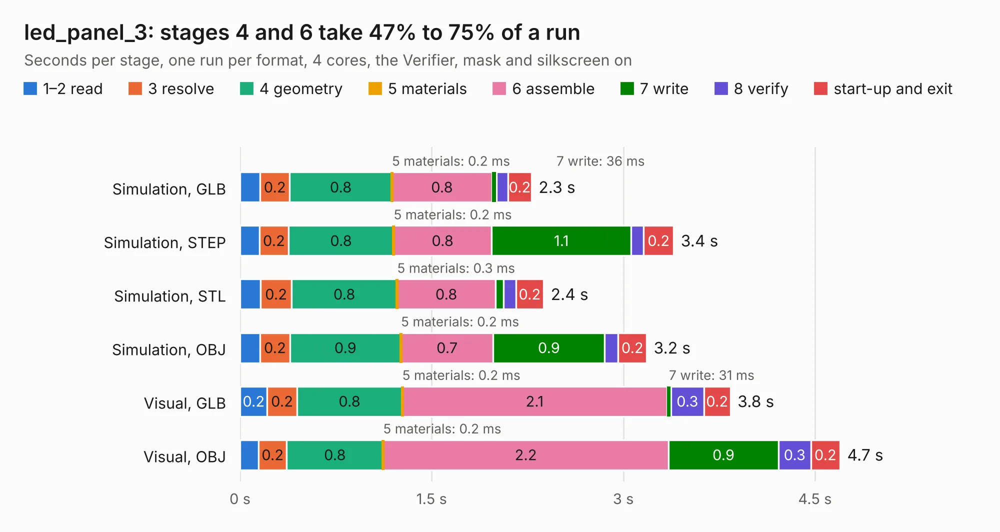

# 2839. led_panel_3

Board 2,839 of the 3,125 of [Corpus Testing](../Corpus-Testing.md), on [Corpus Page 27](../CorpusTestingPages/Corpus-Testing-27.md#2839-led_panel_3).

| Mode and format | 1–2 read | 3 resolve | 4 geometry | 5 materials | 6 assemble | 7 write | 8 verify | start-up and exit | Total |
|---|---:|---:|---:|---:|---:|---:|---:|---:|---:|
| Simulation, GLB | 0.2 | 0.2 | 0.8 | 0.2&nbsp;ms | 0.8 | 36&nbsp;ms | 89&nbsp;ms | 0.2 | 2.3 |
| Simulation, STEP | 0.2 | 0.2 | 0.8 | 0.2&nbsp;ms | 0.8 | 1.1 | 96&nbsp;ms | 0.2 | 3.4 |
| Simulation, STL | 0.2 | 0.2 | 0.8 | 0.3&nbsp;ms | 0.8 | 64&nbsp;ms | 96&nbsp;ms | 0.2 | 2.4 |
| Simulation, OBJ | 0.2 | 0.2 | 0.9 | 0.2&nbsp;ms | 0.7 | 0.9 | 0.1 | 0.2 | 3.2 |
| Visual, GLB | 0.2 | 0.2 | 0.8 | 0.2&nbsp;ms | 2.1 | 31&nbsp;ms | 0.3 | 0.2 | 3.8 |
| Visual, OBJ | 0.1 | 0.2 | 0.8 | 0.2&nbsp;ms | 2.2 | 0.9 | 0.3 | 0.2 | 4.7 |

<table align="center"><tr><td valign="top">

| Board | Repo: [tmarhguy/alu](https://github.com/tmarhguy/alu) Board: `led_panel_3.kicad_pcb` |
|---|---|
| Folder | schematics / kicad / boards / led_panel / led_panel_3 |
| Complexity | 66&nbsp;/&nbsp;1000 (size&nbsp;56, features&nbsp;10) |
| KESE&nbsp;features | rounded, trapezoid or chamfered pads |
| Tested | 9th November 2026 |
| Copper&nbsp;layers | 2 |
| File&nbsp;format | KiCad 9 (20241229) |
| Parts,&nbsp;tracks,&nbsp;vias | 35, 0, 0 |
| Triangles,&nbsp;simulation | 209,734 in 47 parts |
| Note | panel |
| Verifier | PASS in all six runs |

</td><td valign="top">

<table>
<tr><th>File type</th><th>File size</th><th>Peak memory used</th></tr>
<tr><th colspan="3" align="left">Simulation</th></tr>
<tr><td>GLB</td><td align="right">7.2&nbsp;MB</td><td align="right">227&nbsp;MB</td></tr>
<tr><td>STEP</td><td align="right">32&nbsp;MB</td><td align="right">238&nbsp;MB</td></tr>
<tr><td>STL</td><td align="right">10&nbsp;MB</td><td align="right">220&nbsp;MB</td></tr>
<tr><td>OBJ</td><td align="right">21&nbsp;MB</td><td align="right">229&nbsp;MB</td></tr>
<tr><th colspan="3" align="left">Visual</th></tr>
<tr><td>GLB</td><td align="right">5.9&nbsp;MB</td><td align="right">229&nbsp;MB</td></tr>
<tr><td>OBJ</td><td align="right">17&nbsp;MB</td><td align="right">238&nbsp;MB</td></tr>
</table>

</td></tr></table>

| Previous | Next |
|:---|---:|
| [2838. led_panel_2](b2838b_alu_led-panel-2.md) | [2840. main_control](b2840b_alu_main-control.md) |
