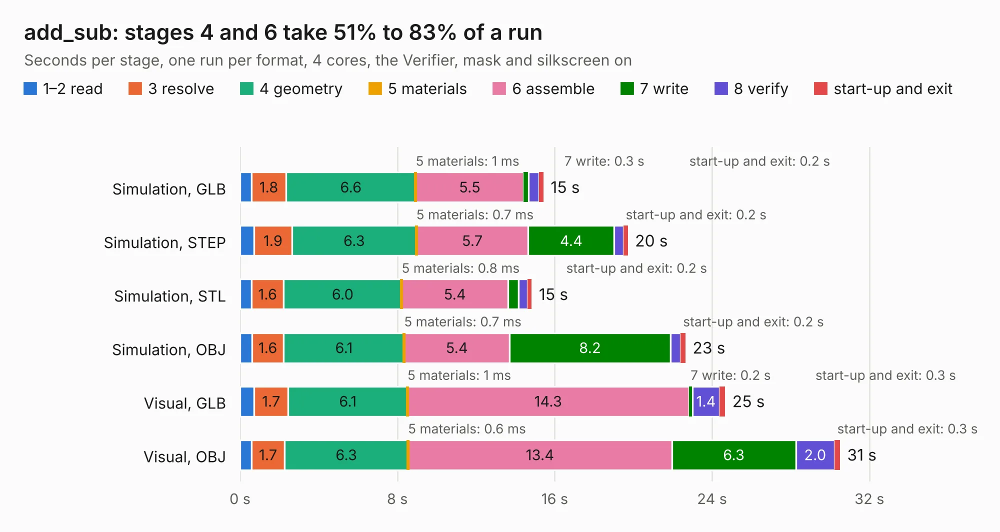

# 2840. add_sub

Board 2,840 of the 3,130 of [Corpus Testing](../Corpus-Testing.md), on [Corpus Page 27](../CorpusTestingPages/Corpus-Testing-27.md#2840-add_sub).

| Mode and format | 1–2 read | 3 resolve | 4 geometry | 5 materials | 6 assemble | 7 write | 8 verify | start-up and exit | Total |
|---|---:|---:|---:|---:|---:|---:|---:|---:|---:|
| Simulation, GLB | 0.6 | 1.8 | 6.6 | 1&nbsp;ms | 5.5 | 0.3 | 0.5 | 0.2 | 15.4 |
| Simulation, STEP | 0.7 | 1.9 | 6.3 | 0.7&nbsp;ms | 5.7 | 4.4 | 0.5 | 0.2 | 19.7 |
| Simulation, STL | 0.6 | 1.6 | 6.0 | 0.8&nbsp;ms | 5.4 | 0.5 | 0.5 | 0.2 | 14.8 |
| Simulation, OBJ | 0.6 | 1.6 | 6.1 | 0.7&nbsp;ms | 5.4 | 8.2 | 0.5 | 0.2 | 22.6 |
| Visual, GLB | 0.7 | 1.7 | 6.1 | 1&nbsp;ms | 14.3 | 0.2 | 1.4 | 0.3 | 24.7 |
| Visual, OBJ | 0.6 | 1.7 | 6.3 | 0.6&nbsp;ms | 13.4 | 6.3 | 2.0 | 0.3 | 30.5 |

<table align="center"><tr><td valign="top">

| Board | Repo: [tmarhguy/alu](https://github.com/tmarhguy/alu) Board: `add_sub.kicad_pcb` |
|---|---|
| Folder | schematics / kicad / boards / add_sub |
| Complexity | 84&nbsp;/&nbsp;1000 (size&nbsp;74, features&nbsp;10) |
| KESE&nbsp;features | rounded, trapezoid or chamfered pads |
| Tested | 9th November 2026 |
| Copper&nbsp;layers | 2 |
| File&nbsp;format | KiCad 9 (20241229) |
| Parts,&nbsp;tracks,&nbsp;vias | 200, 0, 0 |
| Triangles,&nbsp;simulation | 1,454,268 in 244 parts |
| Note | mostly unrouted |
| Verifier | PASS in all six runs |

</td><td valign="top">

<table>
<tr><th>File type</th><th>File size</th><th>Peak memory used</th></tr>
<tr><th colspan="3" align="left">Simulation</th></tr>
<tr><td>GLB</td><td align="right">49&nbsp;MB</td><td align="right">588&nbsp;MB</td></tr>
<tr><td>STEP</td><td align="right">235&nbsp;MB</td><td align="right">784&nbsp;MB</td></tr>
<tr><td>STL</td><td align="right">73&nbsp;MB</td><td align="right">583&nbsp;MB</td></tr>
<tr><td>OBJ</td><td align="right">154&nbsp;MB</td><td align="right">1.0&nbsp;GB</td></tr>
<tr><th colspan="3" align="left">Visual</th></tr>
<tr><td>GLB</td><td align="right">41&nbsp;MB</td><td align="right">992&nbsp;MB</td></tr>
<tr><td>OBJ</td><td align="right">123&nbsp;MB</td><td align="right">849&nbsp;MB</td></tr>
</table>

</td></tr></table>

| Previous | Next |
|:---|---:|
| [2839. rpi-cm4-switch-board](b2839b_rpi-cm4-switch-board_rpi-cm4-switch-board.md) | [2841. flags](b2841b_alu_flags.md) |
