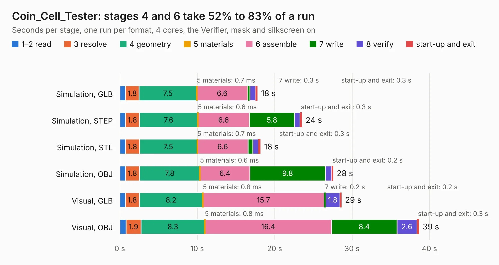

# 2841. Coin_Cell_Tester

Board 2,841 of the 3,104 of [Corpus Testing](../Corpus-Testing.md), on [Corpus Page 27](../CorpusTestingPages/Corpus-Testing-27.md#2841-coin_cell_tester).

| Mode and format | 1–2 read | 3 resolve | 4 geometry | 5 materials | 6 assemble | 7 write | 8 verify | start-up and exit | Total |
|---|---:|---:|---:|---:|---:|---:|---:|---:|---:|
| Simulation, GLB | 0.7 | 1.8 | 7.5 | 0.7&nbsp;ms | 6.6 | 0.3 | 0.7 | 0.3 | 17.8 |
| Simulation, STEP | 0.7 | 1.8 | 7.6 | 0.6&nbsp;ms | 6.6 | 5.8 | 0.7 | 0.3 | 23.5 |
| Simulation, STL | 0.7 | 1.8 | 7.5 | 0.7&nbsp;ms | 6.6 | 0.6 | 0.7 | 0.3 | 18.2 |
| Simulation, OBJ | 0.7 | 1.8 | 7.8 | 0.6&nbsp;ms | 6.4 | 9.8 | 0.8 | 0.2 | 27.6 |
| Visual, GLB | 0.7 | 1.8 | 8.2 | 0.8&nbsp;ms | 15.7 | 0.2 | 1.8 | 0.2 | 28.6 |
| Visual, OBJ | 0.8 | 1.9 | 8.3 | 0.8&nbsp;ms | 16.4 | 8.4 | 2.6 | 0.3 | 38.7 |

<table align="center"><tr><td valign="top">

| Board | Repo: [tomrodinger/servomotor](https://github.com/tomrodinger/servomotor) Board: `Coin_Cell_Tester.kicad_pcb` |
|---|---|
| Folder | PCB / Coin_Cell_Tester / PCB / V2 |
| Complexity | 322&nbsp;/&nbsp;1000 (size&nbsp;237, features&nbsp;85) |
| KESE&nbsp;features | through vias, slotted holes, rounded, trapezoid or chamfered pads, filled zones, stack-up, dielectric εr and tanδ |
| Tested | 9th November 2026 |
| Copper&nbsp;layers | 2 |
| File&nbsp;format | KiCad 6 (20211014) |
| Parts,&nbsp;tracks,&nbsp;vias | 193, 1,255, 184 |
| Triangles,&nbsp;simulation | 1,916,852 in 102 parts |
| Verifier | PASS in all six runs |

</td><td valign="top">

<table>
<tr><th>File type</th><th>File size</th><th>Peak memory used</th></tr>
<tr><th colspan="3" align="left">Simulation</th></tr>
<tr><td>GLB</td><td align="right">66&nbsp;MB</td><td align="right">687&nbsp;MB</td></tr>
<tr><td>STEP</td><td align="right">349&nbsp;MB</td><td align="right">950&nbsp;MB</td></tr>
<tr><td>STL</td><td align="right">96&nbsp;MB</td><td align="right">717&nbsp;MB</td></tr>
<tr><td>OBJ</td><td align="right">200&nbsp;MB</td><td align="right">1.3&nbsp;GB</td></tr>
<tr><th colspan="3" align="left">Visual</th></tr>
<tr><td>GLB</td><td align="right">53&nbsp;MB</td><td align="right">897&nbsp;MB</td></tr>
<tr><td>OBJ</td><td align="right">162&nbsp;MB</td><td align="right">1.2&nbsp;GB</td></tr>
</table>

</td></tr></table>

| Previous | Next |
|:---|---:|
| [2840. Coin_Cell_Tester](b2840b_servomotor_PCB-Coin-Cell-Tester-PCB-V1_Coin-Cell-Tester.md) | [2842. servo_motor](b2842b_servomotor_PCB-Servomotor1-V26_servo-motor.md) |
