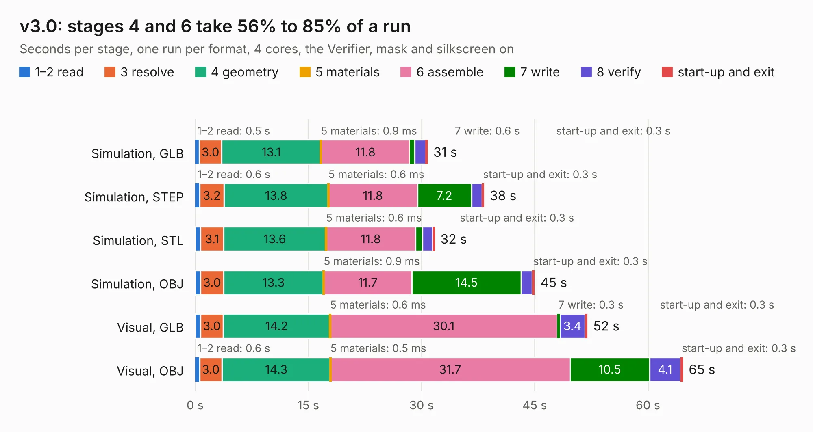

# 2842. v3.0

Board 2,842 of the 3,110 of [Corpus Testing](../Corpus-Testing.md), on [Corpus Page 27](../CorpusTestingPages/Corpus-Testing-27.md#2842-v30).

| Mode and format | 1–2 read | 3 resolve | 4 geometry | 5 materials | 6 assemble | 7 write | 8 verify | start-up and exit | Total |
|---|---:|---:|---:|---:|---:|---:|---:|---:|---:|
| Simulation, GLB | 0.5 | 3.0 | 13.1 | 0.9&nbsp;ms | 11.8 | 0.6 | 1.4 | 0.3 | 30.8 |
| Simulation, STEP | 0.6 | 3.2 | 13.8 | 0.6&nbsp;ms | 11.8 | 7.2 | 1.4 | 0.3 | 38.3 |
| Simulation, STL | 0.7 | 3.1 | 13.6 | 0.6&nbsp;ms | 11.8 | 0.9 | 1.4 | 0.3 | 31.7 |
| Simulation, OBJ | 0.7 | 3.0 | 13.3 | 0.9&nbsp;ms | 11.7 | 14.5 | 1.4 | 0.3 | 45.0 |
| Visual, GLB | 0.7 | 3.0 | 14.2 | 0.6&nbsp;ms | 30.1 | 0.3 | 3.4 | 0.3 | 52.0 |
| Visual, OBJ | 0.6 | 3.0 | 14.3 | 0.5&nbsp;ms | 31.7 | 10.5 | 4.1 | 0.3 | 64.6 |

<table align="center"><tr><td valign="top">

| Board | Repo: [tomojitakasu/PocketSDR](https://github.com/tomojitakasu/PocketSDR) Board: `v3.0.kicad_pcb` |
|---|---|
| Folder | FE_4CH / HW / v3.0 |
| Complexity | 384&nbsp;/&nbsp;1000 (size&nbsp;284, features&nbsp;100) |
| KESE&nbsp;features | through vias, slotted holes, arc tracks, filled zones, curved board outline, stack-up, dielectric εr and tanδ |
| Tested | 9th November 2026 |
| Copper&nbsp;layers | 4 |
| File&nbsp;format | KiCad 8 (20240108) |
| Parts,&nbsp;tracks,&nbsp;vias | 149, 2,287, 626 |
| Triangles,&nbsp;simulation | 3,206,818 in 200 parts |
| Verifier | PASS in all six runs |

</td><td valign="top">

<table>
<tr><th>File type</th><th>File size</th><th>Peak memory used</th></tr>
<tr><th colspan="3" align="left">Simulation</th></tr>
<tr><td>GLB</td><td align="right">111&nbsp;MB</td><td align="right">1.1&nbsp;GB</td></tr>
<tr><td>STEP</td><td align="right">459&nbsp;MB</td><td align="right">1.4&nbsp;GB</td></tr>
<tr><td>STL</td><td align="right">160&nbsp;MB</td><td align="right">1.1&nbsp;GB</td></tr>
<tr><td>OBJ</td><td align="right">345&nbsp;MB</td><td align="right">2.1&nbsp;GB</td></tr>
<tr><th colspan="3" align="left">Visual</th></tr>
<tr><td>GLB</td><td align="right">73&nbsp;MB</td><td align="right">1.3&nbsp;GB</td></tr>
<tr><td>OBJ</td><td align="right">232&nbsp;MB</td><td align="right">1.6&nbsp;GB</td></tr>
</table>

</td></tr></table>

| Previous | Next |
|:---|---:|
| [2841. pocket_sdr_v2.3](b2841b_PocketSDR_pocket-sdr-v2-3.md) | [2843. div_4px2](b2843b_PocketSDR_div-4px2.md) |
