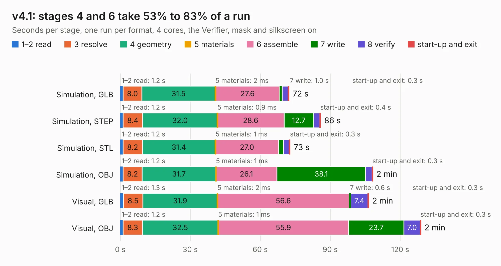

# 2842. v4.1

Board 2,842 of the 3,107 of [Corpus Testing](../Corpus-Testing.md), on [Corpus Page 27](../CorpusTestingPages/Corpus-Testing-27.md#2842-v41).

| Mode and format | 1–2 read | 3 resolve | 4 geometry | 5 materials | 6 assemble | 7 write | 8 verify | start-up and exit | Total |
|---|---:|---:|---:|---:|---:|---:|---:|---:|---:|
| Simulation, GLB | 1.2 | 8.0 | 31.5 | 2&nbsp;ms | 27.6 | 1.0 | 2.6 | 0.3 | 72.4 |
| Simulation, STEP | 1.2 | 8.4 | 32.0 | 0.9&nbsp;ms | 28.6 | 12.7 | 2.6 | 0.4 | 85.9 |
| Simulation, STL | 1.2 | 8.2 | 31.4 | 1&nbsp;ms | 27.0 | 2.0 | 2.6 | 0.3 | 72.8 |
| Simulation, OBJ | 1.2 | 8.2 | 31.7 | 1&nbsp;ms | 26.1 | 38.1 | 2.7 | 0.3 | 108.3 |
| Visual, GLB | 1.3 | 8.5 | 31.9 | 2&nbsp;ms | 56.6 | 0.6 | 7.4 | 0.3 | 106.5 |
| Visual, OBJ | 1.2 | 8.3 | 32.5 | 1&nbsp;ms | 55.9 | 23.7 | 7.0 | 0.3 | 128.9 |

<table align="center"><tr><td valign="top">

| Board | Repo: [tomojitakasu/PocketSDR](https://github.com/tomojitakasu/PocketSDR) Board: `v4.1.kicad_pcb` |
|---|---|
| Folder | FE_8CH / HW / v4.1 |
| Complexity | 403&nbsp;/&nbsp;1000 (size&nbsp;303, features&nbsp;100) |
| KESE&nbsp;features | through vias, slotted holes, arc tracks, filled zones, curved board outline, stack-up, dielectric εr and tanδ |
| Tested | 9th November 2026 |
| Copper&nbsp;layers | 4 |
| File&nbsp;format | KiCad 8 (20240108) |
| Parts,&nbsp;tracks,&nbsp;vias | 216, 3,080, 1,765 |
| Triangles,&nbsp;simulation | 6,053,476 in 262 parts |
| Verifier | PASS in all six runs |

</td><td valign="top">

<table>
<tr><th>File type</th><th>File size</th><th>Peak memory used</th></tr>
<tr><th colspan="3" align="left">Simulation</th></tr>
<tr><td>GLB</td><td align="right">206&nbsp;MB</td><td align="right">1.7&nbsp;GB</td></tr>
<tr><td>STEP</td><td align="right">673&nbsp;MB</td><td align="right">2.5&nbsp;GB</td></tr>
<tr><td>STL</td><td align="right">303&nbsp;MB</td><td align="right">1.9&nbsp;GB</td></tr>
<tr><td>OBJ</td><td align="right">651&nbsp;MB</td><td align="right">3.9&nbsp;GB</td></tr>
<tr><th colspan="3" align="left">Visual</th></tr>
<tr><td>GLB</td><td align="right">128&nbsp;MB</td><td align="right">2.1&nbsp;GB</td></tr>
<tr><td>OBJ</td><td align="right">418&nbsp;MB</td><td align="right">2.8&nbsp;GB</td></tr>
</table>

</td></tr></table>

| Previous | Next |
|:---|---:|
| [2841. v4.0](b2841b_PocketSDR_v4-0.md) | [2843. Coin_Cell_Tester](b2843b_servomotor_PCB-Coin-Cell-Tester-PCB-V1_Coin-Cell-Tester.md) |
