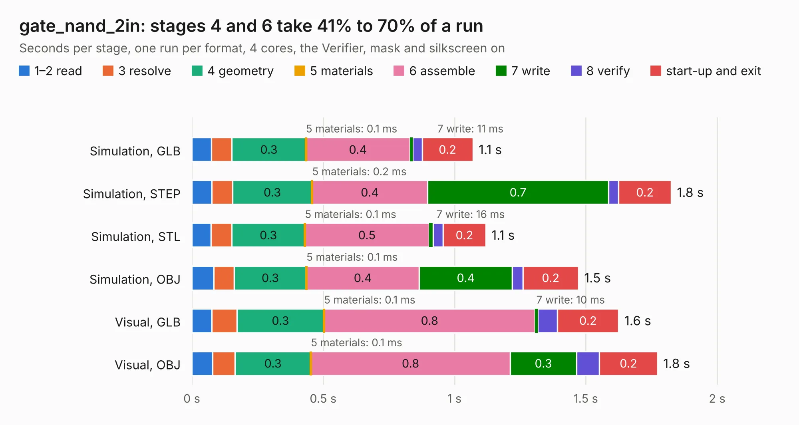

# 2845. gate_nand_2in

Board 2,845 of the 3,125 of [Corpus Testing](../Corpus-Testing.md), on [Corpus Page 27](../CorpusTestingPages/Corpus-Testing-27.md#2845-gate_nand_2in).

| Mode and format | 1–2 read | 3 resolve | 4 geometry | 5 materials | 6 assemble | 7 write | 8 verify | start-up and exit | Total |
|---|---:|---:|---:|---:|---:|---:|---:|---:|---:|
| Simulation, GLB | 74&nbsp;ms | 78&nbsp;ms | 0.3 | 0.1&nbsp;ms | 0.4 | 11&nbsp;ms | 36&nbsp;ms | 0.2 | 1.1 |
| Simulation, STEP | 75&nbsp;ms | 79&nbsp;ms | 0.3 | 0.2&nbsp;ms | 0.4 | 0.7 | 38&nbsp;ms | 0.2 | 1.8 |
| Simulation, STL | 73&nbsp;ms | 79&nbsp;ms | 0.3 | 0.1&nbsp;ms | 0.5 | 16&nbsp;ms | 38&nbsp;ms | 0.2 | 1.1 |
| Simulation, OBJ | 84&nbsp;ms | 77&nbsp;ms | 0.3 | 0.1&nbsp;ms | 0.4 | 0.4 | 40&nbsp;ms | 0.2 | 1.5 |
| Visual, GLB | 76&nbsp;ms | 96&nbsp;ms | 0.3 | 0.1&nbsp;ms | 0.8 | 10&nbsp;ms | 75&nbsp;ms | 0.2 | 1.6 |
| Visual, OBJ | 79&nbsp;ms | 85&nbsp;ms | 0.3 | 0.1&nbsp;ms | 0.8 | 0.3 | 87&nbsp;ms | 0.2 | 1.8 |

<table align="center"><tr><td valign="top">

| Board | Repo: [tmarhguy/alu](https://github.com/tmarhguy/alu) Board: `gate_nand_2in.kicad_pcb` |
|---|---|
| Folder | schematics / kicad / modules / gates / gate_nand / gate_nand_2in |
| Complexity | 105&nbsp;/&nbsp;1000 (size&nbsp;90, features&nbsp;15) |
| KESE&nbsp;features | through vias |
| Tested | 9th November 2026 |
| Copper&nbsp;layers | 2 |
| File&nbsp;format | KiCad 9 (20241229) |
| Parts,&nbsp;tracks,&nbsp;vias | 4, 24, 2 |
| Triangles,&nbsp;simulation | 71,860 in 16 parts |
| Verifier | PASS in all six runs |

</td><td valign="top">

<table>
<tr><th>File type</th><th>File size</th><th>Peak memory used</th></tr>
<tr><th colspan="3" align="left">Simulation</th></tr>
<tr><td>GLB</td><td align="right">2.4&nbsp;MB</td><td align="right">170&nbsp;MB</td></tr>
<tr><td>STEP</td><td align="right">9.3&nbsp;MB</td><td align="right">174&nbsp;MB</td></tr>
<tr><td>STL</td><td align="right">3.6&nbsp;MB</td><td align="right">172&nbsp;MB</td></tr>
<tr><td>OBJ</td><td align="right">6.8&nbsp;MB</td><td align="right">168&nbsp;MB</td></tr>
<tr><th colspan="3" align="left">Visual</th></tr>
<tr><td>GLB</td><td align="right">1.6&nbsp;MB</td><td align="right">149&nbsp;MB</td></tr>
<tr><td>OBJ</td><td align="right">4.4&nbsp;MB</td><td align="right">150&nbsp;MB</td></tr>
</table>

</td></tr></table>

| Previous | Next |
|:---|---:|
| [2844. gate_inv_1bit](b2844b_alu_gate-inv-1bit.md) | [2846. gate_nor_2in](b2846b_alu_gate-nor-2in.md) |
