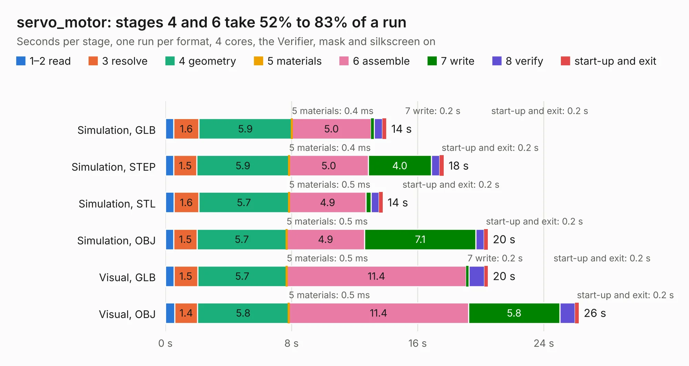

# 2845. servo_motor

Board 2,845 of the 3,106 of [Corpus Testing](../Corpus-Testing.md), on [Corpus Page 27](../CorpusTestingPages/Corpus-Testing-27.md#2845-servo_motor).

| Mode and format | 1–2 read | 3 resolve | 4 geometry | 5 materials | 6 assemble | 7 write | 8 verify | start-up and exit | Total |
|---|---:|---:|---:|---:|---:|---:|---:|---:|---:|
| Simulation, GLB | 0.5 | 1.6 | 5.9 | 0.4&nbsp;ms | 5.0 | 0.2 | 0.5 | 0.2 | 14.0 |
| Simulation, STEP | 0.5 | 1.5 | 5.9 | 0.4&nbsp;ms | 5.0 | 4.0 | 0.5 | 0.2 | 17.6 |
| Simulation, STL | 0.5 | 1.6 | 5.7 | 0.5&nbsp;ms | 4.9 | 0.3 | 0.5 | 0.2 | 13.8 |
| Simulation, OBJ | 0.5 | 1.5 | 5.7 | 0.5&nbsp;ms | 4.9 | 7.1 | 0.5 | 0.2 | 20.5 |
| Visual, GLB | 0.5 | 1.5 | 5.7 | 0.5&nbsp;ms | 11.4 | 0.2 | 1.0 | 0.2 | 20.5 |
| Visual, OBJ | 0.6 | 1.4 | 5.8 | 0.5&nbsp;ms | 11.4 | 5.8 | 1.0 | 0.2 | 26.2 |

<table align="center"><tr><td valign="top">

| Board | Repo: [tomrodinger/servomotor](https://github.com/tomrodinger/servomotor) Board: `servo_motor.kicad_pcb` |
|---|---|
| Folder | PCB / Servomotor1 / V27 |
| Complexity | 297&nbsp;/&nbsp;1000 (size&nbsp;187, features&nbsp;110) |
| KESE&nbsp;features | through vias, custom pads, rounded, trapezoid or chamfered pads, filled zones, copper drawings, curved board outline, stack-up, dielectric εr and tanδ |
| Tested | 9th November 2026 |
| Copper&nbsp;layers | 2 |
| File&nbsp;format | KiCad 7 (20221018) |
| Parts,&nbsp;tracks,&nbsp;vias | 99, 815, 233 |
| Triangles,&nbsp;simulation | 1,394,996 in 111 parts |
| Verifier | PASS in all six runs |

</td><td valign="top">

<table>
<tr><th>File type</th><th>File size</th><th>Peak memory used</th></tr>
<tr><th colspan="3" align="left">Simulation</th></tr>
<tr><td>GLB</td><td align="right">49&nbsp;MB</td><td align="right">555&nbsp;MB</td></tr>
<tr><td>STEP</td><td align="right">258&nbsp;MB</td><td align="right">704&nbsp;MB</td></tr>
<tr><td>STL</td><td align="right">70&nbsp;MB</td><td align="right">563&nbsp;MB</td></tr>
<tr><td>OBJ</td><td align="right">147&nbsp;MB</td><td align="right">957&nbsp;MB</td></tr>
<tr><th colspan="3" align="left">Visual</th></tr>
<tr><td>GLB</td><td align="right">42&nbsp;MB</td><td align="right">742&nbsp;MB</td></tr>
<tr><td>OBJ</td><td align="right">126&nbsp;MB</td><td align="right">910&nbsp;MB</td></tr>
</table>

</td></tr></table>

| Previous | Next |
|:---|---:|
| [2844. servo_motor](b2844b_servomotor_PCB-Servomotor1-V26_servo-motor.md) | [2846. servo_motor](b2846b_servomotor_PCB-Servomotor2-V4_servo-motor.md) |
