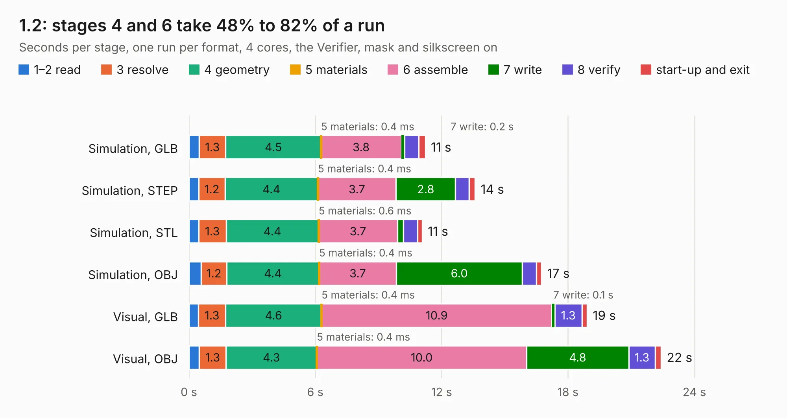

# 2846. 1.2

Board 2,846 of the 3,102 of [Corpus Testing](../Corpus-Testing.md), on [Corpus Page 27](../CorpusTestingPages/Corpus-Testing-27.md#2846-12).

| Mode and format | 1–2 read | 3 resolve | 4 geometry | 5 materials | 6 assemble | 7 write | 8 verify | start-up and exit | Total |
|---|---:|---:|---:|---:|---:|---:|---:|---:|---:|
| Simulation, GLB | 0.5 | 1.3 | 4.5 | 0.4&nbsp;ms | 3.8 | 0.2 | 0.7 | 0.3 | 11.2 |
| Simulation, STEP | 0.5 | 1.2 | 4.4 | 0.4&nbsp;ms | 3.7 | 2.8 | 0.7 | 0.3 | 13.6 |
| Simulation, STL | 0.5 | 1.3 | 4.4 | 0.6&nbsp;ms | 3.7 | 0.3 | 0.7 | 0.2 | 11.1 |
| Simulation, OBJ | 0.6 | 1.2 | 4.4 | 0.4&nbsp;ms | 3.7 | 6.0 | 0.7 | 0.2 | 16.7 |
| Visual, GLB | 0.4 | 1.3 | 4.6 | 0.4&nbsp;ms | 10.9 | 0.1 | 1.3 | 0.2 | 18.9 |
| Visual, OBJ | 0.5 | 1.3 | 4.3 | 0.4&nbsp;ms | 10.0 | 4.8 | 1.3 | 0.3 | 22.4 |

<table align="center"><tr><td valign="top">

| Board | Repo: [tomrodinger/servomotor](https://github.com/tomrodinger/servomotor) Board: `1.2.kicad_pcb` |
|---|---|
| Folder | PCB / Servomotor3 / 1.2 |
| Complexity | 348&nbsp;/&nbsp;1000 (size&nbsp;223, features&nbsp;125) |
| KESE&nbsp;features | through vias, custom pads, rounded, trapezoid or chamfered pads, filled zones, copper drawings, curved board outline, stack-up, dielectric εr and tanδ, copper finish |
| Tested | 9th November 2026 |
| Copper&nbsp;layers | 2 |
| File&nbsp;format | KiCad 8 (20240108) |
| Parts,&nbsp;tracks,&nbsp;vias | 74, 542, 308 |
| Triangles,&nbsp;simulation | 975,320 in 65 parts |
| Verifier | PASS in all six runs |

</td><td valign="top">

<table>
<tr><th>File type</th><th>File size</th><th>Peak memory used</th></tr>
<tr><th colspan="3" align="left">Simulation</th></tr>
<tr><td>GLB</td><td align="right">33&nbsp;MB</td><td align="right">487&nbsp;MB</td></tr>
<tr><td>STEP</td><td align="right">148&nbsp;MB</td><td align="right">558&nbsp;MB</td></tr>
<tr><td>STL</td><td align="right">49&nbsp;MB</td><td align="right">504&nbsp;MB</td></tr>
<tr><td>OBJ</td><td align="right">99&nbsp;MB</td><td align="right">696&nbsp;MB</td></tr>
<tr><th colspan="3" align="left">Visual</th></tr>
<tr><td>GLB</td><td align="right">28&nbsp;MB</td><td align="right">665&nbsp;MB</td></tr>
<tr><td>OBJ</td><td align="right">84&nbsp;MB</td><td align="right">673&nbsp;MB</td></tr>
</table>

</td></tr></table>

| Previous | Next |
|:---|---:|
| [2845. 1.0](b2845b_servomotor_1-0.md) | [2847. 1.3](b2847b_servomotor_1-3.md) |
