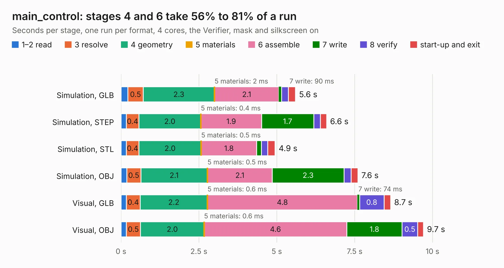

# 2847. main_control

Board 2,847 of the 3,132 of [Corpus Testing](../Corpus-Testing.md), on [Corpus Page 27](../CorpusTestingPages/Corpus-Testing-27.md#2847-main_control).

| Mode and format | 1–2 read | 3 resolve | 4 geometry | 5 materials | 6 assemble | 7 write | 8 verify | start-up and exit | Total |
|---|---:|---:|---:|---:|---:|---:|---:|---:|---:|
| Simulation, GLB | 0.2 | 0.5 | 2.3 | 2&nbsp;ms | 2.1 | 90&nbsp;ms | 0.2 | 0.2 | 5.6 |
| Simulation, STEP | 0.2 | 0.4 | 2.0 | 0.4&nbsp;ms | 1.9 | 1.7 | 0.2 | 0.2 | 6.6 |
| Simulation, STL | 0.2 | 0.4 | 2.0 | 0.5&nbsp;ms | 1.8 | 0.2 | 0.2 | 0.2 | 4.9 |
| Simulation, OBJ | 0.2 | 0.5 | 2.1 | 0.5&nbsp;ms | 2.1 | 2.3 | 0.2 | 0.2 | 7.6 |
| Visual, GLB | 0.2 | 0.4 | 2.2 | 0.6&nbsp;ms | 4.8 | 74&nbsp;ms | 0.8 | 0.2 | 8.7 |
| Visual, OBJ | 0.2 | 0.5 | 2.0 | 0.6&nbsp;ms | 4.6 | 1.8 | 0.5 | 0.2 | 9.7 |

<table align="center"><tr><td valign="top">

| Board | Repo: [tmarhguy/alu](https://github.com/tmarhguy/alu) Board: `main_control.kicad_pcb` |
|---|---|
| Folder | schematics / kicad / boards / main_control |
| Complexity | 68&nbsp;/&nbsp;1000 (size&nbsp;58, features&nbsp;10) |
| KESE&nbsp;features | rounded, trapezoid or chamfered pads |
| Tested | 9th November 2026 |
| Copper&nbsp;layers | 2 |
| File&nbsp;format | KiCad 9 (20241229) |
| Parts,&nbsp;tracks,&nbsp;vias | 42, 0, 0 |
| Triangles,&nbsp;simulation | 561,324 in 172 parts |
| Note | mostly unrouted |
| Verifier | PASS in all six runs |

</td><td valign="top">

<table>
<tr><th>File type</th><th>File size</th><th>Peak memory used</th></tr>
<tr><th colspan="3" align="left">Simulation</th></tr>
<tr><td>GLB</td><td align="right">19&nbsp;MB</td><td align="right">317&nbsp;MB</td></tr>
<tr><td>STEP</td><td align="right">88&nbsp;MB</td><td align="right">397&nbsp;MB</td></tr>
<tr><td>STL</td><td align="right">28&nbsp;MB</td><td align="right">317&nbsp;MB</td></tr>
<tr><td>OBJ</td><td align="right">58&nbsp;MB</td><td align="right">431&nbsp;MB</td></tr>
<tr><th colspan="3" align="left">Visual</th></tr>
<tr><td>GLB</td><td align="right">15&nbsp;MB</td><td align="right">468&nbsp;MB</td></tr>
<tr><td>OBJ</td><td align="right">45&nbsp;MB</td><td align="right">509&nbsp;MB</td></tr>
</table>

</td></tr></table>

| Previous | Next |
|:---|---:|
| [2846. led_panel_3](b2846b_alu_led-panel-3.md) | [2848. main_logic](b2848b_alu_main-logic.md) |
