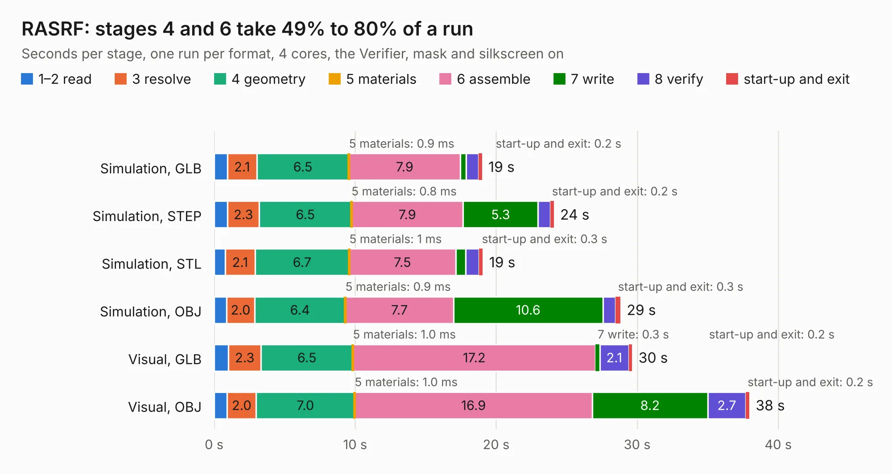

# 2848. RASRF

Board 2,848 of the 3,119 of [Corpus Testing](../Corpus-Testing.md), on [Corpus Page 27](../CorpusTestingPages/Corpus-Testing-27.md#2848-rasrf).

| Mode and format | 1–2 read | 3 resolve | 4 geometry | 5 materials | 6 assemble | 7 write | 8 verify | start-up and exit | Total |
|---|---:|---:|---:|---:|---:|---:|---:|---:|---:|
| Simulation, GLB | 0.9 | 2.1 | 6.5 | 0.9&nbsp;ms | 7.9 | 0.4 | 0.9 | 0.2 | 19.0 |
| Simulation, STEP | 1.0 | 2.3 | 6.5 | 0.8&nbsp;ms | 7.9 | 5.3 | 0.9 | 0.2 | 24.1 |
| Simulation, STL | 0.8 | 2.1 | 6.7 | 1&nbsp;ms | 7.5 | 0.7 | 0.9 | 0.3 | 19.0 |
| Simulation, OBJ | 0.9 | 2.0 | 6.4 | 0.9&nbsp;ms | 7.7 | 10.6 | 0.9 | 0.3 | 28.8 |
| Visual, GLB | 1.0 | 2.3 | 6.5 | 1.0&nbsp;ms | 17.2 | 0.3 | 2.1 | 0.2 | 29.6 |
| Visual, OBJ | 0.9 | 2.0 | 7.0 | 1.0&nbsp;ms | 16.9 | 8.2 | 2.7 | 0.2 | 38.0 |

<table align="center"><tr><td valign="top">

| Board | Repo: [tobias-dg3yev/ra-sentinel](https://github.com/tobias-dg3yev/ra-sentinel) Board: `RASRF.kicad_pcb` |
|---|---|
| Folder | RASRF2400WB / Hardware / PCB_Design |
| Complexity | 337&nbsp;/&nbsp;1000 (size&nbsp;217, features&nbsp;120) |
| KESE&nbsp;features | through vias, custom pads, rounded, trapezoid or chamfered pads, arc tracks, filled zones, copper drawings, stack-up, dielectric εr and tanδ, mask and silkscreen colours |
| Tested | 9th November 2026 |
| Copper&nbsp;layers | 4 |
| File&nbsp;format | KiCad 10 (20260206) |
| Parts,&nbsp;tracks,&nbsp;vias | 147, 1,319, 468 |
| Triangles,&nbsp;simulation | 2,326,330 in 185 parts |
| Verifier | PASS in all six runs |

</td><td valign="top">

<table>
<tr><th>File type</th><th>File size</th><th>Peak memory used</th></tr>
<tr><th colspan="3" align="left">Simulation</th></tr>
<tr><td>GLB</td><td align="right">79&nbsp;MB</td><td align="right">938&nbsp;MB</td></tr>
<tr><td>STEP</td><td align="right">308&nbsp;MB</td><td align="right">1.1&nbsp;GB</td></tr>
<tr><td>STL</td><td align="right">116&nbsp;MB</td><td align="right">956&nbsp;MB</td></tr>
<tr><td>OBJ</td><td align="right">241&nbsp;MB</td><td align="right">1.5&nbsp;GB</td></tr>
<tr><th colspan="3" align="left">Visual</th></tr>
<tr><td>GLB</td><td align="right">56&nbsp;MB</td><td align="right">1.1&nbsp;GB</td></tr>
<tr><td>OBJ</td><td align="right">174&nbsp;MB</td><td align="right">1.2&nbsp;GB</td></tr>
</table>

</td></tr></table>

| Previous | Next |
|:---|---:|
| [2847. RASBB](b2847b_ra-sentinel_RASBB-Hardware-Rev-C-Design_RASBB.md) | [2849. RASRF2400WBMC](b2849b_ra-sentinel_RASRF2400WBMC.md) |
